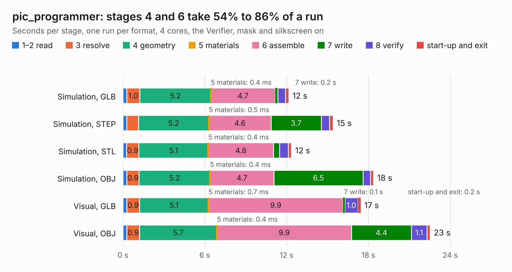

# 1447. pic_programmer

Board 1,447 of the 3,125 of [Corpus Testing](../Corpus-Testing.md), on [Corpus Page 14](../CorpusTestingPages/Corpus-Testing-14.md#1447-pic_programmer).

| Mode and format | 1–2 read | 3 resolve | 4 geometry | 5 materials | 6 assemble | 7 write | 8 verify | start-up and exit | Total |
|---|---:|---:|---:|---:|---:|---:|---:|---:|---:|
| Simulation, GLB | 0.3 | 1.0 | 5.2 | 0.4&nbsp;ms | 4.7 | 0.2 | 0.6 | 0.2 | 12.2 |
| Simulation, STEP | 0.3 | 0.9 | 5.2 | 0.5&nbsp;ms | 4.6 | 3.7 | 0.6 | 0.3 | 15.4 |
| Simulation, STL | 0.3 | 0.9 | 5.1 | 0.4&nbsp;ms | 4.8 | 0.4 | 0.6 | 0.2 | 12.4 |
| Simulation, OBJ | 0.3 | 0.9 | 5.2 | 0.4&nbsp;ms | 4.7 | 6.5 | 0.5 | 0.2 | 18.4 |
| Visual, GLB | 0.3 | 0.9 | 5.1 | 0.7&nbsp;ms | 9.9 | 0.1 | 1.0 | 0.2 | 17.4 |
| Visual, OBJ | 0.3 | 0.9 | 5.7 | 0.4&nbsp;ms | 9.9 | 4.4 | 1.1 | 0.2 | 22.5 |

<table align="center"><tr><td valign="top">

| Board | Repo: [KiCad/kicad-source-mirror](https://github.com/KiCad/kicad-source-mirror) Board: `pic_programmer.kicad_pcb` |
|---|---|
| Folder | demos / pic_programmer |
| Complexity | 273&nbsp;/&nbsp;1000 (size&nbsp;158, features&nbsp;115) |
| KESE&nbsp;features | through vias, custom pads, rounded, trapezoid or chamfered pads, filled zones, copper drawings, copper text, stack-up, dielectric εr and tanδ, mask and silkscreen colours |
| Tested | 9th November 2026 |
| Copper&nbsp;layers | 2 |
| File&nbsp;format | KiCad 10 (20260206) |
| Parts,&nbsp;tracks,&nbsp;vias | 57, 370, 6 |
| Triangles,&nbsp;simulation | 1,330,386 in 123 parts |
| Verifier | PASS in all six runs |

</td><td valign="top">

<table>
<tr><th>File type</th><th>File size</th><th>Peak memory used</th></tr>
<tr><th colspan="3" align="left">Simulation</th></tr>
<tr><td>GLB</td><td align="right">44&nbsp;MB</td><td align="right">573&nbsp;MB</td></tr>
<tr><td>STEP</td><td align="right">211&nbsp;MB</td><td align="right">662&nbsp;MB</td></tr>
<tr><td>STL</td><td align="right">67&nbsp;MB</td><td align="right">546&nbsp;MB</td></tr>
<tr><td>OBJ</td><td align="right">134&nbsp;MB</td><td align="right">884&nbsp;MB</td></tr>
<tr><th colspan="3" align="left">Visual</th></tr>
<tr><td>GLB</td><td align="right">28&nbsp;MB</td><td align="right">792&nbsp;MB</td></tr>
<tr><td>OBJ</td><td align="right">84&nbsp;MB</td><td align="right">687&nbsp;MB</td></tr>
</table>

</td></tr></table>

| Previous | Next |
|:---|---:|
| [1446. One-Air-Max](b1446b_kicad-source-mirror_One-Air-Max.md) | [1448. RoyalBlue54L-NFC-Antenna](b1448b_kicad-source-mirror_RoyalBlue54L-NFC-Antenna.md) |
