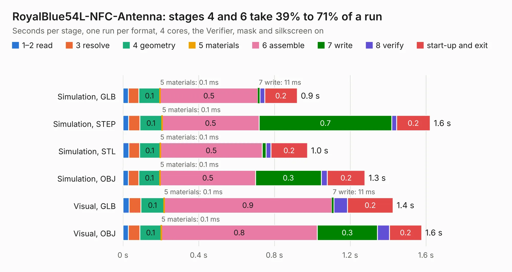

# 1449. RoyalBlue54L-NFC-Antenna

Board 1,449 of the 3,126 of [Corpus Testing](../Corpus-Testing.md), on [Corpus Page 14](../CorpusTestingPages/Corpus-Testing-14.md#1449-royalblue54l-nfc-antenna).

| Mode and format | 1–2 read | 3 resolve | 4 geometry | 5 materials | 6 assemble | 7 write | 8 verify | start-up and exit | Total |
|---|---:|---:|---:|---:|---:|---:|---:|---:|---:|
| Simulation, GLB | 28&nbsp;ms | 56&nbsp;ms | 0.1 | 0.1&nbsp;ms | 0.5 | 11&nbsp;ms | 25&nbsp;ms | 0.2 | 0.9 |
| Simulation, STEP | 30&nbsp;ms | 59&nbsp;ms | 0.1 | 0.1&nbsp;ms | 0.5 | 0.7 | 25&nbsp;ms | 0.2 | 1.6 |
| Simulation, STL | 31&nbsp;ms | 56&nbsp;ms | 0.1 | 0.1&nbsp;ms | 0.5 | 19&nbsp;ms | 26&nbsp;ms | 0.2 | 1.0 |
| Simulation, OBJ | 29&nbsp;ms | 56&nbsp;ms | 0.1 | 0.1&nbsp;ms | 0.5 | 0.3 | 32&nbsp;ms | 0.2 | 1.3 |
| Visual, GLB | 33&nbsp;ms | 62&nbsp;ms | 0.1 | 0.1&nbsp;ms | 0.9 | 11&nbsp;ms | 72&nbsp;ms | 0.2 | 1.4 |
| Visual, OBJ | 29&nbsp;ms | 61&nbsp;ms | 0.1 | 0.1&nbsp;ms | 0.8 | 0.3 | 64&nbsp;ms | 0.2 | 1.6 |

<table align="center"><tr><td valign="top">

| Board | Repo: [KiCad/kicad-source-mirror](https://github.com/KiCad/kicad-source-mirror) Board: `RoyalBlue54L-NFC-Antenna.kicad_pcb` |
|---|---|
| Folder | demos / royalblue54L_feather / nfc_antenna / RoyalBlue54L-NFC-Antenna |
| Complexity | 168&nbsp;/&nbsp;1000 (size&nbsp;108, features&nbsp;60) |
| KESE&nbsp;features | through vias, rounded, trapezoid or chamfered pads, arc tracks, copper drawings, curved board outline |
| Tested | 9th November 2026 |
| Copper&nbsp;layers | 2 |
| File&nbsp;format | KiCad 9 (20241229) |
| Parts,&nbsp;tracks,&nbsp;vias | 1, 160, 2 |
| Triangles,&nbsp;simulation | 67,926 in 7 parts |
| Verifier | PASS in all six runs |

</td><td valign="top">

<table>
<tr><th>File type</th><th>File size</th><th>Peak memory used</th></tr>
<tr><th colspan="3" align="left">Simulation</th></tr>
<tr><td>GLB</td><td align="right">2.3&nbsp;MB</td><td align="right">159&nbsp;MB</td></tr>
<tr><td>STEP</td><td align="right">7.9&nbsp;MB</td><td align="right">160&nbsp;MB</td></tr>
<tr><td>STL</td><td align="right">3.4&nbsp;MB</td><td align="right">154&nbsp;MB</td></tr>
<tr><td>OBJ</td><td align="right">6.4&nbsp;MB</td><td align="right">158&nbsp;MB</td></tr>
<tr><th colspan="3" align="left">Visual</th></tr>
<tr><td>GLB</td><td align="right">2.2&nbsp;MB</td><td align="right">132&nbsp;MB</td></tr>
<tr><td>OBJ</td><td align="right">6.2&nbsp;MB</td><td align="right">131&nbsp;MB</td></tr>
</table>

</td></tr></table>

| Previous | Next |
|:---|---:|
| [1448. pic_programmer](b1448b_kicad-source-mirror_pic-programmer.md) | [1450. RoyalBlue54L-Feather](b1450b_kicad-source-mirror_RoyalBlue54L-Feather.md) |
