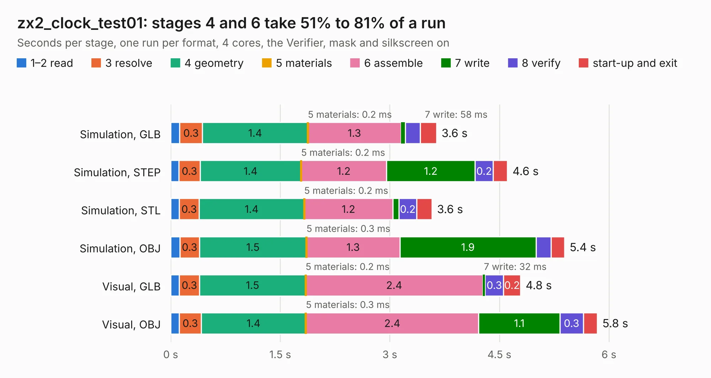

# 1450. zx2_clock_test01

Board 1,450 of the 3,105 of [Corpus Testing](../Corpus-Testing.md), on [Corpus Page 14](../CorpusTestingPages/Corpus-Testing-14.md#1450-zx2_clock_test01).

| Mode and format | 1–2 read | 3 resolve | 4 geometry | 5 materials | 6 assemble | 7 write | 8 verify | start-up and exit | Total |
|---|---:|---:|---:|---:|---:|---:|---:|---:|---:|
| Simulation, GLB | 0.1 | 0.3 | 1.4 | 0.2&nbsp;ms | 1.3 | 58&nbsp;ms | 0.2 | 0.2 | 3.6 |
| Simulation, STEP | 0.1 | 0.3 | 1.4 | 0.2&nbsp;ms | 1.2 | 1.2 | 0.2 | 0.2 | 4.6 |
| Simulation, STL | 0.1 | 0.3 | 1.4 | 0.2&nbsp;ms | 1.2 | 84&nbsp;ms | 0.2 | 0.2 | 3.6 |
| Simulation, OBJ | 0.1 | 0.3 | 1.5 | 0.3&nbsp;ms | 1.3 | 1.9 | 0.2 | 0.2 | 5.4 |
| Visual, GLB | 0.1 | 0.3 | 1.5 | 0.2&nbsp;ms | 2.4 | 32&nbsp;ms | 0.3 | 0.2 | 4.8 |
| Visual, OBJ | 0.1 | 0.3 | 1.4 | 0.3&nbsp;ms | 2.4 | 1.1 | 0.3 | 0.2 | 5.8 |

<table align="center"><tr><td valign="top">

| Board | Repo: [krzys9876/ZX_Spectrum_diy](https://github.com/krzys9876/ZX_Spectrum_diy) Board: `zx2_clock_test01.kicad_pcb` |
|---|---|
| Folder | Kicad5 / zx2_clock |
| Complexity | 163&nbsp;/&nbsp;1000 (size&nbsp;138, features&nbsp;25) |
| KESE&nbsp;features | through vias, rounded, trapezoid or chamfered pads |
| Tested | 9th November 2026 |
| Copper&nbsp;layers | 2 |
| File&nbsp;format | KiCad 5 (20171130) |
| Parts,&nbsp;tracks,&nbsp;vias | 21, 191, 5 |
| Triangles,&nbsp;simulation | 380,468 in 31 parts |
| Verifier | PASS in all six runs |

</td><td valign="top">

<table>
<tr><th>File type</th><th>File size</th><th>Peak memory used</th></tr>
<tr><th colspan="3" align="left">Simulation</th></tr>
<tr><td>GLB</td><td align="right">13&nbsp;MB</td><td align="right">248&nbsp;MB</td></tr>
<tr><td>STEP</td><td align="right">49&nbsp;MB</td><td align="right">288&nbsp;MB</td></tr>
<tr><td>STL</td><td align="right">19&nbsp;MB</td><td align="right">243&nbsp;MB</td></tr>
<tr><td>OBJ</td><td align="right">37&nbsp;MB</td><td align="right">279&nbsp;MB</td></tr>
<tr><th colspan="3" align="left">Visual</th></tr>
<tr><td>GLB</td><td align="right">7.6&nbsp;MB</td><td align="right">276&nbsp;MB</td></tr>
<tr><td>OBJ</td><td align="right">22&nbsp;MB</td><td align="right">278&nbsp;MB</td></tr>
</table>

</td></tr></table>

| Previous | Next |
|:---|---:|
| [1449. zx2_clock](b1449b_ZX-Spectrum-diy_zx2-clock.md) | [1451. zx2_cpu](b1451b_ZX-Spectrum-diy_zx2-cpu.md) |
