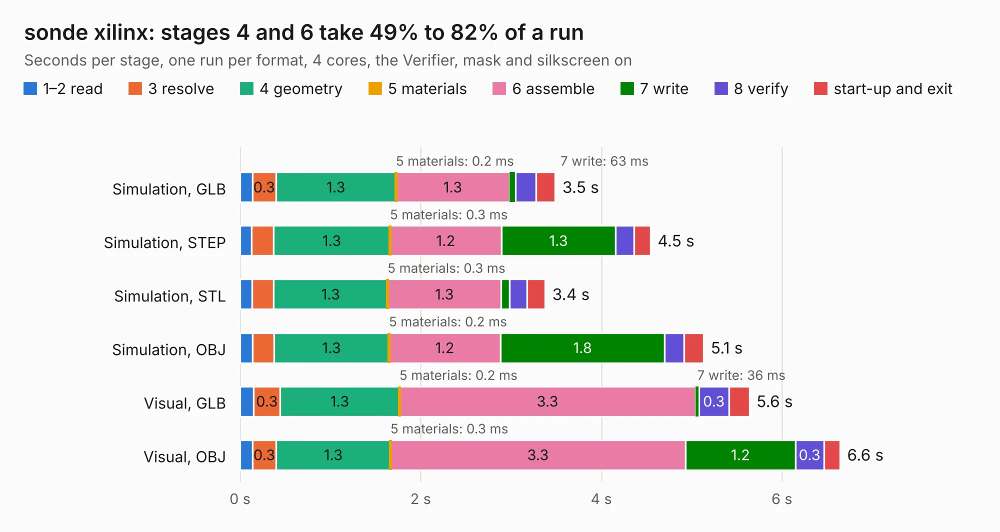

# 1450. sonde xilinx

Board 1,450 of the 3,125 of [Corpus Testing](../Corpus-Testing.md), on [Corpus Page 14](../CorpusTestingPages/Corpus-Testing-14.md#1450-sonde-xilinx).

| Mode and format | 1–2 read | 3 resolve | 4 geometry | 5 materials | 6 assemble | 7 write | 8 verify | start-up and exit | Total |
|---|---:|---:|---:|---:|---:|---:|---:|---:|---:|
| Simulation, GLB | 0.1 | 0.3 | 1.3 | 0.2&nbsp;ms | 1.3 | 63&nbsp;ms | 0.2 | 0.2 | 3.5 |
| Simulation, STEP | 0.1 | 0.2 | 1.3 | 0.3&nbsp;ms | 1.2 | 1.3 | 0.2 | 0.2 | 4.5 |
| Simulation, STL | 0.1 | 0.2 | 1.3 | 0.3&nbsp;ms | 1.3 | 89&nbsp;ms | 0.2 | 0.2 | 3.4 |
| Simulation, OBJ | 0.1 | 0.2 | 1.3 | 0.2&nbsp;ms | 1.2 | 1.8 | 0.2 | 0.2 | 5.1 |
| Visual, GLB | 0.2 | 0.3 | 1.3 | 0.2&nbsp;ms | 3.3 | 36&nbsp;ms | 0.3 | 0.2 | 5.6 |
| Visual, OBJ | 0.1 | 0.3 | 1.3 | 0.3&nbsp;ms | 3.3 | 1.2 | 0.3 | 0.2 | 6.6 |

<table align="center"><tr><td valign="top">

| Board | Repo: [KiCad/kicad-source-mirror](https://github.com/KiCad/kicad-source-mirror) Board: `sonde xilinx.kicad_pcb` |
|---|---|
| Folder | demos / sonde xilinx |
| Complexity | 235&nbsp;/&nbsp;1000 (size&nbsp;140, features&nbsp;95) |
| KESE&nbsp;features | through vias, filled zones, copper text, stack-up, dielectric εr and tanδ, copper finish, mask and silkscreen colours |
| Tested | 9th November 2026 |
| Copper&nbsp;layers | 2 |
| File&nbsp;format | KiCad 9 (20241229) |
| Parts,&nbsp;tracks,&nbsp;vias | 25, 208, 3 |
| Triangles,&nbsp;simulation | 454,014 in 54 parts |
| Verifier | PASS in all six runs |

</td><td valign="top">

<table>
<tr><th>File type</th><th>File size</th><th>Peak memory used</th></tr>
<tr><th colspan="3" align="left">Simulation</th></tr>
<tr><td>GLB</td><td align="right">15&nbsp;MB</td><td align="right">311&nbsp;MB</td></tr>
<tr><td>STEP</td><td align="right">72&nbsp;MB</td><td align="right">333&nbsp;MB</td></tr>
<tr><td>STL</td><td align="right">23&nbsp;MB</td><td align="right">320&nbsp;MB</td></tr>
<tr><td>OBJ</td><td align="right">45&nbsp;MB</td><td align="right">347&nbsp;MB</td></tr>
<tr><th colspan="3" align="left">Visual</th></tr>
<tr><td>GLB</td><td align="right">10.0&nbsp;MB</td><td align="right">345&nbsp;MB</td></tr>
<tr><td>OBJ</td><td align="right">30&nbsp;MB</td><td align="right">343&nbsp;MB</td></tr>
</table>

</td></tr></table>

| Previous | Next |
|:---|---:|
| [1449. RoyalBlue54L-Feather](b1449b_kicad-source-mirror_RoyalBlue54L-Feather.md) | [1451. StickHub](b1451b_kicad-source-mirror_StickHub.md) |
