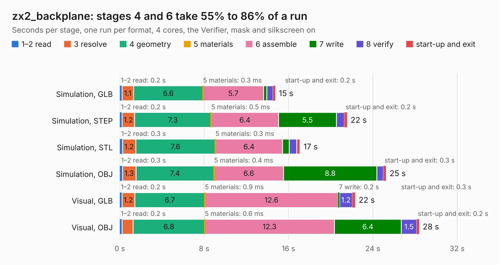

# 1451. zx2_backplane

Board 1,451 of the 3,108 of [Corpus Testing](../Corpus-Testing.md), on [Corpus Page 14](../CorpusTestingPages/Corpus-Testing-14.md#1451-zx2_backplane).

| Mode and format | 1–2 read | 3 resolve | 4 geometry | 5 materials | 6 assemble | 7 write | 8 verify | start-up and exit | Total |
|---|---:|---:|---:|---:|---:|---:|---:|---:|---:|
| Simulation, GLB | 0.2 | 1.1 | 6.6 | 0.3&nbsp;ms | 5.7 | 0.3 | 0.6 | 0.2 | 14.7 |
| Simulation, STEP | 0.2 | 1.2 | 7.3 | 0.5&nbsp;ms | 6.4 | 5.5 | 0.8 | 0.2 | 21.5 |
| Simulation, STL | 0.3 | 1.2 | 7.6 | 0.3&nbsp;ms | 6.4 | 0.6 | 0.7 | 0.3 | 17.1 |
| Simulation, OBJ | 0.3 | 1.3 | 7.4 | 0.4&nbsp;ms | 6.6 | 8.8 | 0.6 | 0.3 | 25.2 |
| Visual, GLB | 0.2 | 1.2 | 6.7 | 0.9&nbsp;ms | 12.6 | 0.2 | 1.2 | 0.3 | 22.3 |
| Visual, OBJ | 0.2 | 1.0 | 6.8 | 0.6&nbsp;ms | 12.3 | 6.4 | 1.5 | 0.2 | 28.4 |

<table align="center"><tr><td valign="top">

| Board | Repo: [krzys9876/ZX_Spectrum_diy](https://github.com/krzys9876/ZX_Spectrum_diy) Board: `zx2_backplane.kicad_pcb` |
|---|---|
| Folder | Kicad5 / zx2_backplane |
| Complexity | 187&nbsp;/&nbsp;1000 (size&nbsp;147, features&nbsp;40) |
| KESE&nbsp;features | rounded, trapezoid or chamfered pads, filled zones, copper text |
| Tested | 9th November 2026 |
| Copper&nbsp;layers | 2 |
| File&nbsp;format | KiCad 5 (20171130) |
| Parts,&nbsp;tracks,&nbsp;vias | 12, 532, 0 |
| Triangles,&nbsp;simulation | 1,561,198 in 55 parts |
| Verifier | PASS in all six runs |

</td><td valign="top">

<table>
<tr><th>File type</th><th>File size</th><th>Peak memory used</th></tr>
<tr><th colspan="3" align="left">Simulation</th></tr>
<tr><td>GLB</td><td align="right">51&nbsp;MB</td><td align="right">571&nbsp;MB</td></tr>
<tr><td>STEP</td><td align="right">226&nbsp;MB</td><td align="right">727&nbsp;MB</td></tr>
<tr><td>STL</td><td align="right">78&nbsp;MB</td><td align="right">593&nbsp;MB</td></tr>
<tr><td>OBJ</td><td align="right">161&nbsp;MB</td><td align="right">1.0&nbsp;GB</td></tr>
<tr><th colspan="3" align="left">Visual</th></tr>
<tr><td>GLB</td><td align="right">32&nbsp;MB</td><td align="right">955&nbsp;MB</td></tr>
<tr><td>OBJ</td><td align="right">98&nbsp;MB</td><td align="right">787&nbsp;MB</td></tr>
</table>

</td></tr></table>

| Previous | Next |
|:---|---:|
| [1450. z2_io_test02](b1450b_ZX-Spectrum-diy_z2-io-test02.md) | [1452. zx2_clock](b1452b_ZX-Spectrum-diy_zx2-clock.md) |
