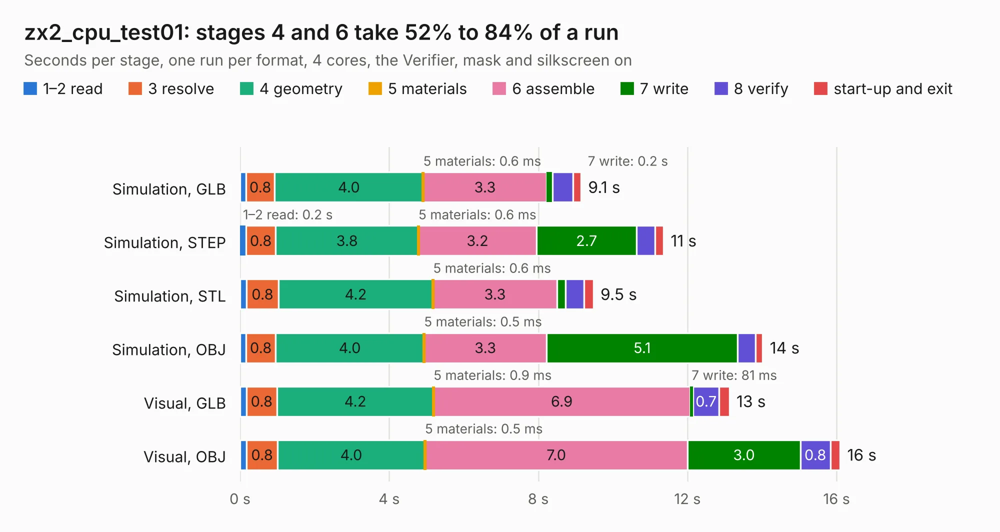

# 1452. zx2_cpu_test01

Board 1,452 of the 3,105 of [Corpus Testing](../Corpus-Testing.md), on [Corpus Page 14](../CorpusTestingPages/Corpus-Testing-14.md#1452-zx2_cpu_test01).

| Mode and format | 1–2 read | 3 resolve | 4 geometry | 5 materials | 6 assemble | 7 write | 8 verify | start-up and exit | Total |
|---|---:|---:|---:|---:|---:|---:|---:|---:|---:|
| Simulation, GLB | 0.2 | 0.8 | 4.0 | 0.6&nbsp;ms | 3.3 | 0.2 | 0.5 | 0.2 | 9.1 |
| Simulation, STEP | 0.2 | 0.8 | 3.8 | 0.6&nbsp;ms | 3.2 | 2.7 | 0.5 | 0.2 | 11.4 |
| Simulation, STL | 0.2 | 0.8 | 4.2 | 0.6&nbsp;ms | 3.3 | 0.2 | 0.5 | 0.2 | 9.5 |
| Simulation, OBJ | 0.2 | 0.8 | 4.0 | 0.5&nbsp;ms | 3.3 | 5.1 | 0.5 | 0.2 | 14.0 |
| Visual, GLB | 0.2 | 0.8 | 4.2 | 0.9&nbsp;ms | 6.9 | 81&nbsp;ms | 0.7 | 0.3 | 13.1 |
| Visual, OBJ | 0.2 | 0.8 | 4.0 | 0.5&nbsp;ms | 7.0 | 3.0 | 0.8 | 0.3 | 16.1 |

<table align="center"><tr><td valign="top">

| Board | Repo: [krzys9876/ZX_Spectrum_diy](https://github.com/krzys9876/ZX_Spectrum_diy) Board: `zx2_cpu_test01.kicad_pcb` |
|---|---|
| Folder | Kicad5 / zx2_cpu |
| Complexity | 190&nbsp;/&nbsp;1000 (size&nbsp;155, features&nbsp;35) |
| KESE&nbsp;features | through vias, rounded, trapezoid or chamfered pads, copper text |
| Tested | 9th November 2026 |
| Copper&nbsp;layers | 2 |
| File&nbsp;format | KiCad 5 (20171130) |
| Parts,&nbsp;tracks,&nbsp;vias | 18, 493, 51 |
| Triangles,&nbsp;simulation | 980,980 in 83 parts |
| Verifier | PASS in all six runs |

</td><td valign="top">

<table>
<tr><th>File type</th><th>File size</th><th>Peak memory used</th></tr>
<tr><th colspan="3" align="left">Simulation</th></tr>
<tr><td>GLB</td><td align="right">33&nbsp;MB</td><td align="right">460&nbsp;MB</td></tr>
<tr><td>STEP</td><td align="right">162&nbsp;MB</td><td align="right">513&nbsp;MB</td></tr>
<tr><td>STL</td><td align="right">49&nbsp;MB</td><td align="right">479&nbsp;MB</td></tr>
<tr><td>OBJ</td><td align="right">100&nbsp;MB</td><td align="right">701&nbsp;MB</td></tr>
<tr><th colspan="3" align="left">Visual</th></tr>
<tr><td>GLB</td><td align="right">20&nbsp;MB</td><td align="right">492&nbsp;MB</td></tr>
<tr><td>OBJ</td><td align="right">60&nbsp;MB</td><td align="right">557&nbsp;MB</td></tr>
</table>

</td></tr></table>

| Previous | Next |
|:---|---:|
| [1451. zx2_cpu](b1451b_ZX-Spectrum-diy_zx2-cpu.md) | [1453. zx2_fpga_int](b1453b_ZX-Spectrum-diy_zx2-fpga-int.md) |
