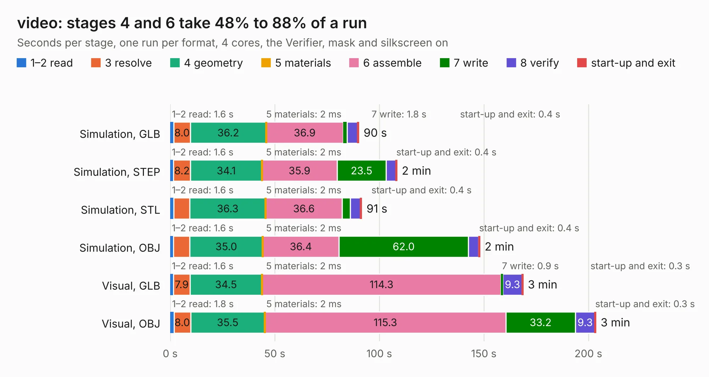

# 1453. video

Board 1,453 of the 3,125 of [Corpus Testing](../Corpus-Testing.md), on [Corpus Page 14](../CorpusTestingPages/Corpus-Testing-14.md#1453-video).

| Mode and format | 1–2 read | 3 resolve | 4 geometry | 5 materials | 6 assemble | 7 write | 8 verify | start-up and exit | Total |
|---|---:|---:|---:|---:|---:|---:|---:|---:|---:|
| Simulation, GLB | 1.6 | 8.0 | 36.2 | 2&nbsp;ms | 36.9 | 1.8 | 5.1 | 0.4 | 90.1 |
| Simulation, STEP | 1.6 | 8.2 | 34.1 | 2&nbsp;ms | 35.9 | 23.5 | 4.7 | 0.4 | 108.3 |
| Simulation, STL | 1.6 | 7.7 | 36.3 | 2&nbsp;ms | 36.6 | 3.9 | 4.9 | 0.4 | 91.5 |
| Simulation, OBJ | 1.6 | 7.7 | 35.0 | 2&nbsp;ms | 36.4 | 62.0 | 4.9 | 0.4 | 148.0 |
| Visual, GLB | 1.6 | 7.9 | 34.5 | 2&nbsp;ms | 114.3 | 0.9 | 9.3 | 0.3 | 168.6 |
| Visual, OBJ | 1.8 | 8.0 | 35.5 | 2&nbsp;ms | 115.3 | 33.2 | 9.3 | 0.3 | 203.5 |

<table align="center"><tr><td valign="top">

| Board | Repo: [KiCad/kicad-source-mirror](https://github.com/KiCad/kicad-source-mirror) Board: `video.kicad_pcb` |
|---|---|
| Folder | demos / video |
| Complexity | 405&nbsp;/&nbsp;1000 (size&nbsp;300, features&nbsp;105) |
| KESE&nbsp;features | through vias, rounded, trapezoid or chamfered pads, filled zones, copper text, stack-up, dielectric εr and tanδ, copper finish, mask and silkscreen colours |
| Tested | 9th November 2026 |
| Copper&nbsp;layers | 4 |
| File&nbsp;format | KiCad 9 (20241229) |
| Parts,&nbsp;tracks,&nbsp;vias | 185, 7,932, 808 |
| Triangles,&nbsp;simulation | 10,648,432 in 602 parts |
| Verifier | PASS in all six runs |

</td><td valign="top">

<table>
<tr><th>File type</th><th>File size</th><th>Peak memory used</th></tr>
<tr><th colspan="3" align="left">Simulation</th></tr>
<tr><td>GLB</td><td align="right">352&nbsp;MB</td><td align="right">2.8&nbsp;GB</td></tr>
<tr><td>STEP</td><td align="right">1.3&nbsp;GB</td><td align="right">3.5&nbsp;GB</td></tr>
<tr><td>STL</td><td align="right">532&nbsp;MB</td><td align="right">2.8&nbsp;GB</td></tr>
<tr><td>OBJ</td><td align="right">1.2&nbsp;GB</td><td align="right">6.6&nbsp;GB</td></tr>
<tr><th colspan="3" align="left">Visual</th></tr>
<tr><td>GLB</td><td align="right">197&nbsp;MB</td><td align="right">3.3&nbsp;GB</td></tr>
<tr><td>OBJ</td><td align="right">660&nbsp;MB</td><td align="right">4.3&nbsp;GB</td></tr>
</table>

</td></tr></table>

| Previous | Next |
|:---|---:|
| [1452. tinytapeout-demo](b1452b_kicad-source-mirror_tinytapeout-demo.md) | [1454. reform-kintex-edp](b1454b_reform-kintex-som_reform-kintex-edp.md) |
