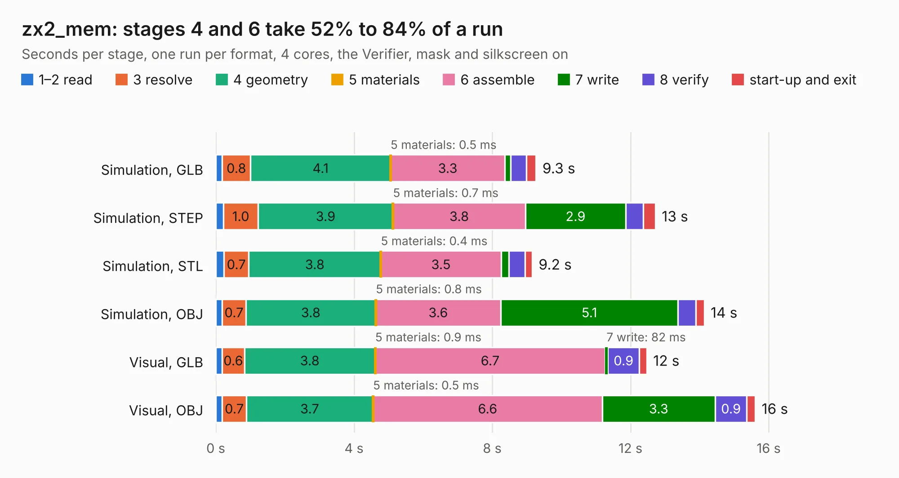

# 1454. zx2_mem

Board 1,454 of the 3,103 of [Corpus Testing](../Corpus-Testing.md), on [Corpus Page 14](../CorpusTestingPages/Corpus-Testing-14.md#1454-zx2_mem).

| Mode and format | 1–2 read | 3 resolve | 4 geometry | 5 materials | 6 assemble | 7 write | 8 verify | start-up and exit | Total |
|---|---:|---:|---:|---:|---:|---:|---:|---:|---:|
| Simulation, GLB | 0.2 | 0.8 | 4.1 | 0.5&nbsp;ms | 3.3 | 0.2 | 0.5 | 0.3 | 9.3 |
| Simulation, STEP | 0.2 | 1.0 | 3.9 | 0.7&nbsp;ms | 3.8 | 2.9 | 0.5 | 0.4 | 12.7 |
| Simulation, STL | 0.2 | 0.7 | 3.8 | 0.4&nbsp;ms | 3.5 | 0.2 | 0.5 | 0.2 | 9.2 |
| Simulation, OBJ | 0.2 | 0.7 | 3.8 | 0.8&nbsp;ms | 3.6 | 5.1 | 0.5 | 0.2 | 14.1 |
| Visual, GLB | 0.2 | 0.6 | 3.8 | 0.9&nbsp;ms | 6.7 | 82&nbsp;ms | 0.9 | 0.2 | 12.5 |
| Visual, OBJ | 0.2 | 0.7 | 3.7 | 0.5&nbsp;ms | 6.6 | 3.3 | 0.9 | 0.2 | 15.6 |

<table align="center"><tr><td valign="top">

| Board | Repo: [krzys9876/ZX_Spectrum_diy](https://github.com/krzys9876/ZX_Spectrum_diy) Board: `zx2_mem.kicad_pcb` |
|---|---|
| Folder | Kicad5 / zx2_mem |
| Complexity | 195&nbsp;/&nbsp;1000 (size&nbsp;160, features&nbsp;35) |
| KESE&nbsp;features | through vias, rounded, trapezoid or chamfered pads, copper text |
| Tested | 9th November 2026 |
| Copper&nbsp;layers | 2 |
| File&nbsp;format | KiCad 5 (20171130) |
| Parts,&nbsp;tracks,&nbsp;vias | 20, 687, 43 |
| Triangles,&nbsp;simulation | 932,552 in 57 parts |
| Verifier | PASS in all six runs |

</td><td valign="top">

<table>
<tr><th>File type</th><th>File size</th><th>Peak memory used</th></tr>
<tr><th colspan="3" align="left">Simulation</th></tr>
<tr><td>GLB</td><td align="right">31&nbsp;MB</td><td align="right">447&nbsp;MB</td></tr>
<tr><td>STEP</td><td align="right">129&nbsp;MB</td><td align="right">504&nbsp;MB</td></tr>
<tr><td>STL</td><td align="right">47&nbsp;MB</td><td align="right">441&nbsp;MB</td></tr>
<tr><td>OBJ</td><td align="right">93&nbsp;MB</td><td align="right">656&nbsp;MB</td></tr>
<tr><th colspan="3" align="left">Visual</th></tr>
<tr><td>GLB</td><td align="right">20&nbsp;MB</td><td align="right">589&nbsp;MB</td></tr>
<tr><td>OBJ</td><td align="right">60&nbsp;MB</td><td align="right">548&nbsp;MB</td></tr>
</table>

</td></tr></table>

| Previous | Next |
|:---|---:|
| [1453. zx2_keyb_idc](b1453b_ZX-Spectrum-diy_zx2-keyb-idc.md) | [1455. zx2_mem_test01](b1455b_ZX-Spectrum-diy_zx2-mem-test01.md) |
