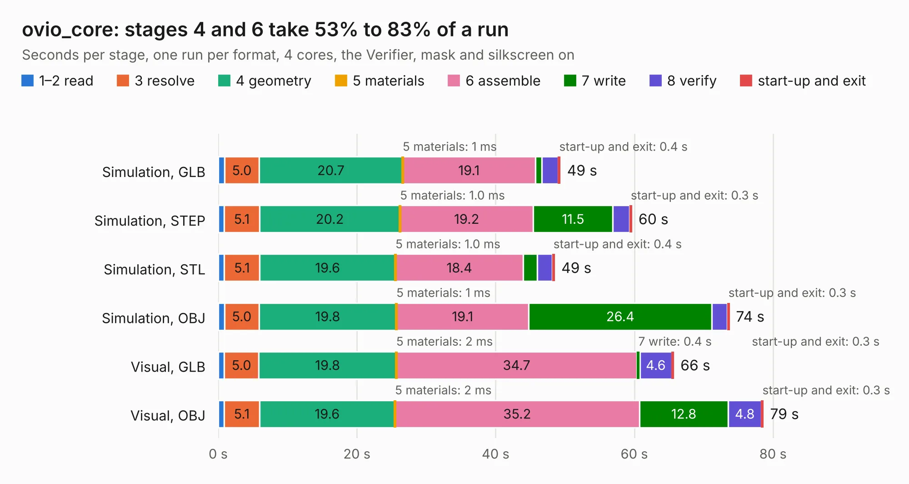

# 1454. ovio_core

Board 1,454 of the 3,118 of [Corpus Testing](../Corpus-Testing.md), on [Corpus Page 14](../CorpusTestingPages/Corpus-Testing-14.md#1454-ovio_core).

| Mode and format | 1–2 read | 3 resolve | 4 geometry | 5 materials | 6 assemble | 7 write | 8 verify | start-up and exit | Total |
|---|---:|---:|---:|---:|---:|---:|---:|---:|---:|
| Simulation, GLB | 0.9 | 5.0 | 20.7 | 1&nbsp;ms | 19.1 | 1.0 | 2.3 | 0.4 | 49.4 |
| Simulation, STEP | 0.8 | 5.1 | 20.2 | 1.0&nbsp;ms | 19.2 | 11.5 | 2.4 | 0.3 | 59.7 |
| Simulation, STL | 0.9 | 5.1 | 19.6 | 1.0&nbsp;ms | 18.4 | 2.0 | 2.1 | 0.4 | 48.5 |
| Simulation, OBJ | 0.9 | 5.0 | 19.8 | 1&nbsp;ms | 19.1 | 26.4 | 2.2 | 0.3 | 73.7 |
| Visual, GLB | 0.8 | 5.0 | 19.8 | 2&nbsp;ms | 34.7 | 0.4 | 4.6 | 0.3 | 65.7 |
| Visual, OBJ | 0.9 | 5.1 | 19.6 | 2&nbsp;ms | 35.2 | 12.8 | 4.8 | 0.3 | 78.6 |

<table align="center"><tr><td valign="top">

| Board | Repo: [korken89/ovio_core](https://github.com/korken89/ovio_core) Board: `ovio_core.kicad_pcb` |
|---|---|
| Complexity | 371&nbsp;/&nbsp;1000 (size&nbsp;306, features&nbsp;65) |
| KESE&nbsp;features | through vias, slotted holes, rounded, trapezoid or chamfered pads, filled zones, curved board outline |
| Tested | 9th November 2026 |
| Copper&nbsp;layers | 6 |
| File&nbsp;format | KiCad 5 (20171130) |
| Parts,&nbsp;tracks,&nbsp;vias | 194, 5,830, 552 |
| Triangles,&nbsp;simulation | 5,013,746 in 342 parts |
| Verifier | PASS in all six runs |

</td><td valign="top">

<table>
<tr><th>File type</th><th>File size</th><th>Peak memory used</th></tr>
<tr><th colspan="3" align="left">Simulation</th></tr>
<tr><td>GLB</td><td align="right">173&nbsp;MB</td><td align="right">1.4&nbsp;GB</td></tr>
<tr><td>STEP</td><td align="right">687&nbsp;MB</td><td align="right">1.8&nbsp;GB</td></tr>
<tr><td>STL</td><td align="right">251&nbsp;MB</td><td align="right">1.4&nbsp;GB</td></tr>
<tr><td>OBJ</td><td align="right">535&nbsp;MB</td><td align="right">3.2&nbsp;GB</td></tr>
<tr><th colspan="3" align="left">Visual</th></tr>
<tr><td>GLB</td><td align="right">89&nbsp;MB</td><td align="right">1.6&nbsp;GB</td></tr>
<tr><td>OBJ</td><td align="right">287&nbsp;MB</td><td align="right">2.0&nbsp;GB</td></tr>
</table>

</td></tr></table>

| Previous | Next |
|:---|---:|
| [1453. H616_devboard](b1453b_allwinner-h616-devboard_H616-devboard.md) | [1455. keyb2](b1455b_ZX-Spectrum-diy_keyb2.md) |
