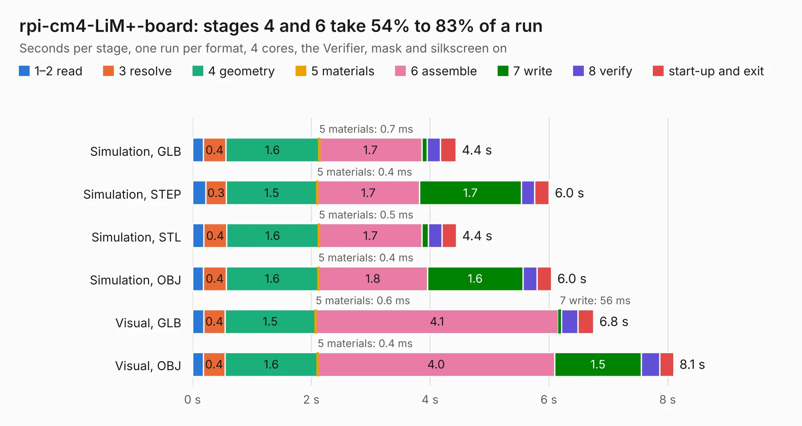

# 1455. rpi-cm4-LiM+-board

Board 1,455 of the 3,101 of [Corpus Testing](../Corpus-Testing.md), on [Corpus Page 14](../CorpusTestingPages/Corpus-Testing-14.md#1455-rpi-cm4-lim-board).

| Mode and format | 1–2 read | 3 resolve | 4 geometry | 5 materials | 6 assemble | 7 write | 8 verify | start-up and exit | Total |
|---|---:|---:|---:|---:|---:|---:|---:|---:|---:|
| Simulation, GLB | 0.2 | 0.4 | 1.6 | 0.7&nbsp;ms | 1.7 | 87&nbsp;ms | 0.2 | 0.3 | 4.4 |
| Simulation, STEP | 0.2 | 0.3 | 1.5 | 0.4&nbsp;ms | 1.7 | 1.7 | 0.2 | 0.2 | 6.0 |
| Simulation, STL | 0.2 | 0.4 | 1.6 | 0.5&nbsp;ms | 1.7 | 0.1 | 0.2 | 0.2 | 4.4 |
| Simulation, OBJ | 0.2 | 0.4 | 1.6 | 0.4&nbsp;ms | 1.8 | 1.6 | 0.2 | 0.2 | 6.0 |
| Visual, GLB | 0.2 | 0.4 | 1.5 | 0.6&nbsp;ms | 4.1 | 56&nbsp;ms | 0.3 | 0.3 | 6.8 |
| Visual, OBJ | 0.2 | 0.4 | 1.6 | 0.4&nbsp;ms | 4.0 | 1.5 | 0.3 | 0.2 | 8.1 |

<table align="center"><tr><td valign="top">

| Board | Repo: [l00nix/rpi-cm4-LiM-board](https://github.com/l00nix/rpi-cm4-LiM-board) Board: `rpi-cm4-LiM+-board.kicad_pcb` |
|---|---|
| Folder | hardware / rpi-cm4-LiM+-board / KiCad Files |
| Complexity | 268&nbsp;/&nbsp;1000 (size&nbsp;143, features&nbsp;125) |
| KESE&nbsp;features | through vias, slotted holes, custom pads, rounded, trapezoid or chamfered pads, filled zones, copper drawings, curved board outline, stack-up, dielectric εr and tanδ, mask and silkscreen colours |
| Tested | 9th November 2026 |
| Copper&nbsp;layers | 2 |
| File&nbsp;format | KiCad 6 (20210424) |
| Parts,&nbsp;tracks,&nbsp;vias | 12, 284, 45 |
| Triangles,&nbsp;simulation | 273,312 in 161 parts |
| Verifier | PASS in all six runs |

</td><td valign="top">

<table>
<tr><th>File type</th><th>File size</th><th>Peak memory used</th></tr>
<tr><th colspan="3" align="left">Simulation</th></tr>
<tr><td>GLB</td><td align="right">9.9&nbsp;MB</td><td align="right">260&nbsp;MB</td></tr>
<tr><td>STEP</td><td align="right">60&nbsp;MB</td><td align="right">288&nbsp;MB</td></tr>
<tr><td>STL</td><td align="right">14&nbsp;MB</td><td align="right">265&nbsp;MB</td></tr>
<tr><td>OBJ</td><td align="right">28&nbsp;MB</td><td align="right">264&nbsp;MB</td></tr>
<tr><th colspan="3" align="left">Visual</th></tr>
<tr><td>GLB</td><td align="right">8.9&nbsp;MB</td><td align="right">310&nbsp;MB</td></tr>
<tr><td>OBJ</td><td align="right">26&nbsp;MB</td><td align="right">308&nbsp;MB</td></tr>
</table>

</td></tr></table>

| Previous | Next |
|:---|---:|
| [1454. zx2_uart](b1454b_ZX-Spectrum-diy_zx2-uart.md) | [1456. rpi-cm4-LiM-board](b1456b_rpi-cm4-LiM-board_hardware-rpi-cm4-LiM-board-KiCad-Files_rpi-cm4-LiM-board_2462.md) |
