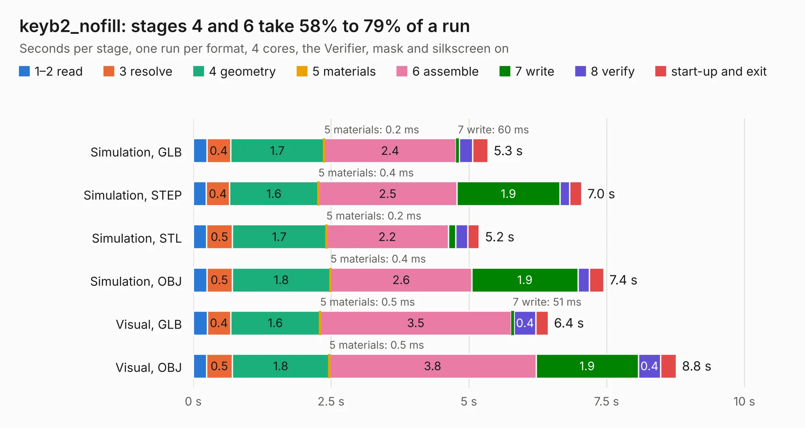

# 1456. keyb2_nofill

Board 1,456 of the 3,118 of [Corpus Testing](../Corpus-Testing.md), on [Corpus Page 14](../CorpusTestingPages/Corpus-Testing-14.md#1456-keyb2_nofill).

| Mode and format | 1–2 read | 3 resolve | 4 geometry | 5 materials | 6 assemble | 7 write | 8 verify | start-up and exit | Total |
|---|---:|---:|---:|---:|---:|---:|---:|---:|---:|
| Simulation, GLB | 0.2 | 0.4 | 1.7 | 0.2&nbsp;ms | 2.4 | 60&nbsp;ms | 0.2 | 0.3 | 5.3 |
| Simulation, STEP | 0.2 | 0.4 | 1.6 | 0.4&nbsp;ms | 2.5 | 1.9 | 0.2 | 0.2 | 7.0 |
| Simulation, STL | 0.2 | 0.5 | 1.7 | 0.2&nbsp;ms | 2.2 | 0.1 | 0.2 | 0.2 | 5.2 |
| Simulation, OBJ | 0.2 | 0.5 | 1.8 | 0.4&nbsp;ms | 2.6 | 1.9 | 0.2 | 0.3 | 7.4 |
| Visual, GLB | 0.3 | 0.4 | 1.6 | 0.5&nbsp;ms | 3.5 | 51&nbsp;ms | 0.4 | 0.2 | 6.4 |
| Visual, OBJ | 0.2 | 0.5 | 1.8 | 0.5&nbsp;ms | 3.8 | 1.9 | 0.4 | 0.3 | 8.8 |

<table align="center"><tr><td valign="top">

| Board | Repo: [krzys9876/ZX_Spectrum_diy](https://github.com/krzys9876/ZX_Spectrum_diy) Board: `keyb2_nofill.kicad_pcb` |
|---|---|
| Folder | Kicad4 / keyb2 |
| Complexity | 172&nbsp;/&nbsp;1000 (size&nbsp;162, features&nbsp;10) |
| KESE&nbsp;features | copper text |
| Tested | 9th November 2026 |
| Copper&nbsp;layers | 2 |
| File&nbsp;format | KiCad 4 (4) |
| Parts,&nbsp;tracks,&nbsp;vias | 59, 480, 0 |
| Triangles,&nbsp;simulation | 303,980 in 30 parts |
| Verifier | PASS in all six runs |

</td><td valign="top">

<table>
<tr><th>File type</th><th>File size</th><th>Peak memory used</th></tr>
<tr><th colspan="3" align="left">Simulation</th></tr>
<tr><td>GLB</td><td align="right">11&nbsp;MB</td><td align="right">296&nbsp;MB</td></tr>
<tr><td>STEP</td><td align="right">62&nbsp;MB</td><td align="right">319&nbsp;MB</td></tr>
<tr><td>STL</td><td align="right">15&nbsp;MB</td><td align="right">293&nbsp;MB</td></tr>
<tr><td>OBJ</td><td align="right">33&nbsp;MB</td><td align="right">294&nbsp;MB</td></tr>
<tr><th colspan="3" align="left">Visual</th></tr>
<tr><td>GLB</td><td align="right">10&nbsp;MB</td><td align="right">312&nbsp;MB</td></tr>
<tr><td>OBJ</td><td align="right">30&nbsp;MB</td><td align="right">349&nbsp;MB</td></tr>
</table>

</td></tr></table>

| Previous | Next |
|:---|---:|
| [1455. keyb2](b1455b_ZX-Spectrum-diy_keyb2.md) | [1457. z2_io](b1457b_ZX-Spectrum-diy_z2-io.md) |
