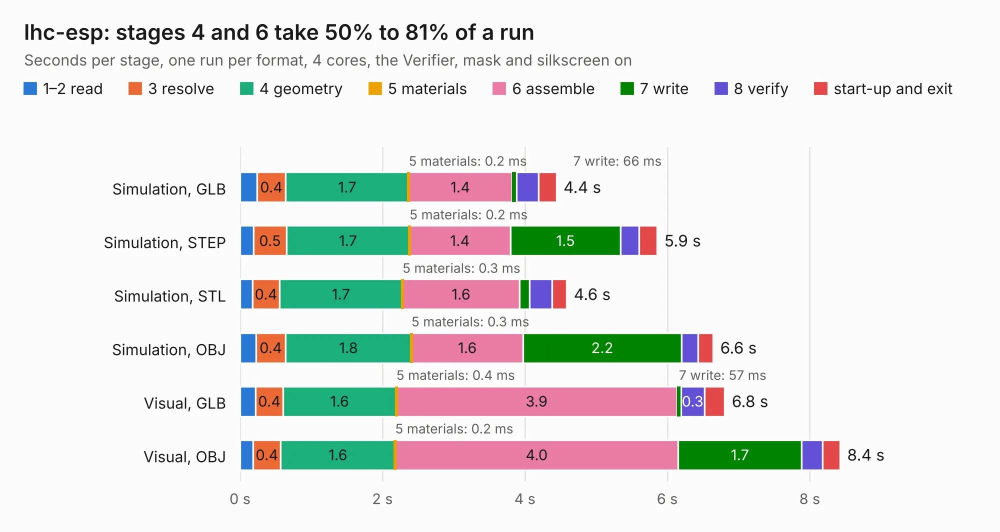

# 1463. lhc-esp

Board 1,463 of the 3,104 of [Corpus Testing](../Corpus-Testing.md), on [Corpus Page 14](../CorpusTestingPages/Corpus-Testing-14.md#1463-lhc-esp).

| Mode and format | 1–2 read | 3 resolve | 4 geometry | 5 materials | 6 assemble | 7 write | 8 verify | start-up and exit | Total |
|---|---:|---:|---:|---:|---:|---:|---:|---:|---:|
| Simulation, GLB | 0.2 | 0.4 | 1.7 | 0.2&nbsp;ms | 1.4 | 66&nbsp;ms | 0.3 | 0.2 | 4.4 |
| Simulation, STEP | 0.2 | 0.5 | 1.7 | 0.2&nbsp;ms | 1.4 | 1.5 | 0.3 | 0.3 | 5.9 |
| Simulation, STL | 0.2 | 0.4 | 1.7 | 0.3&nbsp;ms | 1.6 | 0.1 | 0.3 | 0.2 | 4.6 |
| Simulation, OBJ | 0.2 | 0.4 | 1.8 | 0.3&nbsp;ms | 1.6 | 2.2 | 0.2 | 0.2 | 6.6 |
| Visual, GLB | 0.2 | 0.4 | 1.6 | 0.4&nbsp;ms | 3.9 | 57&nbsp;ms | 0.3 | 0.3 | 6.8 |
| Visual, OBJ | 0.2 | 0.4 | 1.6 | 0.2&nbsp;ms | 4.0 | 1.7 | 0.3 | 0.2 | 8.4 |

<table align="center"><tr><td valign="top">

| Board | Repo: [lhc/hardware](https://github.com/lhc/hardware) Board: `lhc-esp.kicad_pcb` |
|---|---|
| Folder | Oficinas / monte-sua-placa-kicad / Projeto Referência |
| Complexity | 228&nbsp;/&nbsp;1000 (size&nbsp;148, features&nbsp;80) |
| KESE&nbsp;features | through vias, slotted holes, custom pads, rounded, trapezoid or chamfered pads, filled zones, copper drawings |
| Tested | 9th November 2026 |
| Copper&nbsp;layers | 2 |
| File&nbsp;format | KiCad 8 (20240108) |
| Parts,&nbsp;tracks,&nbsp;vias | 24, 194, 58 |
| Triangles,&nbsp;simulation | 398,364 in 43 parts |
| Verifier | PASS in all six runs |

</td><td valign="top">

<table>
<tr><th>File type</th><th>File size</th><th>Peak memory used</th></tr>
<tr><th colspan="3" align="left">Simulation</th></tr>
<tr><td>GLB</td><td align="right">14&nbsp;MB</td><td align="right">300&nbsp;MB</td></tr>
<tr><td>STEP</td><td align="right">61&nbsp;MB</td><td align="right">294&nbsp;MB</td></tr>
<tr><td>STL</td><td align="right">20&nbsp;MB</td><td align="right">276&nbsp;MB</td></tr>
<tr><td>OBJ</td><td align="right">40&nbsp;MB</td><td align="right">289&nbsp;MB</td></tr>
<tr><th colspan="3" align="left">Visual</th></tr>
<tr><td>GLB</td><td align="right">10&nbsp;MB</td><td align="right">314&nbsp;MB</td></tr>
<tr><td>OBJ</td><td align="right">30&nbsp;MB</td><td align="right">308&nbsp;MB</td></tr>
</table>

</td></tr></table>

| Previous | Next |
|:---|---:|
| [1462. placas-kicad](b1462b_hardware_placas-kicad.md) | [1464. BPS-Minion](b1464b_bps-voltagepcb_BPS-Minion.md) |
