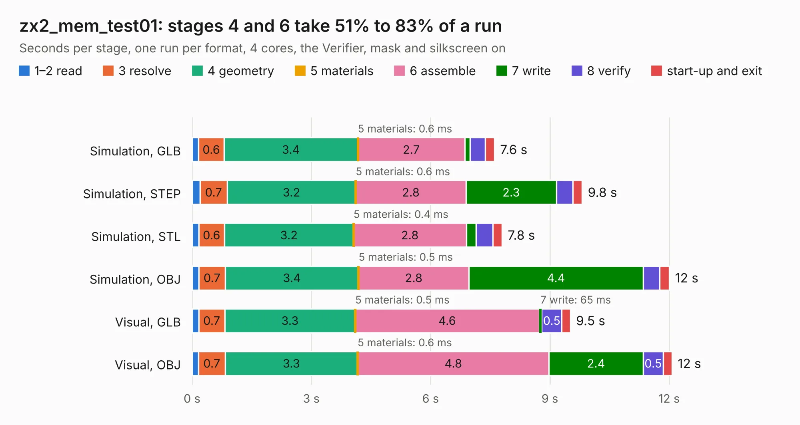

# 1464. zx2_mem_test01

Board 1,464 of the 3,112 of [Corpus Testing](../Corpus-Testing.md), on [Corpus Page 14](../CorpusTestingPages/Corpus-Testing-14.md#1464-zx2_mem_test01).

| Mode and format | 1–2 read | 3 resolve | 4 geometry | 5 materials | 6 assemble | 7 write | 8 verify | start-up and exit | Total |
|---|---:|---:|---:|---:|---:|---:|---:|---:|---:|
| Simulation, GLB | 0.2 | 0.6 | 3.4 | 0.6&nbsp;ms | 2.7 | 0.1 | 0.4 | 0.2 | 7.6 |
| Simulation, STEP | 0.2 | 0.7 | 3.2 | 0.6&nbsp;ms | 2.8 | 2.3 | 0.4 | 0.2 | 9.8 |
| Simulation, STL | 0.2 | 0.6 | 3.2 | 0.4&nbsp;ms | 2.8 | 0.2 | 0.4 | 0.2 | 7.8 |
| Simulation, OBJ | 0.2 | 0.7 | 3.4 | 0.5&nbsp;ms | 2.8 | 4.4 | 0.4 | 0.2 | 12.0 |
| Visual, GLB | 0.2 | 0.7 | 3.3 | 0.5&nbsp;ms | 4.6 | 65&nbsp;ms | 0.5 | 0.2 | 9.5 |
| Visual, OBJ | 0.2 | 0.7 | 3.3 | 0.6&nbsp;ms | 4.8 | 2.4 | 0.5 | 0.2 | 12.1 |

<table align="center"><tr><td valign="top">

| Board | Repo: [krzys9876/ZX_Spectrum_diy](https://github.com/krzys9876/ZX_Spectrum_diy) Board: `zx2_mem_test01.kicad_pcb` |
|---|---|
| Folder | Kicad5 / zx2_mem |
| Complexity | 176&nbsp;/&nbsp;1000 (size&nbsp;151, features&nbsp;25) |
| KESE&nbsp;features | through vias, rounded, trapezoid or chamfered pads |
| Tested | 9th November 2026 |
| Copper&nbsp;layers | 2 |
| File&nbsp;format | KiCad 5 (20171130) |
| Parts,&nbsp;tracks,&nbsp;vias | 18, 414, 29 |
| Triangles,&nbsp;simulation | 777,604 in 56 parts |
| Verifier | PASS in all six runs |

</td><td valign="top">

<table>
<tr><th>File type</th><th>File size</th><th>Peak memory used</th></tr>
<tr><th colspan="3" align="left">Simulation</th></tr>
<tr><td>GLB</td><td align="right">26&nbsp;MB</td><td align="right">376&nbsp;MB</td></tr>
<tr><td>STEP</td><td align="right">110&nbsp;MB</td><td align="right">440&nbsp;MB</td></tr>
<tr><td>STL</td><td align="right">39&nbsp;MB</td><td align="right">378&nbsp;MB</td></tr>
<tr><td>OBJ</td><td align="right">79&nbsp;MB</td><td align="right">555&nbsp;MB</td></tr>
<tr><th colspan="3" align="left">Visual</th></tr>
<tr><td>GLB</td><td align="right">14&nbsp;MB</td><td align="right">423&nbsp;MB</td></tr>
<tr><td>OBJ</td><td align="right">43&nbsp;MB</td><td align="right">429&nbsp;MB</td></tr>
</table>

</td></tr></table>

| Previous | Next |
|:---|---:|
| [1463. zx2_mem](b1463b_ZX-Spectrum-diy_zx2-mem.md) | [1465. zx2_uart](b1465b_ZX-Spectrum-diy_zx2-uart.md) |
