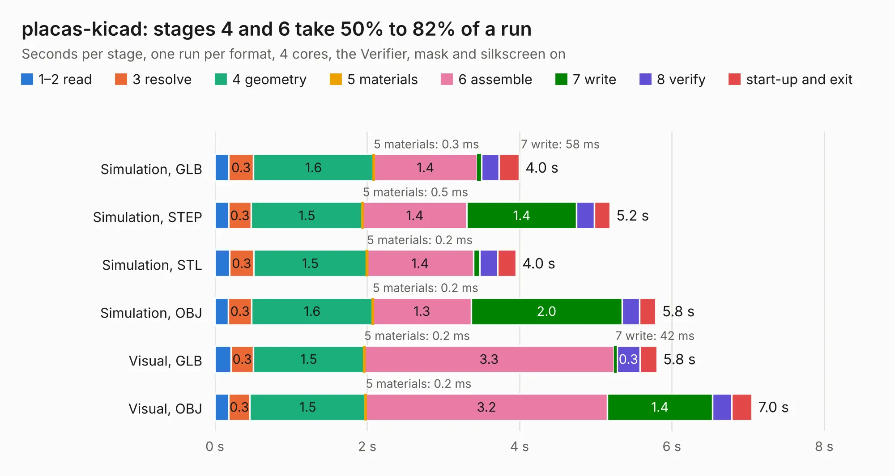

# 1464. placas-kicad

Board 1,464 of the 3,106 of [Corpus Testing](../Corpus-Testing.md), on [Corpus Page 14](../CorpusTestingPages/Corpus-Testing-14.md#1464-placas-kicad).

| Mode and format | 1–2 read | 3 resolve | 4 geometry | 5 materials | 6 assemble | 7 write | 8 verify | start-up and exit | Total |
|---|---:|---:|---:|---:|---:|---:|---:|---:|---:|
| Simulation, GLB | 0.2 | 0.3 | 1.6 | 0.3&nbsp;ms | 1.4 | 58&nbsp;ms | 0.2 | 0.3 | 4.0 |
| Simulation, STEP | 0.2 | 0.3 | 1.5 | 0.5&nbsp;ms | 1.4 | 1.4 | 0.2 | 0.2 | 5.2 |
| Simulation, STL | 0.2 | 0.3 | 1.5 | 0.2&nbsp;ms | 1.4 | 85&nbsp;ms | 0.2 | 0.2 | 4.0 |
| Simulation, OBJ | 0.2 | 0.3 | 1.6 | 0.2&nbsp;ms | 1.3 | 2.0 | 0.2 | 0.2 | 5.8 |
| Visual, GLB | 0.2 | 0.3 | 1.5 | 0.2&nbsp;ms | 3.3 | 42&nbsp;ms | 0.3 | 0.2 | 5.8 |
| Visual, OBJ | 0.2 | 0.3 | 1.5 | 0.2&nbsp;ms | 3.2 | 1.4 | 0.3 | 0.3 | 7.0 |

<table align="center"><tr><td valign="top">

| Board | Repo: [lhc/hardware](https://github.com/lhc/hardware) Board: `placas-kicad.kicad_pcb` |
|---|---|
| Folder | Oficinas / monte-sua-placa-kicad / Projeto Live |
| Complexity | 220&nbsp;/&nbsp;1000 (size&nbsp;140, features&nbsp;80) |
| KESE&nbsp;features | through vias, slotted holes, custom pads, rounded, trapezoid or chamfered pads, filled zones, copper drawings |
| Tested | 9th November 2026 |
| Copper&nbsp;layers | 2 |
| File&nbsp;format | KiCad 8 (20240108) |
| Parts,&nbsp;tracks,&nbsp;vias | 24, 139, 25 |
| Triangles,&nbsp;simulation | 344,872 in 43 parts |
| Verifier | PASS in all six runs |

</td><td valign="top">

<table>
<tr><th>File type</th><th>File size</th><th>Peak memory used</th></tr>
<tr><th colspan="3" align="left">Simulation</th></tr>
<tr><td>GLB</td><td align="right">12&nbsp;MB</td><td align="right">277&nbsp;MB</td></tr>
<tr><td>STEP</td><td align="right">53&nbsp;MB</td><td align="right">278&nbsp;MB</td></tr>
<tr><td>STL</td><td align="right">17&nbsp;MB</td><td align="right">287&nbsp;MB</td></tr>
<tr><td>OBJ</td><td align="right">34&nbsp;MB</td><td align="right">279&nbsp;MB</td></tr>
<tr><th colspan="3" align="left">Visual</th></tr>
<tr><td>GLB</td><td align="right">8.4&nbsp;MB</td><td align="right">282&nbsp;MB</td></tr>
<tr><td>OBJ</td><td align="right">25&nbsp;MB</td><td align="right">276&nbsp;MB</td></tr>
</table>

</td></tr></table>

| Previous | Next |
|:---|---:|
| [1463. lhc_tijolo32_board](b1463b_hardware_lhc-tijolo32-board.md) | [1465. lhc-esp](b1465b_hardware_lhc-esp.md) |
