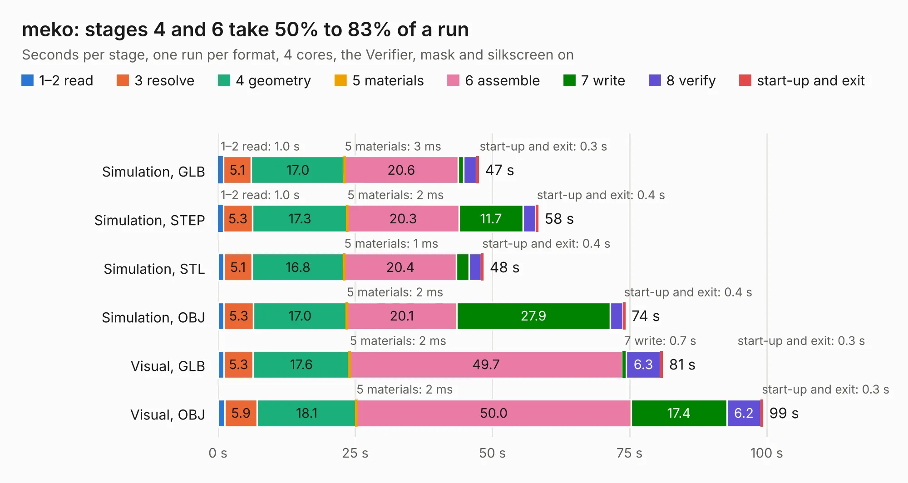

# 1465 meko

Board 1,465 of the 3,138 of [Corpus Testing](../Corpus-Testing.md), on [Corpus Page 14](../CorpusTestingPages/Corpus-Testing-14.md#1465-meko).

| Mode and format | 1–2 read | 3 resolve | 4 geometry | 5 materials | 6 assemble | 7 write | 8 verify | start-up and exit | Total |
|---|---:|---:|---:|---:|---:|---:|---:|---:|---:|
| Simulation, GLB | 1.0 | 5.1 | 17.0 | 3&nbsp;ms | 20.6 | 1.0 | 2.4 | 0.3 | 47.5 |
| Simulation, STEP | 1.0 | 5.3 | 17.3 | 2&nbsp;ms | 20.3 | 11.7 | 2.3 | 0.4 | 58.3 |
| Simulation, STL | 1.1 | 5.1 | 16.8 | 1&nbsp;ms | 20.4 | 2.3 | 2.2 | 0.4 | 48.3 |
| Simulation, OBJ | 1.1 | 5.3 | 17.0 | 2&nbsp;ms | 20.1 | 27.9 | 2.4 | 0.4 | 74.2 |
| Visual, GLB | 1.1 | 5.3 | 17.6 | 2&nbsp;ms | 49.7 | 0.7 | 6.3 | 0.3 | 81.0 |
| Visual, OBJ | 1.2 | 5.9 | 18.1 | 2&nbsp;ms | 50.0 | 17.4 | 6.2 | 0.3 | 99.3 |

<table align="center"><tr><td valign="top">

| Board | Repo: [koeglike/meko](https://github.com/koeglike/meko) Board: `meko.kicad_pcb` |
|---|---|
| Folder | hardware / pcb |
| Complexity | 479&nbsp;/&nbsp;1000 (size&nbsp;309, features&nbsp;170) |
| KESE&nbsp;features | through vias, slotted holes, custom pads, rounded, trapezoid or chamfered pads, arc tracks, filled zones, copper drawings, curved board outline, knockout text, TrueType text, stack-up, dielectric εr and tanδ, mask and silkscreen colours |
| Tested | 9th November 2026 |
| Copper&nbsp;layers | 6 |
| File&nbsp;format | KiCad 10 (20260206) |
| Parts,&nbsp;tracks,&nbsp;vias | 217, 4,129, 1,105 |
| Triangles,&nbsp;simulation | 5,914,532 in 361 parts |
| Verifier | PASS in all six runs |

</td><td valign="top">

<table>
<tr><th>File type</th><th>File size</th><th>Peak memory used</th></tr>
<tr><th colspan="3" align="left">Simulation</th></tr>
<tr><td>GLB</td><td align="right">194&nbsp;MB</td><td align="right">1.8&nbsp;GB</td></tr>
<tr><td>STEP</td><td align="right">736&nbsp;MB</td><td align="right">2.4&nbsp;GB</td></tr>
<tr><td>STL</td><td align="right">296&nbsp;MB</td><td align="right">1.9&nbsp;GB</td></tr>
<tr><td>OBJ</td><td align="right">623&nbsp;MB</td><td align="right">3.7&nbsp;GB</td></tr>
<tr><th colspan="3" align="left">Visual</th></tr>
<tr><td>GLB</td><td align="right">128&nbsp;MB</td><td align="right">2.2&nbsp;GB</td></tr>
<tr><td>OBJ</td><td align="right">418&nbsp;MB</td><td align="right">2.7&nbsp;GB</td></tr>
</table>

</td></tr></table>

| Previous | Next |
|:---|---:|
| [1464 reform-kintex](b1464b_reform-kintex-som_reform-kintex.md) | [1466 touchpad](b1466b_meko_touchpad.md) |
