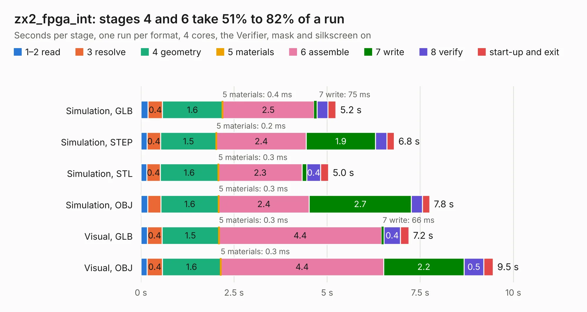

# 1467. zx2_fpga_int

Board 1,467 of the 3,120 of [Corpus Testing](../Corpus-Testing.md), on [Corpus Page 14](../CorpusTestingPages/Corpus-Testing-14.md#1467-zx2_fpga_int).

| Mode and format | 1–2 read | 3 resolve | 4 geometry | 5 materials | 6 assemble | 7 write | 8 verify | start-up and exit | Total |
|---|---:|---:|---:|---:|---:|---:|---:|---:|---:|
| Simulation, GLB | 0.2 | 0.4 | 1.6 | 0.4&nbsp;ms | 2.5 | 75&nbsp;ms | 0.3 | 0.2 | 5.2 |
| Simulation, STEP | 0.2 | 0.4 | 1.5 | 0.2&nbsp;ms | 2.4 | 1.9 | 0.3 | 0.2 | 6.8 |
| Simulation, STL | 0.2 | 0.4 | 1.6 | 0.3&nbsp;ms | 2.3 | 0.1 | 0.4 | 0.2 | 5.0 |
| Simulation, OBJ | 0.2 | 0.4 | 1.6 | 0.3&nbsp;ms | 2.4 | 2.7 | 0.3 | 0.2 | 7.8 |
| Visual, GLB | 0.2 | 0.4 | 1.5 | 0.3&nbsp;ms | 4.4 | 66&nbsp;ms | 0.4 | 0.2 | 7.2 |
| Visual, OBJ | 0.2 | 0.4 | 1.6 | 0.3&nbsp;ms | 4.4 | 2.2 | 0.5 | 0.3 | 9.5 |

<table align="center"><tr><td valign="top">

| Board | Repo: [krzys9876/ZX_Spectrum_diy](https://github.com/krzys9876/ZX_Spectrum_diy) Board: `zx2_fpga_int.kicad_pcb` |
|---|---|
| Folder | Kicad5 / zx2_fpga_int |
| Complexity | 209&nbsp;/&nbsp;1000 (size&nbsp;154, features&nbsp;55) |
| KESE&nbsp;features | through vias, rounded, trapezoid or chamfered pads, filled zones, copper text |
| Tested | 9th November 2026 |
| Copper&nbsp;layers | 2 |
| File&nbsp;format | KiCad 5 (20171130) |
| Parts,&nbsp;tracks,&nbsp;vias | 13, 618, 54 |
| Triangles,&nbsp;simulation | 547,074 in 56 parts |
| Verifier | PASS in all six runs |

</td><td valign="top">

<table>
<tr><th>File type</th><th>File size</th><th>Peak memory used</th></tr>
<tr><th colspan="3" align="left">Simulation</th></tr>
<tr><td>GLB</td><td align="right">18&nbsp;MB</td><td align="right">332&nbsp;MB</td></tr>
<tr><td>STEP</td><td align="right">87&nbsp;MB</td><td align="right">387&nbsp;MB</td></tr>
<tr><td>STL</td><td align="right">27&nbsp;MB</td><td align="right">332&nbsp;MB</td></tr>
<tr><td>OBJ</td><td align="right">55&nbsp;MB</td><td align="right">413&nbsp;MB</td></tr>
<tr><th colspan="3" align="left">Visual</th></tr>
<tr><td>GLB</td><td align="right">15&nbsp;MB</td><td align="right">447&nbsp;MB</td></tr>
<tr><td>OBJ</td><td align="right">44&nbsp;MB</td><td align="right">447&nbsp;MB</td></tr>
</table>

</td></tr></table>

| Previous | Next |
|:---|---:|
| [1466. zx2_cpu_test01](b1466b_ZX-Spectrum-diy_zx2-cpu-test01.md) | [1468. zx2_keyb_conn](b1468b_ZX-Spectrum-diy_zx2-keyb-conn.md) |
