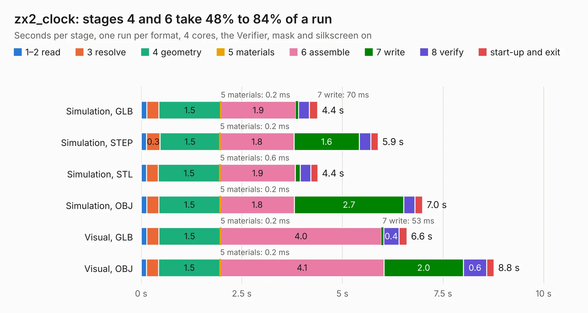

# 1469. zx2_clock

Board 1,469 of the 3,130 of [Corpus Testing](../Corpus-Testing.md), on [Corpus Page 14](../CorpusTestingPages/Corpus-Testing-14.md#1469-zx2_clock).

| Mode and format | 1–2 read | 3 resolve | 4 geometry | 5 materials | 6 assemble | 7 write | 8 verify | start-up and exit | Total |
|---|---:|---:|---:|---:|---:|---:|---:|---:|---:|
| Simulation, GLB | 0.1 | 0.3 | 1.5 | 0.2&nbsp;ms | 1.9 | 70&nbsp;ms | 0.3 | 0.2 | 4.4 |
| Simulation, STEP | 0.1 | 0.3 | 1.5 | 0.2&nbsp;ms | 1.8 | 1.6 | 0.3 | 0.2 | 5.9 |
| Simulation, STL | 0.1 | 0.3 | 1.5 | 0.6&nbsp;ms | 1.9 | 0.1 | 0.3 | 0.2 | 4.4 |
| Simulation, OBJ | 0.1 | 0.3 | 1.5 | 0.2&nbsp;ms | 1.8 | 2.7 | 0.3 | 0.2 | 7.0 |
| Visual, GLB | 0.1 | 0.3 | 1.5 | 0.2&nbsp;ms | 4.0 | 53&nbsp;ms | 0.4 | 0.2 | 6.6 |
| Visual, OBJ | 0.1 | 0.3 | 1.5 | 0.2&nbsp;ms | 4.1 | 2.0 | 0.6 | 0.2 | 8.8 |

<table align="center"><tr><td valign="top">

| Board | Repo: [krzys9876/ZX_Spectrum_diy](https://github.com/krzys9876/ZX_Spectrum_diy) Board: `zx2_clock.kicad_pcb` |
|---|---|
| Folder | Kicad5 / zx2_clock |
| Complexity | 198&nbsp;/&nbsp;1000 (size&nbsp;143, features&nbsp;55) |
| KESE&nbsp;features | through vias, rounded, trapezoid or chamfered pads, filled zones, copper text |
| Tested | 9th November 2026 |
| Copper&nbsp;layers | 2 |
| File&nbsp;format | KiCad 5 (20171130) |
| Parts,&nbsp;tracks,&nbsp;vias | 24, 221, 12 |
| Triangles,&nbsp;simulation | 552,368 in 32 parts |
| Verifier | PASS in all six runs |

</td><td valign="top">

<table>
<tr><th>File type</th><th>File size</th><th>Peak memory used</th></tr>
<tr><th colspan="3" align="left">Simulation</th></tr>
<tr><td>GLB</td><td align="right">18&nbsp;MB</td><td align="right">317&nbsp;MB</td></tr>
<tr><td>STEP</td><td align="right">84&nbsp;MB</td><td align="right">371&nbsp;MB</td></tr>
<tr><td>STL</td><td align="right">28&nbsp;MB</td><td align="right">313&nbsp;MB</td></tr>
<tr><td>OBJ</td><td align="right">55&nbsp;MB</td><td align="right">411&nbsp;MB</td></tr>
<tr><th colspan="3" align="left">Visual</th></tr>
<tr><td>GLB</td><td align="right">13&nbsp;MB</td><td align="right">399&nbsp;MB</td></tr>
<tr><td>OBJ</td><td align="right">40&nbsp;MB</td><td align="right">390&nbsp;MB</td></tr>
</table>

</td></tr></table>

| Previous | Next |
|:---|---:|
| [1468. zx2_backplane](b1468b_ZX-Spectrum-diy_zx2-backplane.md) | [1470. zx2_clock_test01](b1470b_ZX-Spectrum-diy_zx2-clock-test01.md) |
