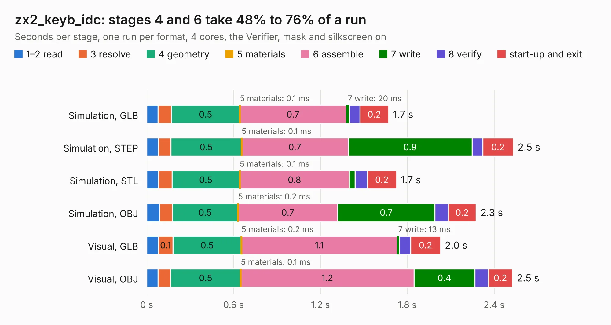

# 1472. zx2_keyb_idc

Board 1,472 of the 3,124 of [Corpus Testing](../Corpus-Testing.md), on [Corpus Page 14](../CorpusTestingPages/Corpus-Testing-14.md#1472-zx2_keyb_idc).

| Mode and format | 1–2 read | 3 resolve | 4 geometry | 5 materials | 6 assemble | 7 write | 8 verify | start-up and exit | Total |
|---|---:|---:|---:|---:|---:|---:|---:|---:|---:|
| Simulation, GLB | 78&nbsp;ms | 92&nbsp;ms | 0.5 | 0.1&nbsp;ms | 0.7 | 20&nbsp;ms | 74&nbsp;ms | 0.2 | 1.7 |
| Simulation, STEP | 80&nbsp;ms | 88&nbsp;ms | 0.5 | 0.1&nbsp;ms | 0.7 | 0.9 | 73&nbsp;ms | 0.2 | 2.5 |
| Simulation, STL | 81&nbsp;ms | 94&nbsp;ms | 0.5 | 0.1&nbsp;ms | 0.8 | 41&nbsp;ms | 84&nbsp;ms | 0.2 | 1.7 |
| Simulation, OBJ | 88&nbsp;ms | 89&nbsp;ms | 0.5 | 0.2&nbsp;ms | 0.7 | 0.7 | 92&nbsp;ms | 0.2 | 2.3 |
| Visual, GLB | 80&nbsp;ms | 0.1 | 0.5 | 0.2&nbsp;ms | 1.1 | 13&nbsp;ms | 78&nbsp;ms | 0.2 | 2.0 |
| Visual, OBJ | 78&nbsp;ms | 87&nbsp;ms | 0.5 | 0.1&nbsp;ms | 1.2 | 0.4 | 93&nbsp;ms | 0.2 | 2.5 |

<table align="center"><tr><td valign="top">

| Board | Repo: [krzys9876/ZX_Spectrum_diy](https://github.com/krzys9876/ZX_Spectrum_diy) Board: `zx2_keyb_idc.kicad_pcb` |
|---|---|
| Folder | Kicad5 / zx2_keyb_idc |
| Complexity | 141&nbsp;/&nbsp;1000 (size&nbsp;111, features&nbsp;30) |
| KESE&nbsp;features | filled zones, copper text |
| Tested | 9th November 2026 |
| Copper&nbsp;layers | 2 |
| File&nbsp;format | KiCad 5 (20171130) |
| Parts,&nbsp;tracks,&nbsp;vias | 4, 108, 0 |
| Triangles,&nbsp;simulation | 124,032 in 26 parts |
| Verifier | PASS in all six runs |

</td><td valign="top">

<table>
<tr><th>File type</th><th>File size</th><th>Peak memory used</th></tr>
<tr><th colspan="3" align="left">Simulation</th></tr>
<tr><td>GLB</td><td align="right">4.1&nbsp;MB</td><td align="right">189&nbsp;MB</td></tr>
<tr><td>STEP</td><td align="right">19&nbsp;MB</td><td align="right">197&nbsp;MB</td></tr>
<tr><td>STL</td><td align="right">6.2&nbsp;MB</td><td align="right">189&nbsp;MB</td></tr>
<tr><td>OBJ</td><td align="right">12&nbsp;MB</td><td align="right">189&nbsp;MB</td></tr>
<tr><th colspan="3" align="left">Visual</th></tr>
<tr><td>GLB</td><td align="right">2.8&nbsp;MB</td><td align="right">154&nbsp;MB</td></tr>
<tr><td>OBJ</td><td align="right">8.0&nbsp;MB</td><td align="right">153&nbsp;MB</td></tr>
</table>

</td></tr></table>

| Previous | Next |
|:---|---:|
| [1471. zx2_keyb_conn](b1471b_ZX-Spectrum-diy_zx2-keyb-conn.md) | [1473. zx2_mem](b1473b_ZX-Spectrum-diy_zx2-mem.md) |
