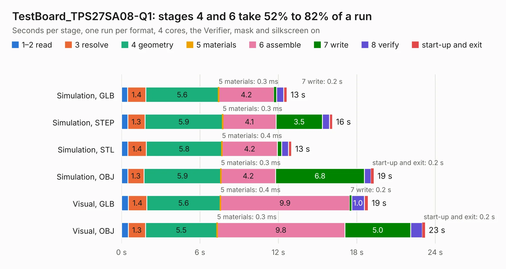

# 1472. TestBoard_TPS27SA08-Q1

Board 1,472 of the 3,108 of [Corpus Testing](../Corpus-Testing.md), on [Corpus Page 14](../CorpusTestingPages/Corpus-Testing-14.md#1472-testboard_tps27sa08-q1).

| Mode and format | 1–2 read | 3 resolve | 4 geometry | 5 materials | 6 assemble | 7 write | 8 verify | start-up and exit | Total |
|---|---:|---:|---:|---:|---:|---:|---:|---:|---:|
| Simulation, GLB | 0.5 | 1.4 | 5.6 | 0.3&nbsp;ms | 4.2 | 0.2 | 0.5 | 0.2 | 12.7 |
| Simulation, STEP | 0.5 | 1.3 | 5.9 | 0.3&nbsp;ms | 4.1 | 3.5 | 0.5 | 0.2 | 16.1 |
| Simulation, STL | 0.5 | 1.4 | 5.8 | 0.4&nbsp;ms | 4.2 | 0.3 | 0.5 | 0.2 | 13.0 |
| Simulation, OBJ | 0.5 | 1.3 | 5.9 | 0.3&nbsp;ms | 4.2 | 6.8 | 0.5 | 0.2 | 19.3 |
| Visual, GLB | 0.5 | 1.4 | 5.6 | 0.4&nbsp;ms | 9.9 | 0.2 | 1.0 | 0.3 | 18.9 |
| Visual, OBJ | 0.5 | 1.3 | 5.5 | 0.3&nbsp;ms | 9.8 | 5.0 | 0.9 | 0.2 | 23.2 |

<table align="center"><tr><td valign="top">

| Board | Repo: [lhr-solar/ps-powerdistributionunit](https://github.com/lhr-solar/ps-powerdistributionunit) Board: `TestBoard_TPS27SA08-Q1.kicad_pcb` |
|---|---|
| Folder | hardware / TestBoard_TPS27SA08-Q1 |
| Complexity | 310&nbsp;/&nbsp;1000 (size&nbsp;215, features&nbsp;95) |
| KESE&nbsp;features | through vias, custom pads, rounded, trapezoid or chamfered pads, filled zones, copper drawings, curved board outline, knockout text |
| Tested | 9th November 2026 |
| Copper&nbsp;layers | 2 |
| File&nbsp;format | KiCad 9 (20241229) |
| Parts,&nbsp;tracks,&nbsp;vias | 102, 576, 52 |
| Triangles,&nbsp;simulation | 1,255,072 in 114 parts |
| Verifier | PASS in all six runs |

</td><td valign="top">

<table>
<tr><th>File type</th><th>File size</th><th>Peak memory used</th></tr>
<tr><th colspan="3" align="left">Simulation</th></tr>
<tr><td>GLB</td><td align="right">43&nbsp;MB</td><td align="right">547&nbsp;MB</td></tr>
<tr><td>STEP</td><td align="right">203&nbsp;MB</td><td align="right">621&nbsp;MB</td></tr>
<tr><td>STL</td><td align="right">63&nbsp;MB</td><td align="right">538&nbsp;MB</td></tr>
<tr><td>OBJ</td><td align="right">129&nbsp;MB</td><td align="right">883&nbsp;MB</td></tr>
<tr><th colspan="3" align="left">Visual</th></tr>
<tr><td>GLB</td><td align="right">32&nbsp;MB</td><td align="right">753&nbsp;MB</td></tr>
<tr><td>OBJ</td><td align="right">94&nbsp;MB</td><td align="right">724&nbsp;MB</td></tr>
</table>

</td></tr></table>

| Previous | Next |
|:---|---:|
| [1471. PowerDistributionUnit_Mk1](b1471b_ps-powerdistributionunit_PowerDistributionUnit-Mk1.md) | [1473. LibreRouter_MegaBoard](b1473b_librerouter_LibreRouter-MegaBoard.md) |
