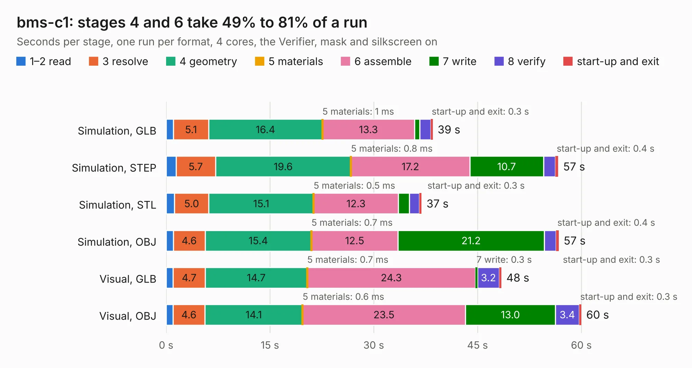

# 1473. bms-c1

Board 1,473 of the 3,106 of [Corpus Testing](../Corpus-Testing.md), on [Corpus Page 14](../CorpusTestingPages/Corpus-Testing-14.md#1473-bms-c1).

| Mode and format | 1–2 read | 3 resolve | 4 geometry | 5 materials | 6 assemble | 7 write | 8 verify | start-up and exit | Total |
|---|---:|---:|---:|---:|---:|---:|---:|---:|---:|
| Simulation, GLB | 1.1 | 5.1 | 16.4 | 1&nbsp;ms | 13.3 | 0.7 | 1.6 | 0.3 | 38.5 |
| Simulation, STEP | 1.4 | 5.7 | 19.6 | 0.8&nbsp;ms | 17.2 | 10.7 | 1.7 | 0.4 | 56.7 |
| Simulation, STL | 1.2 | 5.0 | 15.1 | 0.5&nbsp;ms | 12.3 | 1.6 | 1.4 | 0.3 | 36.9 |
| Simulation, OBJ | 1.0 | 4.6 | 15.4 | 0.7&nbsp;ms | 12.5 | 21.2 | 1.7 | 0.4 | 56.7 |
| Visual, GLB | 1.0 | 4.7 | 14.7 | 0.7&nbsp;ms | 24.3 | 0.3 | 3.2 | 0.3 | 48.4 |
| Visual, OBJ | 1.0 | 4.6 | 14.1 | 0.6&nbsp;ms | 23.5 | 13.0 | 3.4 | 0.3 | 60.0 |

<table align="center"><tr><td valign="top">

| Board | Repo: [LibreSolar/bms-c1](https://github.com/LibreSolar/bms-c1) Board: `bms-c1.kicad_pcb` |
|---|---|
| Folder | kicad |
| Complexity | 383&nbsp;/&nbsp;1000 (size&nbsp;263, features&nbsp;120) |
| KESE&nbsp;features | through vias, slotted holes, custom pads, rounded, trapezoid or chamfered pads, filled zones, copper drawings, curved board outline, stack-up, dielectric εr and tanδ |
| Tested | 9th November 2026 |
| Copper&nbsp;layers | 4 |
| File&nbsp;format | KiCad 9 (20241229) |
| Parts,&nbsp;tracks,&nbsp;vias | 169, 1,097, 805 |
| Triangles,&nbsp;simulation | 3,559,068 in 155 parts |
| Verifier | PASS in all six runs |

</td><td valign="top">

<table>
<tr><th>File type</th><th>File size</th><th>Peak memory used</th></tr>
<tr><th colspan="3" align="left">Simulation</th></tr>
<tr><td>GLB</td><td align="right">120&nbsp;MB</td><td align="right">1.1&nbsp;GB</td></tr>
<tr><td>STEP</td><td align="right">359&nbsp;MB</td><td align="right">1.2&nbsp;GB</td></tr>
<tr><td>STL</td><td align="right">178&nbsp;MB</td><td align="right">1.1&nbsp;GB</td></tr>
<tr><td>OBJ</td><td align="right">369&nbsp;MB</td><td align="right">2.3&nbsp;GB</td></tr>
<tr><th colspan="3" align="left">Visual</th></tr>
<tr><td>GLB</td><td align="right">71&nbsp;MB</td><td align="right">1.3&nbsp;GB</td></tr>
<tr><td>OBJ</td><td align="right">223&nbsp;MB</td><td align="right">1.5&nbsp;GB</td></tr>
</table>

</td></tr></table>

| Previous | Next |
|:---|---:|
| [1472. bms-8s50-ic](b1472b_bms-8s50-ic_bms-8s50-ic.md) | [1474. mppt-1210-hus](b1474b_mppt-1210-hus_mppt-1210-hus.md) |
