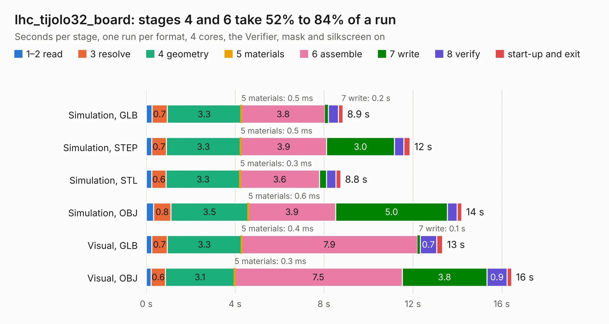

# 1473. lhc_tijolo32_board

Board 1,473 of the 3,117 of [Corpus Testing](../Corpus-Testing.md), on [Corpus Page 14](../CorpusTestingPages/Corpus-Testing-14.md#1473-lhc_tijolo32_board).

| Mode and format | 1–2 read | 3 resolve | 4 geometry | 5 materials | 6 assemble | 7 write | 8 verify | start-up and exit | Total |
|---|---:|---:|---:|---:|---:|---:|---:|---:|---:|
| Simulation, GLB | 0.3 | 0.7 | 3.3 | 0.5&nbsp;ms | 3.8 | 0.2 | 0.4 | 0.2 | 8.9 |
| Simulation, STEP | 0.2 | 0.7 | 3.3 | 0.5&nbsp;ms | 3.9 | 3.0 | 0.4 | 0.3 | 11.9 |
| Simulation, STL | 0.3 | 0.6 | 3.3 | 0.3&nbsp;ms | 3.6 | 0.3 | 0.4 | 0.2 | 8.8 |
| Simulation, OBJ | 0.3 | 0.8 | 3.5 | 0.6&nbsp;ms | 3.9 | 5.0 | 0.4 | 0.2 | 14.2 |
| Visual, GLB | 0.2 | 0.7 | 3.3 | 0.4&nbsp;ms | 7.9 | 0.1 | 0.7 | 0.3 | 13.3 |
| Visual, OBJ | 0.2 | 0.6 | 3.1 | 0.3&nbsp;ms | 7.5 | 3.8 | 0.9 | 0.2 | 16.4 |

<table align="center"><tr><td valign="top">

| Board | Repo: [lhc/hardware](https://github.com/lhc/hardware) Board: `lhc_tijolo32_board.kicad_pcb` |
|---|---|
| Folder | nodeLHC-ESP32 / projeto |
| Complexity | 239&nbsp;/&nbsp;1000 (size&nbsp;164, features&nbsp;75) |
| KESE&nbsp;features | through vias, slotted holes, rounded, trapezoid or chamfered pads, filled zones, copper text, curved board outline |
| Tested | 9th November 2026 |
| Copper&nbsp;layers | 2 |
| File&nbsp;format | KiCad 5 (20171130) |
| Parts,&nbsp;tracks,&nbsp;vias | 46, 405, 75 |
| Triangles,&nbsp;simulation | 901,160 in 76 parts |
| Verifier | PASS in all six runs |

</td><td valign="top">

<table>
<tr><th>File type</th><th>File size</th><th>Peak memory used</th></tr>
<tr><th colspan="3" align="left">Simulation</th></tr>
<tr><td>GLB</td><td align="right">31&nbsp;MB</td><td align="right">402&nbsp;MB</td></tr>
<tr><td>STEP</td><td align="right">148&nbsp;MB</td><td align="right">497&nbsp;MB</td></tr>
<tr><td>STL</td><td align="right">45&nbsp;MB</td><td align="right">417&nbsp;MB</td></tr>
<tr><td>OBJ</td><td align="right">91&nbsp;MB</td><td align="right">618&nbsp;MB</td></tr>
<tr><th colspan="3" align="left">Visual</th></tr>
<tr><td>GLB</td><td align="right">26&nbsp;MB</td><td align="right">589&nbsp;MB</td></tr>
<tr><td>OBJ</td><td align="right">77&nbsp;MB</td><td align="right">615&nbsp;MB</td></tr>
</table>

</td></tr></table>

| Previous | Next |
|:---|---:|
| [1472. LHCbit](b1472b_hardware_LHCbit.md) | [1474. placas-kicad](b1474b_hardware_placas-kicad.md) |
