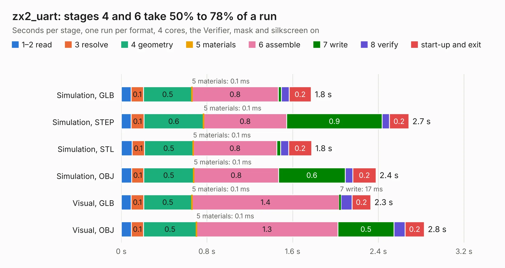

# 1475. zx2_uart

Board 1,475 of the 3,124 of [Corpus Testing](../Corpus-Testing.md), on [Corpus Page 14](../CorpusTestingPages/Corpus-Testing-14.md#1475-zx2_uart).

| Mode and format | 1–2 read | 3 resolve | 4 geometry | 5 materials | 6 assemble | 7 write | 8 verify | start-up and exit | Total |
|---|---:|---:|---:|---:|---:|---:|---:|---:|---:|
| Simulation, GLB | 93&nbsp;ms | 0.1 | 0.5 | 0.1&nbsp;ms | 0.8 | 29&nbsp;ms | 72&nbsp;ms | 0.2 | 1.8 |
| Simulation, STEP | 93&nbsp;ms | 0.1 | 0.6 | 0.1&nbsp;ms | 0.8 | 0.9 | 67&nbsp;ms | 0.2 | 2.7 |
| Simulation, STL | 0.1 | 0.1 | 0.5 | 0.1&nbsp;ms | 0.8 | 34&nbsp;ms | 75&nbsp;ms | 0.2 | 1.8 |
| Simulation, OBJ | 97&nbsp;ms | 0.1 | 0.5 | 0.1&nbsp;ms | 0.8 | 0.6 | 72&nbsp;ms | 0.2 | 2.4 |
| Visual, GLB | 93&nbsp;ms | 0.1 | 0.5 | 0.1&nbsp;ms | 1.4 | 17&nbsp;ms | 0.1 | 0.2 | 2.3 |
| Visual, OBJ | 94&nbsp;ms | 0.1 | 0.5 | 0.1&nbsp;ms | 1.3 | 0.5 | 0.1 | 0.2 | 2.8 |

<table align="center"><tr><td valign="top">

| Board | Repo: [krzys9876/ZX_Spectrum_diy](https://github.com/krzys9876/ZX_Spectrum_diy) Board: `zx2_uart.kicad_pcb` |
|---|---|
| Folder | Kicad5 / zx2_uart |
| Complexity | 176&nbsp;/&nbsp;1000 (size&nbsp;131, features&nbsp;45) |
| KESE&nbsp;features | through vias, rounded, trapezoid or chamfered pads, filled zones |
| Tested | 9th November 2026 |
| Copper&nbsp;layers | 2 |
| File&nbsp;format | KiCad 5 (20171130) |
| Parts,&nbsp;tracks,&nbsp;vias | 15, 152, 7 |
| Triangles,&nbsp;simulation | 131,734 in 27 parts |
| Verifier | PASS in all six runs |

</td><td valign="top">

<table>
<tr><th>File type</th><th>File size</th><th>Peak memory used</th></tr>
<tr><th colspan="3" align="left">Simulation</th></tr>
<tr><td>GLB</td><td align="right">4.5&nbsp;MB</td><td align="right">199&nbsp;MB</td></tr>
<tr><td>STEP</td><td align="right">22&nbsp;MB</td><td align="right">212&nbsp;MB</td></tr>
<tr><td>STL</td><td align="right">6.6&nbsp;MB</td><td align="right">199&nbsp;MB</td></tr>
<tr><td>OBJ</td><td align="right">13&nbsp;MB</td><td align="right">200&nbsp;MB</td></tr>
<tr><th colspan="3" align="left">Visual</th></tr>
<tr><td>GLB</td><td align="right">3.7&nbsp;MB</td><td align="right">180&nbsp;MB</td></tr>
<tr><td>OBJ</td><td align="right">10&nbsp;MB</td><td align="right">181&nbsp;MB</td></tr>
</table>

</td></tr></table>

| Previous | Next |
|:---|---:|
| [1474. zx2_mem_test01](b1474b_ZX-Spectrum-diy_zx2-mem-test01.md) | [1476. rpi-cm4-LiM+-board](b1476b_rpi-cm4-LiM-board_hardware-rpi-cm4-LiM-board-KiCad-Files_rpi-cm4-LiM-board_2262.md) |
