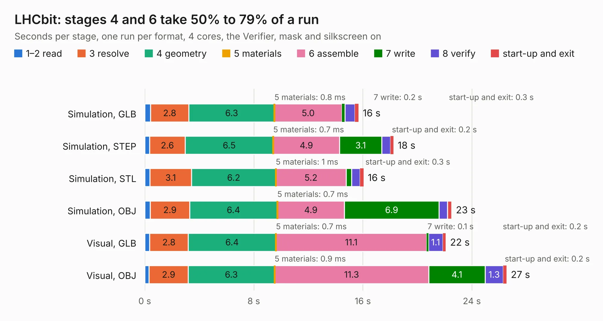

# 1475. LHCbit

Board 1,475 of the 3,121 of [Corpus Testing](../Corpus-Testing.md), on [Corpus Page 14](../CorpusTestingPages/Corpus-Testing-14.md#1475-lhcbit).

| Mode and format | 1–2 read | 3 resolve | 4 geometry | 5 materials | 6 assemble | 7 write | 8 verify | start-up and exit | Total |
|---|---:|---:|---:|---:|---:|---:|---:|---:|---:|
| Simulation, GLB | 0.4 | 2.8 | 6.3 | 0.8&nbsp;ms | 5.0 | 0.2 | 0.7 | 0.3 | 15.7 |
| Simulation, STEP | 0.4 | 2.6 | 6.5 | 0.7&nbsp;ms | 4.9 | 3.1 | 0.6 | 0.2 | 18.2 |
| Simulation, STL | 0.4 | 3.1 | 6.2 | 1&nbsp;ms | 5.2 | 0.4 | 0.6 | 0.3 | 16.1 |
| Simulation, OBJ | 0.4 | 2.9 | 6.4 | 0.7&nbsp;ms | 4.9 | 6.9 | 0.6 | 0.3 | 22.5 |
| Visual, GLB | 0.4 | 2.8 | 6.4 | 0.7&nbsp;ms | 11.1 | 0.1 | 1.1 | 0.2 | 22.1 |
| Visual, OBJ | 0.3 | 2.9 | 6.3 | 0.9&nbsp;ms | 11.3 | 4.1 | 1.3 | 0.2 | 26.5 |

<table align="center"><tr><td valign="top">

| Board | Repo: [lhc/hardware](https://github.com/lhc/hardware) Board: `LHCbit.kicad_pcb` |
|---|---|
| Folder | LHCbit / kicad |
| Complexity | 402&nbsp;/&nbsp;1000 (size&nbsp;197, features&nbsp;205) |
| KESE&nbsp;features | through vias, slotted holes, rounded, trapezoid or chamfered pads, arc tracks, filled zones, copper drawings, curved board outline, TrueType text, stack-up, dielectric εr and tanδ, copper finish, mask and silkscreen colours, castellated pads, plated board edge |
| Tested | 9th November 2026 |
| Copper&nbsp;layers | 4 |
| File&nbsp;format | KiCad 8 (20240108) |
| Parts,&nbsp;tracks,&nbsp;vias | 51, 743, 295 |
| Triangles,&nbsp;simulation | 1,407,910 in 124 parts |
| Verifier | PASS in all six runs |

</td><td valign="top">

<table>
<tr><th>File type</th><th>File size</th><th>Peak memory used</th></tr>
<tr><th colspan="3" align="left">Simulation</th></tr>
<tr><td>GLB</td><td align="right">48&nbsp;MB</td><td align="right">578&nbsp;MB</td></tr>
<tr><td>STEP</td><td align="right">180&nbsp;MB</td><td align="right">681&nbsp;MB</td></tr>
<tr><td>STL</td><td align="right">70&nbsp;MB</td><td align="right">607&nbsp;MB</td></tr>
<tr><td>OBJ</td><td align="right">147&nbsp;MB</td><td align="right">1.0&nbsp;GB</td></tr>
<tr><th colspan="3" align="left">Visual</th></tr>
<tr><td>GLB</td><td align="right">30&nbsp;MB</td><td align="right">667&nbsp;MB</td></tr>
<tr><td>OBJ</td><td align="right">91&nbsp;MB</td><td align="right">721&nbsp;MB</td></tr>
</table>

</td></tr></table>

| Previous | Next |
|:---|---:|
| [1474. rpi-cm4-LiM-board](b1474b_rpi-cm4-LiM-board_hardware-rpi-cm4-LiM-board-KiCad-Files_rpi-cm4-LiM-board_2462.md) | [1476. lhc_tijolo32_board](b1476b_hardware_lhc-tijolo32-board.md) |
