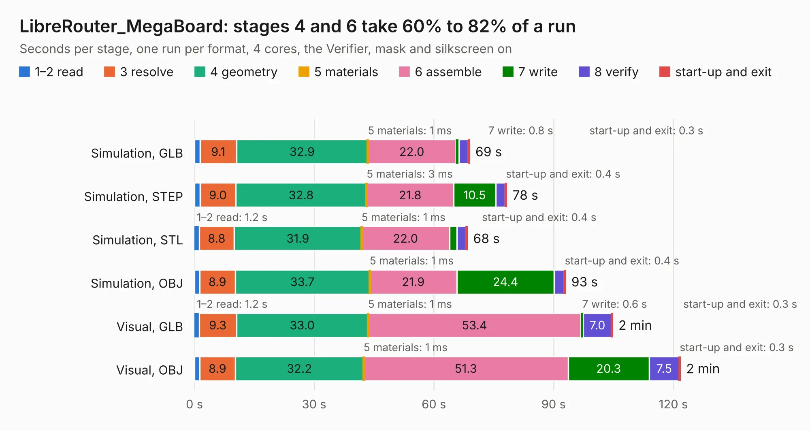

# 1475. LibreRouter_MegaBoard

Board 1,475 of the 3,110 of [Corpus Testing](../Corpus-Testing.md), on [Corpus Page 14](../CorpusTestingPages/Corpus-Testing-14.md#1475-librerouter_megaboard).

| Mode and format | 1–2 read | 3 resolve | 4 geometry | 5 materials | 6 assemble | 7 write | 8 verify | start-up and exit | Total |
|---|---:|---:|---:|---:|---:|---:|---:|---:|---:|
| Simulation, GLB | 1.4 | 9.1 | 32.9 | 1&nbsp;ms | 22.0 | 0.8 | 2.3 | 0.3 | 69.0 |
| Simulation, STEP | 1.4 | 9.0 | 32.8 | 3&nbsp;ms | 21.8 | 10.5 | 2.4 | 0.4 | 78.3 |
| Simulation, STL | 1.2 | 8.8 | 31.9 | 1&nbsp;ms | 22.0 | 1.8 | 2.3 | 0.4 | 68.4 |
| Simulation, OBJ | 1.3 | 8.9 | 33.7 | 1&nbsp;ms | 21.9 | 24.4 | 2.5 | 0.4 | 93.0 |
| Visual, GLB | 1.2 | 9.3 | 33.0 | 1&nbsp;ms | 53.4 | 0.6 | 7.0 | 0.3 | 104.8 |
| Visual, OBJ | 1.3 | 8.9 | 32.2 | 1&nbsp;ms | 51.3 | 20.3 | 7.5 | 0.3 | 121.8 |

<table align="center"><tr><td valign="top">

| Board | Repo: [libremesh/librerouter](https://github.com/libremesh/librerouter) Board: `LibreRouter_MegaBoard.kicad_pcb` |
|---|---|
| Folder | designs / mega_board |
| Complexity | 282&nbsp;/&nbsp;1000 (size&nbsp;227, features&nbsp;55) |
| KESE&nbsp;features | through vias, rounded, trapezoid or chamfered pads, filled zones, curved board outline |
| Tested | 9th November 2026 |
| Copper&nbsp;layers | 2 |
| File&nbsp;format | KiCad 5 (20171130) |
| Parts,&nbsp;tracks,&nbsp;vias | 234, 2,323, 2,552 |
| Triangles,&nbsp;simulation | 4,770,072 in 288 parts |
| Verifier | PASS in all six runs |

</td><td valign="top">

<table>
<tr><th>File type</th><th>File size</th><th>Peak memory used</th></tr>
<tr><th colspan="3" align="left">Simulation</th></tr>
<tr><td>GLB</td><td align="right">164&nbsp;MB</td><td align="right">1.6&nbsp;GB</td></tr>
<tr><td>STEP</td><td align="right">559&nbsp;MB</td><td align="right">2.1&nbsp;GB</td></tr>
<tr><td>STL</td><td align="right">239&nbsp;MB</td><td align="right">1.6&nbsp;GB</td></tr>
<tr><td>OBJ</td><td align="right">510&nbsp;MB</td><td align="right">3.1&nbsp;GB</td></tr>
<tr><th colspan="3" align="left">Visual</th></tr>
<tr><td>GLB</td><td align="right">136&nbsp;MB</td><td align="right">2.2&nbsp;GB</td></tr>
<tr><td>OBJ</td><td align="right">434&nbsp;MB</td><td align="right">2.8&nbsp;GB</td></tr>
</table>

</td></tr></table>

| Previous | Next |
|:---|---:|
| [1474. TestBoard_TPS27SA08-Q1](b1474b_ps-powerdistributionunit_TestBoard-TPS27SA08-Q1.md) | [1476. bms-8s50-ic](b1476b_bms-8s50-ic_bms-8s50-ic.md) |
