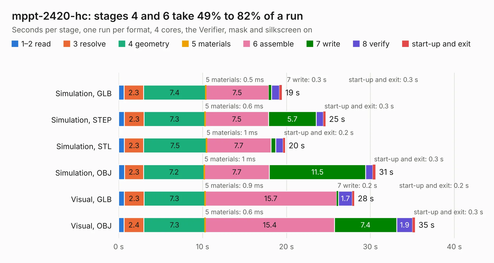

# 1475. mppt-2420-hc

Board 1,475 of the 3,106 of [Corpus Testing](../Corpus-Testing.md), on [Corpus Page 14](../CorpusTestingPages/Corpus-Testing-14.md#1475-mppt-2420-hc).

| Mode and format | 1–2 read | 3 resolve | 4 geometry | 5 materials | 6 assemble | 7 write | 8 verify | start-up and exit | Total |
|---|---:|---:|---:|---:|---:|---:|---:|---:|---:|
| Simulation, GLB | 0.6 | 2.3 | 7.4 | 0.5&nbsp;ms | 7.5 | 0.3 | 0.9 | 0.3 | 19.4 |
| Simulation, STEP | 0.7 | 2.3 | 7.3 | 0.6&nbsp;ms | 7.5 | 5.7 | 0.9 | 0.3 | 24.7 |
| Simulation, STL | 0.7 | 2.3 | 7.5 | 1&nbsp;ms | 7.7 | 0.6 | 0.9 | 0.2 | 19.8 |
| Simulation, OBJ | 0.7 | 2.3 | 7.2 | 1&nbsp;ms | 7.7 | 11.5 | 0.9 | 0.3 | 30.6 |
| Visual, GLB | 0.7 | 2.3 | 7.3 | 0.9&nbsp;ms | 15.7 | 0.2 | 1.7 | 0.2 | 28.1 |
| Visual, OBJ | 0.6 | 2.4 | 7.3 | 0.6&nbsp;ms | 15.4 | 7.4 | 1.9 | 0.3 | 35.3 |

<table align="center"><tr><td valign="top">

| Board | Repo: [LibreSolar/mppt-2420-hc](https://github.com/LibreSolar/mppt-2420-hc) Board: `mppt-2420-hc.kicad_pcb` |
|---|---|
| Folder | kicad |
| Complexity | 307&nbsp;/&nbsp;1000 (size&nbsp;252, features&nbsp;55) |
| KESE&nbsp;features | through vias, rounded, trapezoid or chamfered pads, filled zones, curved board outline |
| Tested | 9th November 2026 |
| Copper&nbsp;layers | 4 |
| File&nbsp;format | KiCad 5 (20171130) |
| Parts,&nbsp;tracks,&nbsp;vias | 140, 1,263, 282 |
| Triangles,&nbsp;simulation | 2,031,356 in 113 parts |
| Verifier | PASS in all six runs |

</td><td valign="top">

<table>
<tr><th>File type</th><th>File size</th><th>Peak memory used</th></tr>
<tr><th colspan="3" align="left">Simulation</th></tr>
<tr><td>GLB</td><td align="right">69&nbsp;MB</td><td align="right">658&nbsp;MB</td></tr>
<tr><td>STEP</td><td align="right">252&nbsp;MB</td><td align="right">834&nbsp;MB</td></tr>
<tr><td>STL</td><td align="right">102&nbsp;MB</td><td align="right">668&nbsp;MB</td></tr>
<tr><td>OBJ</td><td align="right">210&nbsp;MB</td><td align="right">1.4&nbsp;GB</td></tr>
<tr><th colspan="3" align="left">Visual</th></tr>
<tr><td>GLB</td><td align="right">45&nbsp;MB</td><td align="right">818&nbsp;MB</td></tr>
<tr><td>OBJ</td><td align="right">137&nbsp;MB</td><td align="right">994&nbsp;MB</td></tr>
</table>

</td></tr></table>

| Previous | Next |
|:---|---:|
| [1474. mppt-1210-hus](b1474b_mppt-1210-hus_mppt-1210-hus.md) | [1476. mppt-2420-hpx](b1476b_mppt-2420-hpx_mppt-2420-hpx.md) |
