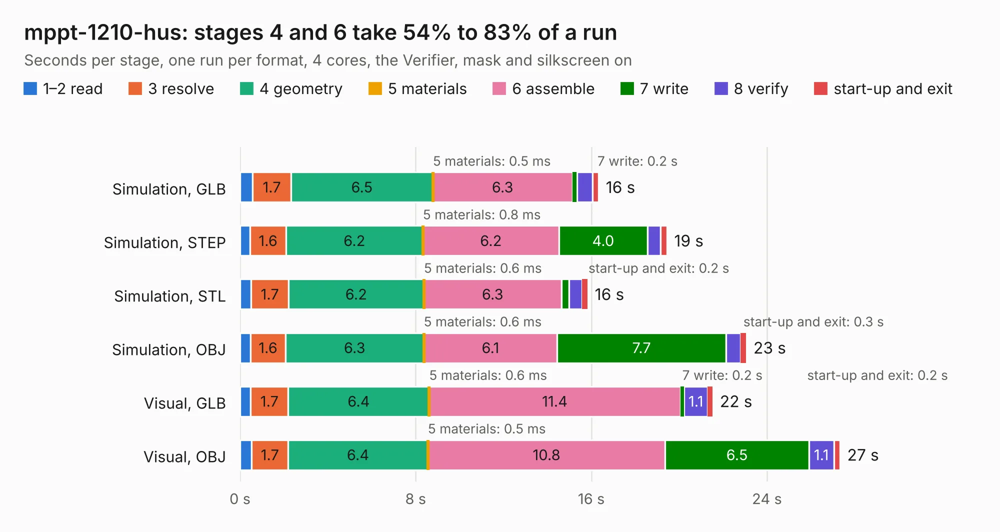

# 1476. mppt-1210-hus

Board 1,476 of the 3,108 of [Corpus Testing](../Corpus-Testing.md), on [Corpus Page 14](../CorpusTestingPages/Corpus-Testing-14.md#1476-mppt-1210-hus).

| Mode and format | 1–2 read | 3 resolve | 4 geometry | 5 materials | 6 assemble | 7 write | 8 verify | start-up and exit | Total |
|---|---:|---:|---:|---:|---:|---:|---:|---:|---:|
| Simulation, GLB | 0.6 | 1.7 | 6.5 | 0.5&nbsp;ms | 6.3 | 0.2 | 0.7 | 0.3 | 16.3 |
| Simulation, STEP | 0.5 | 1.6 | 6.2 | 0.8&nbsp;ms | 6.2 | 4.0 | 0.6 | 0.3 | 19.4 |
| Simulation, STL | 0.5 | 1.7 | 6.2 | 0.6&nbsp;ms | 6.3 | 0.4 | 0.6 | 0.2 | 15.8 |
| Simulation, OBJ | 0.5 | 1.6 | 6.3 | 0.6&nbsp;ms | 6.1 | 7.7 | 0.7 | 0.3 | 23.1 |
| Visual, GLB | 0.5 | 1.7 | 6.4 | 0.6&nbsp;ms | 11.4 | 0.2 | 1.1 | 0.2 | 21.5 |
| Visual, OBJ | 0.5 | 1.7 | 6.4 | 0.5&nbsp;ms | 10.8 | 6.5 | 1.1 | 0.3 | 27.3 |

<table align="center"><tr><td valign="top">

| Board | Repo: [LibreSolar/mppt-1210-hus](https://github.com/LibreSolar/mppt-1210-hus) Board: `mppt-1210-hus.kicad_pcb` |
|---|---|
| Folder | kicad |
| Complexity | 285&nbsp;/&nbsp;1000 (size&nbsp;230, features&nbsp;55) |
| KESE&nbsp;features | through vias, rounded, trapezoid or chamfered pads, filled zones, curved board outline |
| Tested | 9th November 2026 |
| Copper&nbsp;layers | 2 |
| File&nbsp;format | KiCad 5 (20171130) |
| Parts,&nbsp;tracks,&nbsp;vias | 118, 1,023, 212 |
| Triangles,&nbsp;simulation | 1,362,694 in 99 parts |
| Verifier | PASS in all six runs |

</td><td valign="top">

<table>
<tr><th>File type</th><th>File size</th><th>Peak memory used</th></tr>
<tr><th colspan="3" align="left">Simulation</th></tr>
<tr><td>GLB</td><td align="right">47&nbsp;MB</td><td align="right">546&nbsp;MB</td></tr>
<tr><td>STEP</td><td align="right">217&nbsp;MB</td><td align="right">686&nbsp;MB</td></tr>
<tr><td>STL</td><td align="right">68&nbsp;MB</td><td align="right">541&nbsp;MB</td></tr>
<tr><td>OBJ</td><td align="right">140&nbsp;MB</td><td align="right">917&nbsp;MB</td></tr>
<tr><th colspan="3" align="left">Visual</th></tr>
<tr><td>GLB</td><td align="right">39&nbsp;MB</td><td align="right">736&nbsp;MB</td></tr>
<tr><td>OBJ</td><td align="right">116&nbsp;MB</td><td align="right">866&nbsp;MB</td></tr>
</table>

</td></tr></table>

| Previous | Next |
|:---|---:|
| [1475. bms-c1](b1475b_bms-c1_bms-c1.md) | [1477. mppt-2420-hc](b1477b_mppt-2420-hc_mppt-2420-hc.md) |
