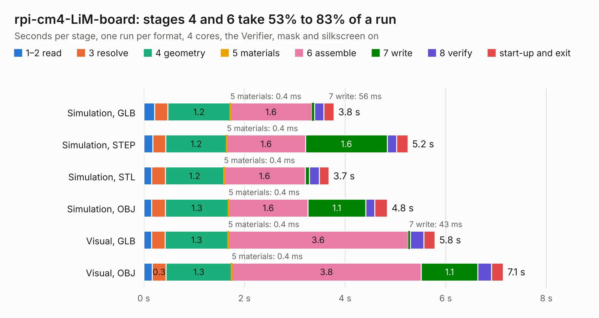

# 1477. rpi-cm4-LiM-board

Board 1,477 of the 3,125 of [Corpus Testing](../Corpus-Testing.md), on [Corpus Page 14](../CorpusTestingPages/Corpus-Testing-14.md#1477-rpi-cm4-lim-board).

| Mode and format | 1–2 read | 3 resolve | 4 geometry | 5 materials | 6 assemble | 7 write | 8 verify | start-up and exit | Total |
|---|---:|---:|---:|---:|---:|---:|---:|---:|---:|
| Simulation, GLB | 0.2 | 0.3 | 1.2 | 0.4&nbsp;ms | 1.6 | 56&nbsp;ms | 0.2 | 0.2 | 3.8 |
| Simulation, STEP | 0.2 | 0.3 | 1.2 | 0.4&nbsp;ms | 1.6 | 1.6 | 0.2 | 0.2 | 5.2 |
| Simulation, STL | 0.2 | 0.3 | 1.2 | 0.4&nbsp;ms | 1.6 | 84&nbsp;ms | 0.2 | 0.2 | 3.7 |
| Simulation, OBJ | 0.2 | 0.3 | 1.3 | 0.4&nbsp;ms | 1.6 | 1.1 | 0.2 | 0.2 | 4.8 |
| Visual, GLB | 0.2 | 0.3 | 1.3 | 0.4&nbsp;ms | 3.6 | 43&nbsp;ms | 0.3 | 0.2 | 5.8 |
| Visual, OBJ | 0.2 | 0.3 | 1.3 | 0.4&nbsp;ms | 3.8 | 1.1 | 0.3 | 0.2 | 7.1 |

<table align="center"><tr><td valign="top">

| Board | Repo: [l00nix/rpi-cm4-LiM-board](https://github.com/l00nix/rpi-cm4-LiM-board) Board: `rpi-cm4-LiM-board.kicad_pcb` |
|---|---|
| Folder | hardware / rpi-cm4-LiM-board / KiCad Files |
| Complexity | 260&nbsp;/&nbsp;1000 (size&nbsp;135, features&nbsp;125) |
| KESE&nbsp;features | through vias, slotted holes, custom pads, rounded, trapezoid or chamfered pads, filled zones, copper drawings, curved board outline, stack-up, dielectric εr and tanδ, mask and silkscreen colours |
| Tested | 9th November 2026 |
| Copper&nbsp;layers | 2 |
| File&nbsp;format | KiCad 6 (20210424) |
| Parts,&nbsp;tracks,&nbsp;vias | 11, 147, 36 |
| Triangles,&nbsp;simulation | 258,546 in 165 parts |
| Verifier | PASS in all six runs |

</td><td valign="top">

<table>
<tr><th>File type</th><th>File size</th><th>Peak memory used</th></tr>
<tr><th colspan="3" align="left">Simulation</th></tr>
<tr><td>GLB</td><td align="right">9.4&nbsp;MB</td><td align="right">270&nbsp;MB</td></tr>
<tr><td>STEP</td><td align="right">60&nbsp;MB</td><td align="right">285&nbsp;MB</td></tr>
<tr><td>STL</td><td align="right">13&nbsp;MB</td><td align="right">266&nbsp;MB</td></tr>
<tr><td>OBJ</td><td align="right">27&nbsp;MB</td><td align="right">265&nbsp;MB</td></tr>
<tr><th colspan="3" align="left">Visual</th></tr>
<tr><td>GLB</td><td align="right">8.3&nbsp;MB</td><td align="right">289&nbsp;MB</td></tr>
<tr><td>OBJ</td><td align="right">24&nbsp;MB</td><td align="right">287&nbsp;MB</td></tr>
</table>

</td></tr></table>

| Previous | Next |
|:---|---:|
| [1476. rpi-cm4-LiM+-board](b1476b_rpi-cm4-LiM-board_hardware-rpi-cm4-LiM-board-KiCad-Files_rpi-cm4-LiM-board_2262.md) | [1478. LHCbit](b1478b_hardware_LHCbit.md) |
