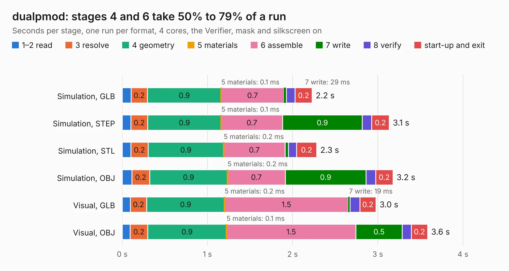

# 1481. dualpmod

Board 1,481 of the 3,108 of [Corpus Testing](../Corpus-Testing.md), on [Corpus Page 14](../CorpusTestingPages/Corpus-Testing-14.md#1481-dualpmod).

| Mode and format | 1–2 read | 3 resolve | 4 geometry | 5 materials | 6 assemble | 7 write | 8 verify | start-up and exit | Total |
|---|---:|---:|---:|---:|---:|---:|---:|---:|---:|
| Simulation, GLB | 0.1 | 0.2 | 0.9 | 0.1&nbsp;ms | 0.7 | 29&nbsp;ms | 0.1 | 0.2 | 2.2 |
| Simulation, STEP | 0.1 | 0.2 | 0.9 | 0.1&nbsp;ms | 0.7 | 0.9 | 0.1 | 0.2 | 3.1 |
| Simulation, STL | 0.1 | 0.2 | 0.9 | 0.2&nbsp;ms | 0.7 | 38&nbsp;ms | 97&nbsp;ms | 0.2 | 2.3 |
| Simulation, OBJ | 0.1 | 0.2 | 0.9 | 0.2&nbsp;ms | 0.7 | 0.9 | 0.1 | 0.2 | 3.2 |
| Visual, GLB | 97&nbsp;ms | 0.2 | 0.9 | 0.2&nbsp;ms | 1.5 | 19&nbsp;ms | 0.1 | 0.2 | 3.0 |
| Visual, OBJ | 92&nbsp;ms | 0.2 | 0.9 | 0.1&nbsp;ms | 1.5 | 0.5 | 0.1 | 0.2 | 3.6 |

<table align="center"><tr><td valign="top">

| Board | Repo: [lowRISC/sonata-system](https://github.com/lowRISC/sonata-system) Board: `dualpmod.kicad_pcb` |
|---|---|
| Folder | vendor / lowrisc_ip / ip / usbdev / pmod / dualpmod-kicad |
| Complexity | 185&nbsp;/&nbsp;1000 (size&nbsp;130, features&nbsp;55) |
| KESE&nbsp;features | through vias, slotted holes, rounded, trapezoid or chamfered pads, filled zones |
| Tested | 9th November 2026 |
| Copper&nbsp;layers | 2 |
| File&nbsp;format | KiCad 5 (20171130) |
| Parts,&nbsp;tracks,&nbsp;vias | 13, 129, 17 |
| Triangles,&nbsp;simulation | 177,628 in 28 parts |
| Verifier | PASS in all six runs |

</td><td valign="top">

<table>
<tr><th>File type</th><th>File size</th><th>Peak memory used</th></tr>
<tr><th colspan="3" align="left">Simulation</th></tr>
<tr><td>GLB</td><td align="right">6.3&nbsp;MB</td><td align="right">207&nbsp;MB</td></tr>
<tr><td>STEP</td><td align="right">33&nbsp;MB</td><td align="right">216&nbsp;MB</td></tr>
<tr><td>STL</td><td align="right">8.9&nbsp;MB</td><td align="right">209&nbsp;MB</td></tr>
<tr><td>OBJ</td><td align="right">18&nbsp;MB</td><td align="right">211&nbsp;MB</td></tr>
<tr><th colspan="3" align="left">Visual</th></tr>
<tr><td>GLB</td><td align="right">3.9&nbsp;MB</td><td align="right">168&nbsp;MB</td></tr>
<tr><td>OBJ</td><td align="right">11&nbsp;MB</td><td align="right">171&nbsp;MB</td></tr>
</table>

</td></tr></table>

| Previous | Next |
|:---|---:|
| [1480. Issue3B](b1480b_ZX-Spectrum-48K-Issue-3B-Based-on-Gerbers-by-PABB-on-PCBWay_Issue3B.md) | [1482. ad9864_breakout](b1482b_vna_ad9864-breakout.md) |
