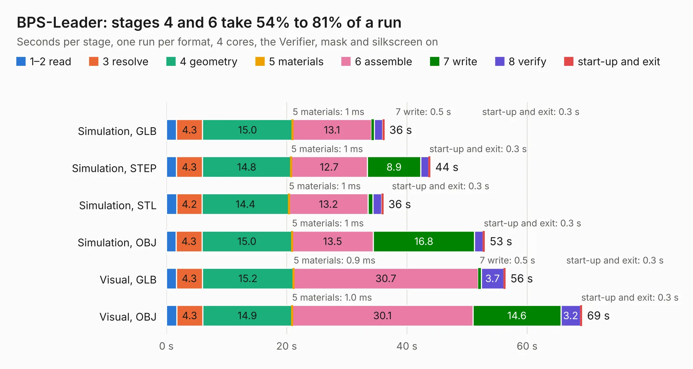

# 1482. BPS-Leader

Board 1,482 of the 3,123 of [Corpus Testing](../Corpus-Testing.md), on [Corpus Page 14](../CorpusTestingPages/Corpus-Testing-14.md#1482-bps-leader).

| Mode and format | 1–2 read | 3 resolve | 4 geometry | 5 materials | 6 assemble | 7 write | 8 verify | start-up and exit | Total |
|---|---:|---:|---:|---:|---:|---:|---:|---:|---:|
| Simulation, GLB | 1.7 | 4.3 | 15.0 | 1&nbsp;ms | 13.1 | 0.5 | 1.4 | 0.3 | 36.3 |
| Simulation, STEP | 1.7 | 4.3 | 14.8 | 1&nbsp;ms | 12.7 | 8.9 | 1.3 | 0.3 | 43.9 |
| Simulation, STL | 1.7 | 4.2 | 14.4 | 1&nbsp;ms | 13.2 | 0.8 | 1.4 | 0.3 | 36.1 |
| Simulation, OBJ | 1.6 | 4.3 | 15.0 | 1&nbsp;ms | 13.5 | 16.8 | 1.4 | 0.3 | 52.9 |
| Visual, GLB | 1.7 | 4.3 | 15.2 | 0.9&nbsp;ms | 30.7 | 0.5 | 3.7 | 0.3 | 56.4 |
| Visual, OBJ | 1.7 | 4.3 | 14.9 | 1.0&nbsp;ms | 30.1 | 14.6 | 3.2 | 0.3 | 69.1 |

<table align="center"><tr><td valign="top">

| Board | Repo: [lhr-solar/ps-bpsleader](https://github.com/lhr-solar/ps-bpsleader) Board: `BPS-Leader.kicad_pcb` |
|---|---|
| Folder | Hardware |
| Complexity | 344&nbsp;/&nbsp;1000 (size&nbsp;209, features&nbsp;135) |
| KESE&nbsp;features | through vias, slotted holes, custom pads, rounded, trapezoid or chamfered pads, filled zones, copper drawings, curved board outline, TrueType text, stack-up, dielectric εr and tanδ |
| Tested | 9th November 2026 |
| Copper&nbsp;layers | 2 |
| File&nbsp;format | KiCad 9 (20241229) |
| Parts,&nbsp;tracks,&nbsp;vias | 225, 1,999, 475 |
| Triangles,&nbsp;simulation | 2,710,942 in 222 parts |
| Verifier | PASS in all six runs |

</td><td valign="top">

<table>
<tr><th>File type</th><th>File size</th><th>Peak memory used</th></tr>
<tr><th colspan="3" align="left">Simulation</th></tr>
<tr><td>GLB</td><td align="right">95&nbsp;MB</td><td align="right">972&nbsp;MB</td></tr>
<tr><td>STEP</td><td align="right">496&nbsp;MB</td><td align="right">1.2&nbsp;GB</td></tr>
<tr><td>STL</td><td align="right">136&nbsp;MB</td><td align="right">960&nbsp;MB</td></tr>
<tr><td>OBJ</td><td align="right">290&nbsp;MB</td><td align="right">1.9&nbsp;GB</td></tr>
<tr><th colspan="3" align="left">Visual</th></tr>
<tr><td>GLB</td><td align="right">82&nbsp;MB</td><td align="right">1.4&nbsp;GB</td></tr>
<tr><td>OBJ</td><td align="right">253&nbsp;MB</td><td align="right">1.8&nbsp;GB</td></tr>
</table>

</td></tr></table>

| Previous | Next |
|:---|---:|
| [1481. BPS-Minion](b1481b_bps-voltagepcb_BPS-Minion.md) | [1483. PowerDistributionUnit](b1483b_ps-powerdistributionunit_PowerDistributionUnit.md) |
