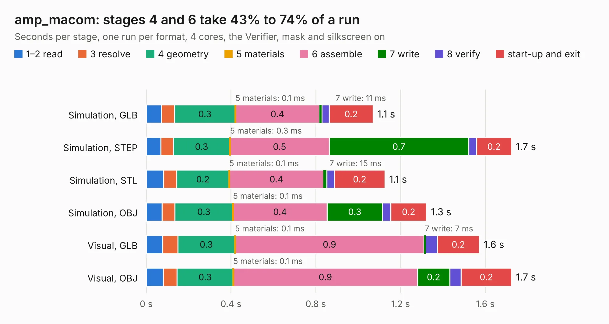

# 1484. amp_macom

Board 1,484 of the 3,100 of [Corpus Testing](../Corpus-Testing.md), on [Corpus Page 14](../CorpusTestingPages/Corpus-Testing-14.md#1484-amp_macom).

| Mode and format | 1–2 read | 3 resolve | 4 geometry | 5 materials | 6 assemble | 7 write | 8 verify | start-up and exit | Total |
|---|---:|---:|---:|---:|---:|---:|---:|---:|---:|
| Simulation, GLB | 72&nbsp;ms | 61&nbsp;ms | 0.3 | 0.1&nbsp;ms | 0.4 | 11&nbsp;ms | 35&nbsp;ms | 0.2 | 1.1 |
| Simulation, STEP | 69&nbsp;ms | 59&nbsp;ms | 0.3 | 0.3&nbsp;ms | 0.5 | 0.7 | 36&nbsp;ms | 0.2 | 1.7 |
| Simulation, STL | 82&nbsp;ms | 62&nbsp;ms | 0.2 | 0.1&nbsp;ms | 0.4 | 15&nbsp;ms | 37&nbsp;ms | 0.2 | 1.1 |
| Simulation, OBJ | 75&nbsp;ms | 60&nbsp;ms | 0.3 | 0.1&nbsp;ms | 0.4 | 0.3 | 38&nbsp;ms | 0.2 | 1.3 |
| Visual, GLB | 77&nbsp;ms | 72&nbsp;ms | 0.3 | 0.1&nbsp;ms | 0.9 | 7&nbsp;ms | 56&nbsp;ms | 0.2 | 1.6 |
| Visual, OBJ | 81&nbsp;ms | 65&nbsp;ms | 0.3 | 0.1&nbsp;ms | 0.9 | 0.2 | 54&nbsp;ms | 0.2 | 1.7 |

<table align="center"><tr><td valign="top">

| Board | Repo: [loxodes/vna](https://github.com/loxodes/vna) Board: `amp_macom.kicad_pcb` |
|---|---|
| Folder | breakouts / amp_macom |
| Complexity | 160&nbsp;/&nbsp;1000 (size&nbsp;125, features&nbsp;35) |
| KESE&nbsp;features | through vias, filled zones |
| Tested | 9th November 2026 |
| Copper&nbsp;layers | 4 |
| File&nbsp;format | KiCad 4 (4) |
| Parts,&nbsp;tracks,&nbsp;vias | 8, 43, 6 |
| Triangles,&nbsp;simulation | 63,682 in 19 parts |
| Verifier | PASS in all six runs |

</td><td valign="top">

<table>
<tr><th>File type</th><th>File size</th><th>Peak memory used</th></tr>
<tr><th colspan="3" align="left">Simulation</th></tr>
<tr><td>GLB</td><td align="right">2.3&nbsp;MB</td><td align="right">166&nbsp;MB</td></tr>
<tr><td>STEP</td><td align="right">9.5&nbsp;MB</td><td align="right">170&nbsp;MB</td></tr>
<tr><td>STL</td><td align="right">3.2&nbsp;MB</td><td align="right">169&nbsp;MB</td></tr>
<tr><td>OBJ</td><td align="right">6.3&nbsp;MB</td><td align="right">171&nbsp;MB</td></tr>
<tr><th colspan="3" align="left">Visual</th></tr>
<tr><td>GLB</td><td align="right">1.3&nbsp;MB</td><td align="right">154&nbsp;MB</td></tr>
<tr><td>OBJ</td><td align="right">3.6&nbsp;MB</td><td align="right">154&nbsp;MB</td></tr>
</table>

</td></tr></table>

| Previous | Next |
|:---|---:|
| [1483. amp_cpw_hmc311](b1483b_vna_amp-cpw-hmc311.md) | [1485. amp_macom_vga](b1485b_vna_amp-macom-vga.md) |
