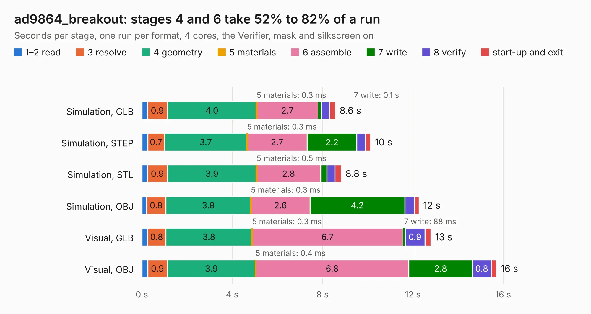

# 1485. ad9864_breakout

Board 1,485 of the 3,111 of [Corpus Testing](../Corpus-Testing.md), on [Corpus Page 14](../CorpusTestingPages/Corpus-Testing-14.md#1485-ad9864_breakout).

| Mode and format | 1–2 read | 3 resolve | 4 geometry | 5 materials | 6 assemble | 7 write | 8 verify | start-up and exit | Total |
|---|---:|---:|---:|---:|---:|---:|---:|---:|---:|
| Simulation, GLB | 0.2 | 0.9 | 4.0 | 0.3&nbsp;ms | 2.7 | 0.1 | 0.4 | 0.3 | 8.6 |
| Simulation, STEP | 0.3 | 0.7 | 3.7 | 0.3&nbsp;ms | 2.7 | 2.2 | 0.4 | 0.2 | 10.1 |
| Simulation, STL | 0.2 | 0.9 | 3.9 | 0.5&nbsp;ms | 2.8 | 0.3 | 0.4 | 0.3 | 8.8 |
| Simulation, OBJ | 0.2 | 0.8 | 3.8 | 0.3&nbsp;ms | 2.6 | 4.2 | 0.4 | 0.2 | 12.3 |
| Visual, GLB | 0.2 | 0.8 | 3.8 | 0.3&nbsp;ms | 6.7 | 88&nbsp;ms | 0.9 | 0.3 | 12.8 |
| Visual, OBJ | 0.3 | 0.9 | 3.9 | 0.4&nbsp;ms | 6.8 | 2.8 | 0.8 | 0.2 | 15.7 |

<table align="center"><tr><td valign="top">

| Board | Repo: [loxodes/vna](https://github.com/loxodes/vna) Board: `ad9864_breakout.kicad_pcb` |
|---|---|
| Folder | breakouts / ad9864 |
| Complexity | 264&nbsp;/&nbsp;1000 (size&nbsp;229, features&nbsp;35) |
| KESE&nbsp;features | through vias, filled zones |
| Tested | 9th November 2026 |
| Copper&nbsp;layers | 4 |
| File&nbsp;format | KiCad 4 (4) |
| Parts,&nbsp;tracks,&nbsp;vias | 82, 476, 74 |
| Triangles,&nbsp;simulation | 859,342 in 73 parts |
| Verifier | PASS in all six runs |

</td><td valign="top">

<table>
<tr><th>File type</th><th>File size</th><th>Peak memory used</th></tr>
<tr><th colspan="3" align="left">Simulation</th></tr>
<tr><td>GLB</td><td align="right">30&nbsp;MB</td><td align="right">384&nbsp;MB</td></tr>
<tr><td>STEP</td><td align="right">128&nbsp;MB</td><td align="right">434&nbsp;MB</td></tr>
<tr><td>STL</td><td align="right">43&nbsp;MB</td><td align="right">395&nbsp;MB</td></tr>
<tr><td>OBJ</td><td align="right">89&nbsp;MB</td><td align="right">633&nbsp;MB</td></tr>
<tr><th colspan="3" align="left">Visual</th></tr>
<tr><td>GLB</td><td align="right">19&nbsp;MB</td><td align="right">460&nbsp;MB</td></tr>
<tr><td>OBJ</td><td align="right">56&nbsp;MB</td><td align="right">461&nbsp;MB</td></tr>
</table>

</td></tr></table>

| Previous | Next |
|:---|---:|
| [1484. dualpmod](b1484b_sonata-system_dualpmod.md) | [1486. adc32xx_syzygy](b1486b_vna_adc32xx-syzygy.md) |
