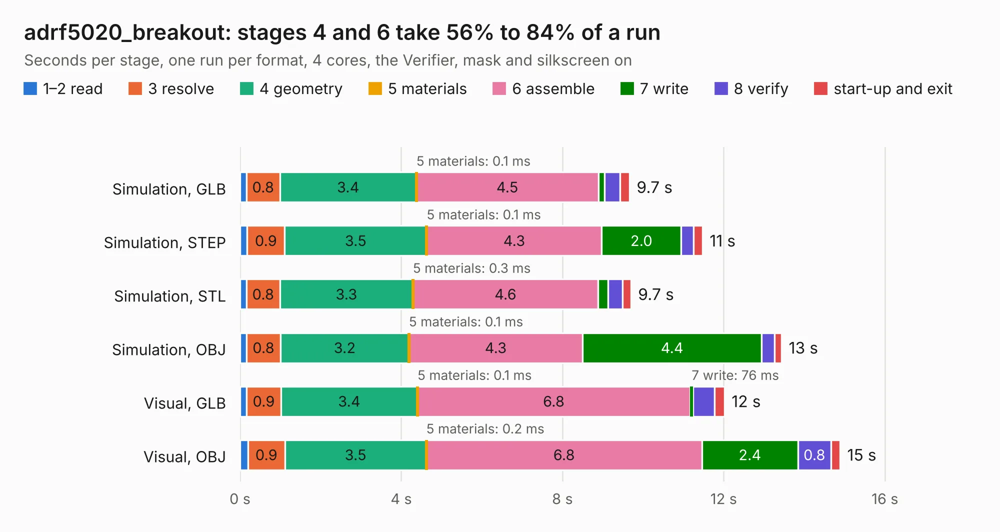

# 1486. adrf5020_breakout

Board 1,486 of the 3,106 of [Corpus Testing](../Corpus-Testing.md), on [Corpus Page 14](../CorpusTestingPages/Corpus-Testing-14.md#1486-adrf5020_breakout).

| Mode and format | 1–2 read | 3 resolve | 4 geometry | 5 materials | 6 assemble | 7 write | 8 verify | start-up and exit | Total |
|---|---:|---:|---:|---:|---:|---:|---:|---:|---:|
| Simulation, GLB | 0.2 | 0.8 | 3.4 | 0.1&nbsp;ms | 4.5 | 0.2 | 0.4 | 0.2 | 9.7 |
| Simulation, STEP | 0.2 | 0.9 | 3.5 | 0.1&nbsp;ms | 4.3 | 2.0 | 0.3 | 0.2 | 11.5 |
| Simulation, STL | 0.2 | 0.8 | 3.3 | 0.3&nbsp;ms | 4.6 | 0.2 | 0.4 | 0.2 | 9.7 |
| Simulation, OBJ | 0.2 | 0.8 | 3.2 | 0.1&nbsp;ms | 4.3 | 4.4 | 0.3 | 0.2 | 13.4 |
| Visual, GLB | 0.2 | 0.9 | 3.4 | 0.1&nbsp;ms | 6.8 | 76&nbsp;ms | 0.5 | 0.2 | 12.0 |
| Visual, OBJ | 0.2 | 0.9 | 3.5 | 0.2&nbsp;ms | 6.8 | 2.4 | 0.8 | 0.2 | 14.9 |

<table align="center"><tr><td valign="top">

| Board | Repo: [loxodes/vna](https://github.com/loxodes/vna) Board: `adrf5020_breakout.kicad_pcb` |
|---|---|
| Folder | breakouts / adrf5020_breakout |
| Complexity | 175&nbsp;/&nbsp;1000 (size&nbsp;140, features&nbsp;35) |
| KESE&nbsp;features | through vias, filled zones |
| Tested | 9th November 2026 |
| Copper&nbsp;layers | 4 |
| File&nbsp;format | KiCad 4 (4) |
| Parts,&nbsp;tracks,&nbsp;vias | 18, 78, 5 |
| Triangles,&nbsp;simulation | 1,154,838 in 28 parts |
| Verifier | PASS in all six runs |

</td><td valign="top">

<table>
<tr><th>File type</th><th>File size</th><th>Peak memory used</th></tr>
<tr><th colspan="3" align="left">Simulation</th></tr>
<tr><td>GLB</td><td align="right">39&nbsp;MB</td><td align="right">488&nbsp;MB</td></tr>
<tr><td>STEP</td><td align="right">106&nbsp;MB</td><td align="right">615&nbsp;MB</td></tr>
<tr><td>STL</td><td align="right">58&nbsp;MB</td><td align="right">516&nbsp;MB</td></tr>
<tr><td>OBJ</td><td align="right">115&nbsp;MB</td><td align="right">775&nbsp;MB</td></tr>
<tr><th colspan="3" align="left">Visual</th></tr>
<tr><td>GLB</td><td align="right">20&nbsp;MB</td><td align="right">561&nbsp;MB</td></tr>
<tr><td>OBJ</td><td align="right">61&nbsp;MB</td><td align="right">563&nbsp;MB</td></tr>
</table>

</td></tr></table>

| Previous | Next |
|:---|---:|
| [1485. adc_dual](b1485b_vna_adc-dual.md) | [1487. ammp6120_breakout](b1487b_vna_ammp6120-breakout.md) |
