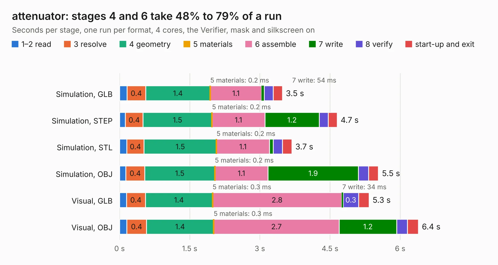

# 1487. attenuator

Board 1,487 of the 3,101 of [Corpus Testing](../Corpus-Testing.md), on [Corpus Page 14](../CorpusTestingPages/Corpus-Testing-14.md#1487-attenuator).

| Mode and format | 1–2 read | 3 resolve | 4 geometry | 5 materials | 6 assemble | 7 write | 8 verify | start-up and exit | Total |
|---|---:|---:|---:|---:|---:|---:|---:|---:|---:|
| Simulation, GLB | 0.2 | 0.4 | 1.4 | 0.2&nbsp;ms | 1.1 | 54&nbsp;ms | 0.2 | 0.2 | 3.5 |
| Simulation, STEP | 0.1 | 0.4 | 1.5 | 0.2&nbsp;ms | 1.1 | 1.2 | 0.2 | 0.2 | 4.7 |
| Simulation, STL | 0.2 | 0.4 | 1.5 | 0.2&nbsp;ms | 1.1 | 81&nbsp;ms | 0.2 | 0.2 | 3.7 |
| Simulation, OBJ | 0.1 | 0.4 | 1.5 | 0.2&nbsp;ms | 1.1 | 1.9 | 0.2 | 0.2 | 5.5 |
| Visual, GLB | 0.1 | 0.4 | 1.4 | 0.3&nbsp;ms | 2.8 | 34&nbsp;ms | 0.3 | 0.2 | 5.3 |
| Visual, OBJ | 0.2 | 0.4 | 1.4 | 0.3&nbsp;ms | 2.7 | 1.2 | 0.2 | 0.2 | 6.4 |

<table align="center"><tr><td valign="top">

| Board | Repo: [loxodes/vna](https://github.com/loxodes/vna) Board: `attenuator.kicad_pcb` |
|---|---|
| Folder | breakouts / attenuator |
| Complexity | 204&nbsp;/&nbsp;1000 (size&nbsp;169, features&nbsp;35) |
| KESE&nbsp;features | through vias, filled zones |
| Tested | 9th November 2026 |
| Copper&nbsp;layers | 4 |
| File&nbsp;format | KiCad 4 (4) |
| Parts,&nbsp;tracks,&nbsp;vias | 36, 232, 41 |
| Triangles,&nbsp;simulation | 357,776 in 47 parts |
| Verifier | PASS in all six runs |

</td><td valign="top">

<table>
<tr><th>File type</th><th>File size</th><th>Peak memory used</th></tr>
<tr><th colspan="3" align="left">Simulation</th></tr>
<tr><td>GLB</td><td align="right">13&nbsp;MB</td><td align="right">247&nbsp;MB</td></tr>
<tr><td>STEP</td><td align="right">47&nbsp;MB</td><td align="right">264&nbsp;MB</td></tr>
<tr><td>STL</td><td align="right">18&nbsp;MB</td><td align="right">236&nbsp;MB</td></tr>
<tr><td>OBJ</td><td align="right">37&nbsp;MB</td><td align="right">290&nbsp;MB</td></tr>
<tr><th colspan="3" align="left">Visual</th></tr>
<tr><td>GLB</td><td align="right">7.9&nbsp;MB</td><td align="right">248&nbsp;MB</td></tr>
<tr><td>OBJ</td><td align="right">23&nbsp;MB</td><td align="right">240&nbsp;MB</td></tr>
</table>

</td></tr></table>

| Previous | Next |
|:---|---:|
| [1486. amp_macom_vga](b1486b_vna_amp-macom-vga.md) | [1488. balun](b1488b_vna_balun.md) |
