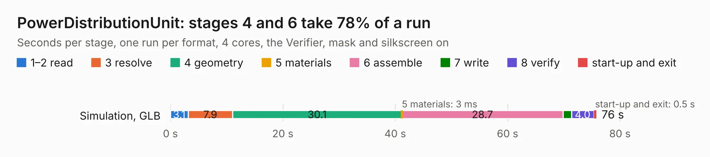

# 1488. PowerDistributionUnit

Board 1,488 of the 3,131 of [Corpus Testing](../Corpus-Testing.md), on [Corpus Page 14](../CorpusTestingPages/Corpus-Testing-14.md#1488-powerdistributionunit).

| Mode and format | 1–2 read | 3 resolve | 4 geometry | 5 materials | 6 assemble | 7 write | 8 verify | start-up and exit | Total |
|---|---:|---:|---:|---:|---:|---:|---:|---:|---:|
| Simulation, GLB | 3.1 | 7.9 | 30.1 | 3&nbsp;ms | 28.7 | 1.5 | 4.0 | 0.5 | 75.8 |
| Simulation, STEP | 3.3 | 7.9 | 31.0 | 4&nbsp;ms | 29.9 | 21.1 | 4.6 | 0.5 | 98.3 |
| Simulation, STL | 3.1 | 8.2 | 32.4 | 3&nbsp;ms | 31.5 | 3.5 | 4.1 | 0.5 | 83.3 |
| Simulation, OBJ | 3.1 | 8.1 | 31.4 | 2&nbsp;ms | 32.1 | 44.8 | 4.4 | 0.5 | 124.4 |
| Visual, GLB | 3.3 | 8.0 | 31.4 | 3&nbsp;ms | 84.8 | 0.8 | 10.8 | 0.4 | 139.5 |
| Visual, OBJ | 3.2 | 8.0 | 30.6 | 2&nbsp;ms | 81.7 | 26.7 | 10.7 | 0.4 | 161.3 |

<table align="center"><tr><td valign="top">

| Board | Repo: [lhr-solar/ps-powerdistributionunit](https://github.com/lhr-solar/ps-powerdistributionunit) Board: `PowerDistributionUnit.kicad_pcb` |
|---|---|
| Folder | hardware / archive / PowerDistributionUnit_TPS25983 |
| Complexity | 423&nbsp;/&nbsp;1000 (size&nbsp;298, features&nbsp;125) |
| KESE&nbsp;features | through vias, custom pads, rounded, trapezoid or chamfered pads, filled zones, copper drawings, curved board outline, knockout text, stack-up, dielectric εr and tanδ |
| Tested | 9th November 2026 |
| Copper&nbsp;layers | 4 |
| File&nbsp;format | KiCad 9 (20241229) |
| Parts,&nbsp;tracks,&nbsp;vias | 693, 5,070, 989 |
| Triangles,&nbsp;simulation | 7,888,204 in 445 parts |
| Verifier | PASS in all six runs |

</td><td valign="top">

<table>
<tr><th>File type</th><th>File size</th><th>Peak memory used</th></tr>
<tr><th colspan="3" align="left">Simulation</th></tr>
<tr><td>GLB</td><td align="right">265&nbsp;MB</td><td align="right">2.3&nbsp;GB</td></tr>
<tr><td>STEP</td><td align="right">1.1&nbsp;GB</td><td align="right">2.7&nbsp;GB</td></tr>
<tr><td>STL</td><td align="right">394&nbsp;MB</td><td align="right">2.5&nbsp;GB</td></tr>
<tr><td>OBJ</td><td align="right">838&nbsp;MB</td><td align="right">4.9&nbsp;GB</td></tr>
<tr><th colspan="3" align="left">Visual</th></tr>
<tr><td>GLB</td><td align="right">170&nbsp;MB</td><td align="right">2.7&nbsp;GB</td></tr>
<tr><td>OBJ</td><td align="right">546&nbsp;MB</td><td align="right">3.4&nbsp;GB</td></tr>
</table>

</td></tr></table>

| Previous | Next |
|:---|---:|
| [1487. BPS-Leader](b1487b_ps-bpsleader_BPS-Leader.md) | [1489. PowerDistributionUnit_Mk1](b1489b_ps-powerdistributionunit_PowerDistributionUnit-Mk1.md) |
