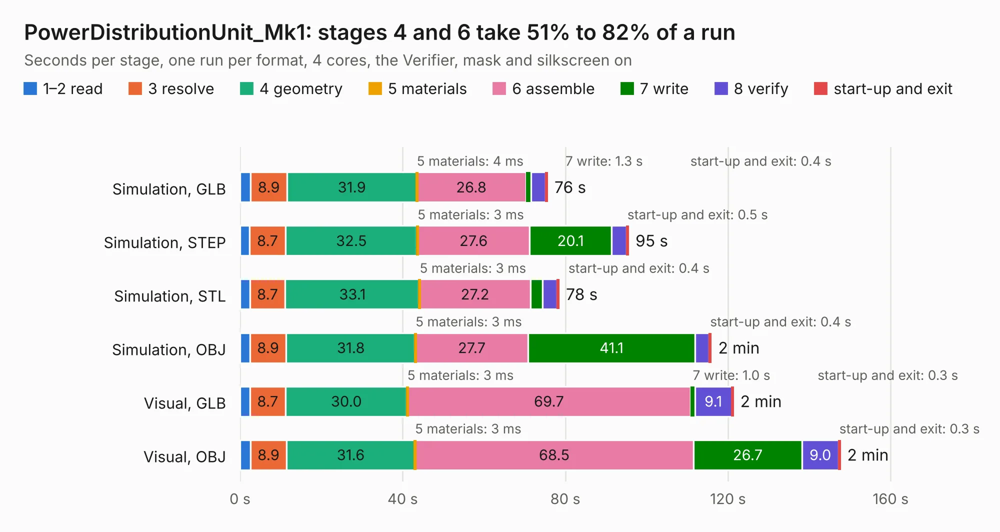

# 1489. PowerDistributionUnit_Mk1

Board 1,489 of the 3,131 of [Corpus Testing](../Corpus-Testing.md), on [Corpus Page 14](../CorpusTestingPages/Corpus-Testing-14.md#1489-powerdistributionunit_mk1).

| Mode and format | 1–2 read | 3 resolve | 4 geometry | 5 materials | 6 assemble | 7 write | 8 verify | start-up and exit | Total |
|---|---:|---:|---:|---:|---:|---:|---:|---:|---:|
| Simulation, GLB | 2.6 | 8.9 | 31.9 | 4&nbsp;ms | 26.8 | 1.3 | 3.6 | 0.4 | 75.6 |
| Simulation, STEP | 2.4 | 8.7 | 32.5 | 3&nbsp;ms | 27.6 | 20.1 | 3.7 | 0.5 | 95.5 |
| Simulation, STL | 2.4 | 8.7 | 33.1 | 3&nbsp;ms | 27.2 | 3.0 | 3.6 | 0.4 | 78.4 |
| Simulation, OBJ | 2.4 | 8.9 | 31.8 | 3&nbsp;ms | 27.7 | 41.1 | 3.5 | 0.4 | 115.8 |
| Visual, GLB | 2.4 | 8.7 | 30.0 | 3&nbsp;ms | 69.7 | 1.0 | 9.1 | 0.3 | 121.3 |
| Visual, OBJ | 2.6 | 8.9 | 31.6 | 3&nbsp;ms | 68.5 | 26.7 | 9.0 | 0.3 | 147.5 |

<table align="center"><tr><td valign="top">

| Board | Repo: [lhr-solar/ps-powerdistributionunit](https://github.com/lhr-solar/ps-powerdistributionunit) Board: `PowerDistributionUnit_Mk1.kicad_pcb` |
|---|---|
| Folder | hardware / PowerDistributionUnit_Mk1 |
| Complexity | 440&nbsp;/&nbsp;1000 (size&nbsp;315, features&nbsp;125) |
| KESE&nbsp;features | through vias, custom pads, rounded, trapezoid or chamfered pads, filled zones, copper drawings, curved board outline, knockout text, stack-up, dielectric εr and tanδ |
| Tested | 9th November 2026 |
| Copper&nbsp;layers | 4 |
| File&nbsp;format | KiCad 9 (20241229) |
| Parts,&nbsp;tracks,&nbsp;vias | 518, 5,195, 762 |
| Triangles,&nbsp;simulation | 7,549,914 in 514 parts |
| Verifier | PASS in all six runs |

</td><td valign="top">

<table>
<tr><th>File type</th><th>File size</th><th>Peak memory used</th></tr>
<tr><th colspan="3" align="left">Simulation</th></tr>
<tr><td>GLB</td><td align="right">256&nbsp;MB</td><td align="right">2.2&nbsp;GB</td></tr>
<tr><td>STEP</td><td align="right">1.1&nbsp;GB</td><td align="right">2.7&nbsp;GB</td></tr>
<tr><td>STL</td><td align="right">378&nbsp;MB</td><td align="right">2.2&nbsp;GB</td></tr>
<tr><td>OBJ</td><td align="right">809&nbsp;MB</td><td align="right">4.8&nbsp;GB</td></tr>
<tr><th colspan="3" align="left">Visual</th></tr>
<tr><td>GLB</td><td align="right">178&nbsp;MB</td><td align="right">2.7&nbsp;GB</td></tr>
<tr><td>OBJ</td><td align="right">572&nbsp;MB</td><td align="right">3.5&nbsp;GB</td></tr>
</table>

</td></tr></table>

| Previous | Next |
|:---|---:|
| [1488. PowerDistributionUnit](b1488b_ps-powerdistributionunit_PowerDistributionUnit.md) | [1490. TestBoard_TPS27SA08-Q1](b1490b_ps-powerdistributionunit_TestBoard-TPS27SA08-Q1.md) |
