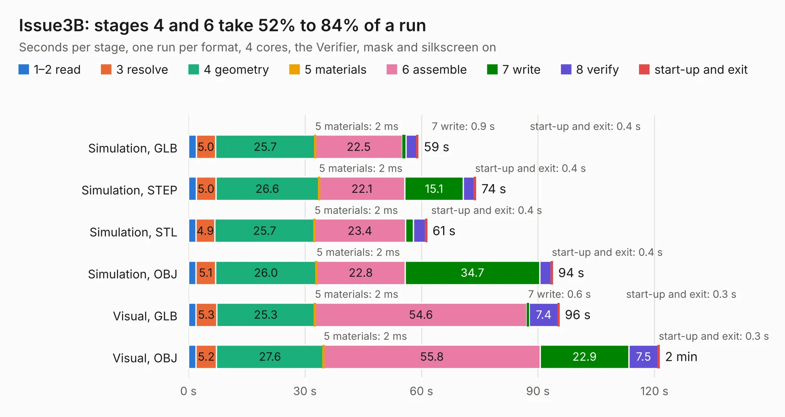

# 1491. Issue3B

Board 1,491 of the 3,121 of [Corpus Testing](../Corpus-Testing.md), on [Corpus Page 14](../CorpusTestingPages/Corpus-Testing-14.md#1491-issue3b).

| Mode and format | 1–2 read | 3 resolve | 4 geometry | 5 materials | 6 assemble | 7 write | 8 verify | start-up and exit | Total |
|---|---:|---:|---:|---:|---:|---:|---:|---:|---:|
| Simulation, GLB | 2.0 | 5.0 | 25.7 | 2&nbsp;ms | 22.5 | 0.9 | 2.8 | 0.4 | 59.2 |
| Simulation, STEP | 2.0 | 5.0 | 26.6 | 2&nbsp;ms | 22.1 | 15.1 | 2.9 | 0.4 | 74.0 |
| Simulation, STL | 1.9 | 4.9 | 25.7 | 2&nbsp;ms | 23.4 | 2.1 | 3.1 | 0.4 | 61.4 |
| Simulation, OBJ | 1.9 | 5.1 | 26.0 | 2&nbsp;ms | 22.8 | 34.7 | 2.9 | 0.4 | 93.8 |
| Visual, GLB | 1.9 | 5.3 | 25.3 | 2&nbsp;ms | 54.6 | 0.6 | 7.4 | 0.3 | 95.5 |
| Visual, OBJ | 2.0 | 5.2 | 27.6 | 2&nbsp;ms | 55.8 | 22.9 | 7.5 | 0.3 | 121.3 |

<table align="center"><tr><td valign="top">

| Board | Repo: [liveboxandy/ZX-Spectrum-48K-Issue-3B---Based-on-Gerbers-by-PABB-on-PCBWay](https://github.com/liveboxandy/ZX-Spectrum-48K-Issue-3B---Based-on-Gerbers-by-PABB-on-PCBWay) Board: `Issue3B.kicad_pcb` |
|---|---|
| Complexity | 277&nbsp;/&nbsp;1000 (size&nbsp;222, features&nbsp;55) |
| KESE&nbsp;features | through vias, slotted holes, rounded, trapezoid or chamfered pads, copper drawings, curved board outline |
| Tested | 9th November 2026 |
| Copper&nbsp;layers | 2 |
| File&nbsp;format | KiCad 10 (20260206) |
| Parts,&nbsp;tracks,&nbsp;vias | 201, 7,150, 422 |
| Triangles,&nbsp;simulation | 5,693,544 in 181 parts |
| Verifier | PASS in all six runs |

</td><td valign="top">

<table>
<tr><th>File type</th><th>File size</th><th>Peak memory used</th></tr>
<tr><th colspan="3" align="left">Simulation</th></tr>
<tr><td>GLB</td><td align="right">193&nbsp;MB</td><td align="right">2.2&nbsp;GB</td></tr>
<tr><td>STEP</td><td align="right">842&nbsp;MB</td><td align="right">2.2&nbsp;GB</td></tr>
<tr><td>STL</td><td align="right">285&nbsp;MB</td><td align="right">2.1&nbsp;GB</td></tr>
<tr><td>OBJ</td><td align="right">604&nbsp;MB</td><td align="right">3.6&nbsp;GB</td></tr>
<tr><th colspan="3" align="left">Visual</th></tr>
<tr><td>GLB</td><td align="right">129&nbsp;MB</td><td align="right">2.2&nbsp;GB</td></tr>
<tr><td>OBJ</td><td align="right">412&nbsp;MB</td><td align="right">2.6&nbsp;GB</td></tr>
</table>

</td></tr></table>

| Previous | Next |
|:---|---:|
| [1490. cantact](b1490b_cantact-hw_cantact.md) | [1492. dualpmod](b1492b_sonata-system_dualpmod.md) |
