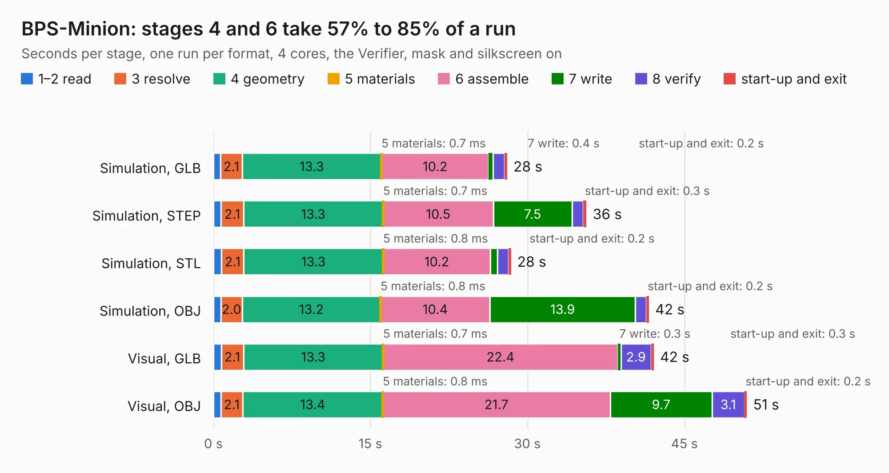

# 1491. BPS-Minion

Board 1,491 of the 3,138 of [Corpus Testing](../Corpus-Testing.md), on [Corpus Page 14](../CorpusTestingPages/Corpus-Testing-14.md#1491-bps-minion).

| Mode and format | 1–2 read | 3 resolve | 4 geometry | 5 materials | 6 assemble | 7 write | 8 verify | start-up and exit | Total |
|---|---:|---:|---:|---:|---:|---:|---:|---:|---:|
| Simulation, GLB | 0.7 | 2.1 | 13.3 | 0.7&nbsp;ms | 10.2 | 0.4 | 1.1 | 0.2 | 28.1 |
| Simulation, STEP | 0.7 | 2.1 | 13.3 | 0.7&nbsp;ms | 10.5 | 7.5 | 1.1 | 0.3 | 35.6 |
| Simulation, STL | 0.8 | 2.1 | 13.3 | 0.8&nbsp;ms | 10.2 | 0.7 | 1.1 | 0.2 | 28.4 |
| Simulation, OBJ | 0.7 | 2.0 | 13.2 | 0.8&nbsp;ms | 10.4 | 13.9 | 1.1 | 0.2 | 41.6 |
| Visual, GLB | 0.7 | 2.1 | 13.3 | 0.7&nbsp;ms | 22.4 | 0.3 | 2.9 | 0.3 | 42.1 |
| Visual, OBJ | 0.7 | 2.1 | 13.4 | 0.8&nbsp;ms | 21.7 | 9.7 | 3.1 | 0.2 | 51.0 |

<table align="center"><tr><td valign="top">

| Board | Repo: [lhr-solar/bps-voltagepcb](https://github.com/lhr-solar/bps-voltagepcb) Board: `BPS-Minion.kicad_pcb` |
|---|---|
| Complexity | 365&nbsp;/&nbsp;1000 (size&nbsp;255, features&nbsp;110) |
| KESE&nbsp;features | through vias, custom pads, rounded, trapezoid or chamfered pads, filled zones, copper drawings, curved board outline, stack-up, dielectric εr and tanδ |
| Tested | 9th November 2026 |
| Copper&nbsp;layers | 2 |
| File&nbsp;format | KiCad 8 (20240108) |
| Parts,&nbsp;tracks,&nbsp;vias | 218, 1,543, 223 |
| Triangles,&nbsp;simulation | 2,640,284 in 220 parts |
| Verifier | PASS in all six runs |

</td><td valign="top">

<table>
<tr><th>File type</th><th>File size</th><th>Peak memory used</th></tr>
<tr><th colspan="3" align="left">Simulation</th></tr>
<tr><td>GLB</td><td align="right">92&nbsp;MB</td><td align="right">884&nbsp;MB</td></tr>
<tr><td>STEP</td><td align="right">521&nbsp;MB</td><td align="right">1.1&nbsp;GB</td></tr>
<tr><td>STL</td><td align="right">132&nbsp;MB</td><td align="right">893&nbsp;MB</td></tr>
<tr><td>OBJ</td><td align="right">283&nbsp;MB</td><td align="right">1.8&nbsp;GB</td></tr>
<tr><th colspan="3" align="left">Visual</th></tr>
<tr><td>GLB</td><td align="right">62&nbsp;MB</td><td align="right">1.1&nbsp;GB</td></tr>
<tr><td>OBJ</td><td align="right">190&nbsp;MB</td><td align="right">1.4&nbsp;GB</td></tr>
</table>

</td></tr></table>

| Previous | Next |
|:---|---:|
| [1490. lhc-esp](b1490b_hardware_lhc-esp.md) | [1492. BPS-Leader](b1492b_ps-bpsleader_BPS-Leader.md) |
