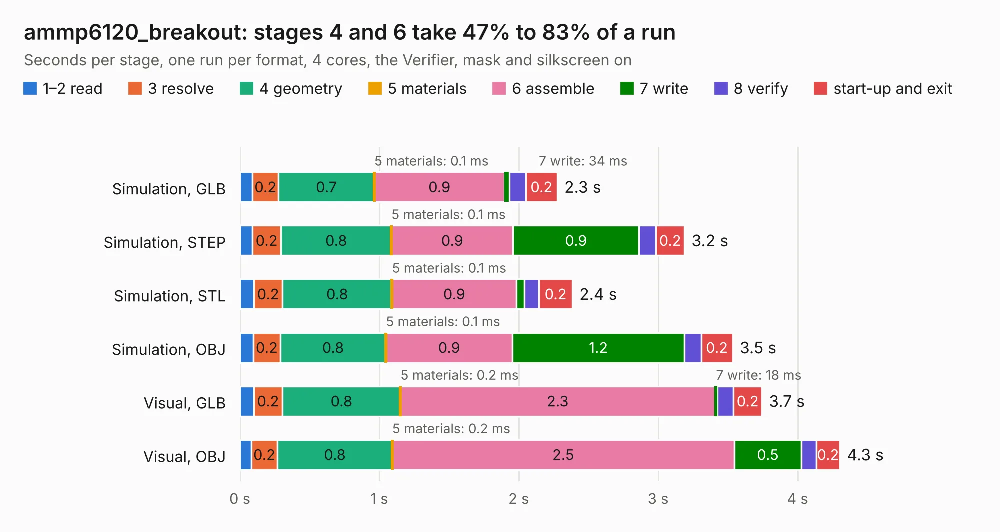

# 1492. ammp6120_breakout

Board 1,492 of the 3,111 of [Corpus Testing](../Corpus-Testing.md), on [Corpus Page 14](../CorpusTestingPages/Corpus-Testing-14.md#1492-ammp6120_breakout).

| Mode and format | 1–2 read | 3 resolve | 4 geometry | 5 materials | 6 assemble | 7 write | 8 verify | start-up and exit | Total |
|---|---:|---:|---:|---:|---:|---:|---:|---:|---:|
| Simulation, GLB | 90&nbsp;ms | 0.2 | 0.7 | 0.1&nbsp;ms | 0.9 | 34&nbsp;ms | 0.1 | 0.2 | 2.3 |
| Simulation, STEP | 89&nbsp;ms | 0.2 | 0.8 | 0.1&nbsp;ms | 0.9 | 0.9 | 0.1 | 0.2 | 3.2 |
| Simulation, STL | 0.1 | 0.2 | 0.8 | 0.1&nbsp;ms | 0.9 | 57&nbsp;ms | 0.1 | 0.2 | 2.4 |
| Simulation, OBJ | 97&nbsp;ms | 0.2 | 0.8 | 0.1&nbsp;ms | 0.9 | 1.2 | 0.1 | 0.2 | 3.5 |
| Visual, GLB | 99&nbsp;ms | 0.2 | 0.8 | 0.2&nbsp;ms | 2.3 | 18&nbsp;ms | 0.1 | 0.2 | 3.7 |
| Visual, OBJ | 81&nbsp;ms | 0.2 | 0.8 | 0.2&nbsp;ms | 2.5 | 0.5 | 0.1 | 0.2 | 4.3 |

<table align="center"><tr><td valign="top">

| Board | Repo: [loxodes/vna](https://github.com/loxodes/vna) Board: `ammp6120_breakout.kicad_pcb` |
|---|---|
| Folder | breakouts / ammp6120_breakout |
| Complexity | 127&nbsp;/&nbsp;1000 (size&nbsp;107, features&nbsp;20) |
| KESE&nbsp;features | filled zones |
| Tested | 9th November 2026 |
| Copper&nbsp;layers | 4 |
| File&nbsp;format | KiCad 4 (4) |
| Parts,&nbsp;tracks,&nbsp;vias | 6, 24, 0 |
| Triangles,&nbsp;simulation | 275,826 in 18 parts |
| Verifier | PASS in all six runs |

</td><td valign="top">

<table>
<tr><th>File type</th><th>File size</th><th>Peak memory used</th></tr>
<tr><th colspan="3" align="left">Simulation</th></tr>
<tr><td>GLB</td><td align="right">9.3&nbsp;MB</td><td align="right">232&nbsp;MB</td></tr>
<tr><td>STEP</td><td align="right">25&nbsp;MB</td><td align="right">265&nbsp;MB</td></tr>
<tr><td>STL</td><td align="right">14&nbsp;MB</td><td align="right">242&nbsp;MB</td></tr>
<tr><td>OBJ</td><td align="right">27&nbsp;MB</td><td align="right">237&nbsp;MB</td></tr>
<tr><th colspan="3" align="left">Visual</th></tr>
<tr><td>GLB</td><td align="right">4.5&nbsp;MB</td><td align="right">200&nbsp;MB</td></tr>
<tr><td>OBJ</td><td align="right">13&nbsp;MB</td><td align="right">204&nbsp;MB</td></tr>
</table>

</td></tr></table>

| Previous | Next |
|:---|---:|
| [1491. adrf5020_breakout](b1491b_vna_adrf5020-breakout.md) | [1493. amp_breakout](b1493b_vna_amp-breakout.md) |
