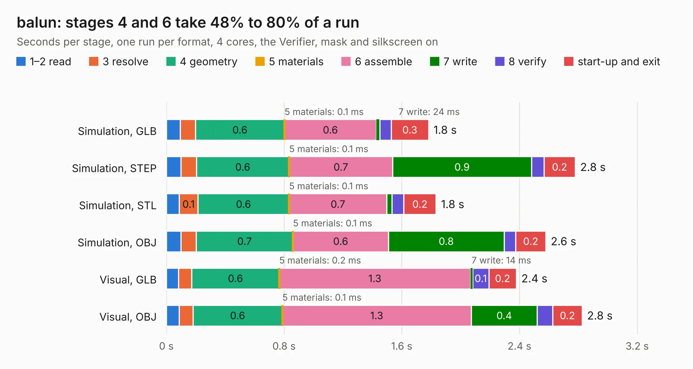

# 1493. balun

Board 1,493 of the 3,106 of [Corpus Testing](../Corpus-Testing.md), on [Corpus Page 14](../CorpusTestingPages/Corpus-Testing-14.md#1493-balun).

| Mode and format | 1–2 read | 3 resolve | 4 geometry | 5 materials | 6 assemble | 7 write | 8 verify | start-up and exit | Total |
|---|---:|---:|---:|---:|---:|---:|---:|---:|---:|
| Simulation, GLB | 94&nbsp;ms | 0.1 | 0.6 | 0.1&nbsp;ms | 0.6 | 24&nbsp;ms | 77&nbsp;ms | 0.3 | 1.8 |
| Simulation, STEP | 98&nbsp;ms | 0.1 | 0.6 | 0.1&nbsp;ms | 0.7 | 0.9 | 84&nbsp;ms | 0.2 | 2.8 |
| Simulation, STL | 87&nbsp;ms | 0.1 | 0.6 | 0.1&nbsp;ms | 0.7 | 35&nbsp;ms | 80&nbsp;ms | 0.2 | 1.8 |
| Simulation, OBJ | 0.1 | 0.1 | 0.7 | 0.1&nbsp;ms | 0.6 | 0.8 | 78&nbsp;ms | 0.2 | 2.6 |
| Visual, GLB | 83&nbsp;ms | 90&nbsp;ms | 0.6 | 0.2&nbsp;ms | 1.3 | 14&nbsp;ms | 0.1 | 0.2 | 2.4 |
| Visual, OBJ | 88&nbsp;ms | 93&nbsp;ms | 0.6 | 0.1&nbsp;ms | 1.3 | 0.4 | 0.1 | 0.2 | 2.8 |

<table align="center"><tr><td valign="top">

| Board | Repo: [loxodes/vna](https://github.com/loxodes/vna) Board: `balun.kicad_pcb` |
|---|---|
| Folder | breakouts / balun |
| Complexity | 121&nbsp;/&nbsp;1000 (size&nbsp;81, features&nbsp;40) |
| KESE&nbsp;features | rounded, trapezoid or chamfered pads, filled zones, curved board outline |
| Tested | 9th November 2026 |
| Copper&nbsp;layers | 2 |
| File&nbsp;format | KiCad 5 (20171130) |
| Parts,&nbsp;tracks,&nbsp;vias | 7, 12, 0 |
| Triangles,&nbsp;simulation | 133,858 in 18 parts |
| Verifier | PASS in all six runs |

</td><td valign="top">

<table>
<tr><th>File type</th><th>File size</th><th>Peak memory used</th></tr>
<tr><th colspan="3" align="left">Simulation</th></tr>
<tr><td>GLB</td><td align="right">4.7&nbsp;MB</td><td align="right">196&nbsp;MB</td></tr>
<tr><td>STEP</td><td align="right">24&nbsp;MB</td><td align="right">201&nbsp;MB</td></tr>
<tr><td>STL</td><td align="right">6.7&nbsp;MB</td><td align="right">199&nbsp;MB</td></tr>
<tr><td>OBJ</td><td align="right">13&nbsp;MB</td><td align="right">188&nbsp;MB</td></tr>
<tr><th colspan="3" align="left">Visual</th></tr>
<tr><td>GLB</td><td align="right">2.8&nbsp;MB</td><td align="right">157&nbsp;MB</td></tr>
<tr><td>OBJ</td><td align="right">7.7&nbsp;MB</td><td align="right">158&nbsp;MB</td></tr>
</table>

</td></tr></table>

| Previous | Next |
|:---|---:|
| [1492. attenuator](b1492b_vna_attenuator.md) | [1494. bias_controller](b1494b_vna_bias-controller.md) |
