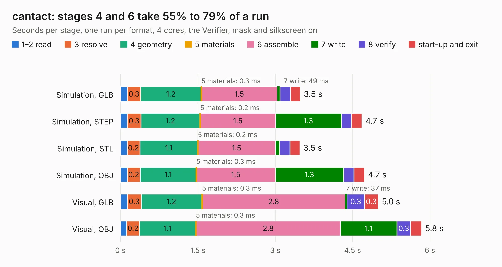

# 1494. cantact

Board 1,494 of the 3,127 of [Corpus Testing](../Corpus-Testing.md), on [Corpus Page 14](../CorpusTestingPages/Corpus-Testing-14.md#1494-cantact).

| Mode and format | 1–2 read | 3 resolve | 4 geometry | 5 materials | 6 assemble | 7 write | 8 verify | start-up and exit | Total |
|---|---:|---:|---:|---:|---:|---:|---:|---:|---:|
| Simulation, GLB | 0.1 | 0.3 | 1.2 | 0.3&nbsp;ms | 1.5 | 49&nbsp;ms | 0.2 | 0.2 | 3.5 |
| Simulation, STEP | 0.1 | 0.3 | 1.2 | 0.2&nbsp;ms | 1.5 | 1.3 | 0.2 | 0.2 | 4.7 |
| Simulation, STL | 0.1 | 0.2 | 1.1 | 0.2&nbsp;ms | 1.5 | 82&nbsp;ms | 0.2 | 0.2 | 3.5 |
| Simulation, OBJ | 0.1 | 0.2 | 1.1 | 0.3&nbsp;ms | 1.5 | 1.3 | 0.2 | 0.2 | 4.7 |
| Visual, GLB | 0.1 | 0.3 | 1.2 | 0.3&nbsp;ms | 2.8 | 37&nbsp;ms | 0.3 | 0.3 | 5.0 |
| Visual, OBJ | 0.1 | 0.2 | 1.1 | 0.3&nbsp;ms | 2.8 | 1.1 | 0.3 | 0.2 | 5.8 |

<table align="center"><tr><td valign="top">

| Board | Repo: [linklayer/cantact-hw](https://github.com/linklayer/cantact-hw) Board: `cantact.kicad_pcb` |
|---|---|
| Complexity | 228&nbsp;/&nbsp;1000 (size&nbsp;193, features&nbsp;35) |
| KESE&nbsp;features | through vias, filled zones |
| Tested | 9th November 2026 |
| Copper&nbsp;layers | 2 |
| File&nbsp;format | KiCad 4 (4) |
| Parts,&nbsp;tracks,&nbsp;vias | 34, 333, 22 |
| Triangles,&nbsp;simulation | 334,110 in 72 parts |
| Verifier | PASS in all six runs |

</td><td valign="top">

<table>
<tr><th>File type</th><th>File size</th><th>Peak memory used</th></tr>
<tr><th colspan="3" align="left">Simulation</th></tr>
<tr><td>GLB</td><td align="right">12&nbsp;MB</td><td align="right">256&nbsp;MB</td></tr>
<tr><td>STEP</td><td align="right">57&nbsp;MB</td><td align="right">297&nbsp;MB</td></tr>
<tr><td>STL</td><td align="right">17&nbsp;MB</td><td align="right">258&nbsp;MB</td></tr>
<tr><td>OBJ</td><td align="right">34&nbsp;MB</td><td align="right">263&nbsp;MB</td></tr>
<tr><th colspan="3" align="left">Visual</th></tr>
<tr><td>GLB</td><td align="right">9.4&nbsp;MB</td><td align="right">302&nbsp;MB</td></tr>
<tr><td>OBJ</td><td align="right">28&nbsp;MB</td><td align="right">300&nbsp;MB</td></tr>
</table>

</td></tr></table>

| Previous | Next |
|:---|---:|
| [1493. mppt-2420-hpx](b1493b_mppt-2420-hpx_mppt-2420-hpx.md) | [1495. Issue3B](b1495b_ZX-Spectrum-48K-Issue-3B-Based-on-Gerbers-by-PABB-on-PCBWay_Issue3B.md) |
