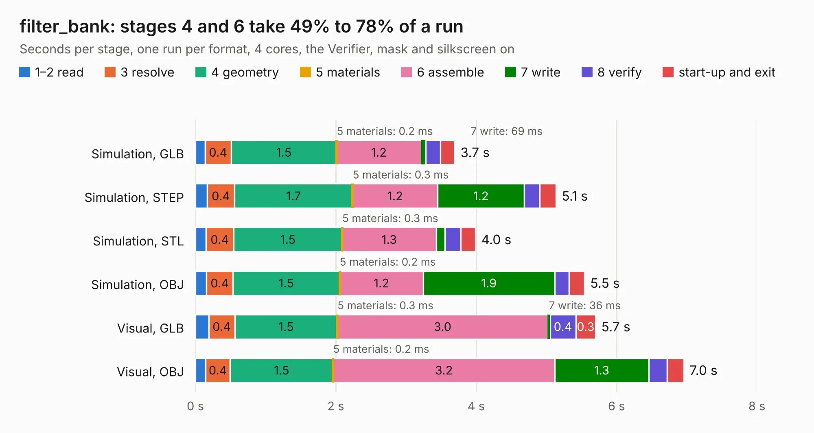

# 1495. filter_bank

Board 1,495 of the 3,100 of [Corpus Testing](../Corpus-Testing.md), on [Corpus Page 14](../CorpusTestingPages/Corpus-Testing-14.md#1495-filter_bank).

| Mode and format | 1–2 read | 3 resolve | 4 geometry | 5 materials | 6 assemble | 7 write | 8 verify | start-up and exit | Total |
|---|---:|---:|---:|---:|---:|---:|---:|---:|---:|
| Simulation, GLB | 0.1 | 0.4 | 1.5 | 0.2&nbsp;ms | 1.2 | 69&nbsp;ms | 0.2 | 0.2 | 3.7 |
| Simulation, STEP | 0.2 | 0.4 | 1.7 | 0.3&nbsp;ms | 1.2 | 1.2 | 0.2 | 0.2 | 5.1 |
| Simulation, STL | 0.1 | 0.4 | 1.5 | 0.3&nbsp;ms | 1.3 | 0.1 | 0.2 | 0.2 | 4.0 |
| Simulation, OBJ | 0.2 | 0.4 | 1.5 | 0.2&nbsp;ms | 1.2 | 1.9 | 0.2 | 0.2 | 5.5 |
| Visual, GLB | 0.2 | 0.4 | 1.5 | 0.3&nbsp;ms | 3.0 | 36&nbsp;ms | 0.4 | 0.3 | 5.7 |
| Visual, OBJ | 0.1 | 0.4 | 1.5 | 0.2&nbsp;ms | 3.2 | 1.3 | 0.3 | 0.2 | 7.0 |

<table align="center"><tr><td valign="top">

| Board | Repo: [loxodes/vna](https://github.com/loxodes/vna) Board: `filter_bank.kicad_pcb` |
|---|---|
| Folder | breakouts / filter_breakout |
| Complexity | 210&nbsp;/&nbsp;1000 (size&nbsp;175, features&nbsp;35) |
| KESE&nbsp;features | through vias, filled zones |
| Tested | 9th November 2026 |
| Copper&nbsp;layers | 4 |
| File&nbsp;format | KiCad 4 (4) |
| Parts,&nbsp;tracks,&nbsp;vias | 36, 361, 53 |
| Triangles,&nbsp;simulation | 321,342 in 56 parts |
| Verifier | PASS in all six runs |

</td><td valign="top">

<table>
<tr><th>File type</th><th>File size</th><th>Peak memory used</th></tr>
<tr><th colspan="3" align="left">Simulation</th></tr>
<tr><td>GLB</td><td align="right">11&nbsp;MB</td><td align="right">237&nbsp;MB</td></tr>
<tr><td>STEP</td><td align="right">40&nbsp;MB</td><td align="right">260&nbsp;MB</td></tr>
<tr><td>STL</td><td align="right">16&nbsp;MB</td><td align="right">253&nbsp;MB</td></tr>
<tr><td>OBJ</td><td align="right">33&nbsp;MB</td><td align="right">269&nbsp;MB</td></tr>
<tr><th colspan="3" align="left">Visual</th></tr>
<tr><td>GLB</td><td align="right">7.3&nbsp;MB</td><td align="right">235&nbsp;MB</td></tr>
<tr><td>OBJ</td><td align="right">21&nbsp;MB</td><td align="right">237&nbsp;MB</td></tr>
</table>

</td></tr></table>

| Previous | Next |
|:---|---:|
| [1494. demod_breakout](b1494b_vna_demod-breakout.md) | [1496. trl_thru](b1496b_vna_breakouts-hmc576-breakout_trl-thru.md) |
