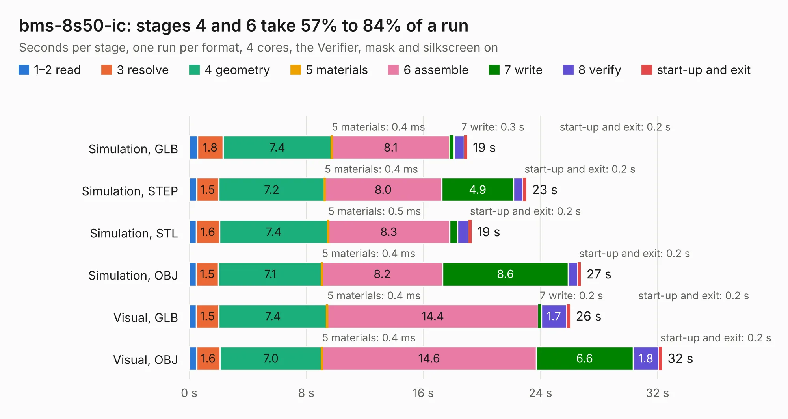

# 1497. bms-8s50-ic

Board 1,497 of the 3,139 of [Corpus Testing](../Corpus-Testing.md), on [Corpus Page 14](../CorpusTestingPages/Corpus-Testing-14.md#1497-bms-8s50-ic).

| Mode and format | 1–2 read | 3 resolve | 4 geometry | 5 materials | 6 assemble | 7 write | 8 verify | start-up and exit | Total |
|---|---:|---:|---:|---:|---:|---:|---:|---:|---:|
| Simulation, GLB | 0.6 | 1.8 | 7.4 | 0.4&nbsp;ms | 8.1 | 0.3 | 0.7 | 0.2 | 19.0 |
| Simulation, STEP | 0.5 | 1.5 | 7.2 | 0.4&nbsp;ms | 8.0 | 4.9 | 0.6 | 0.2 | 23.0 |
| Simulation, STL | 0.5 | 1.6 | 7.4 | 0.5&nbsp;ms | 8.3 | 0.6 | 0.7 | 0.2 | 19.3 |
| Simulation, OBJ | 0.5 | 1.5 | 7.1 | 0.4&nbsp;ms | 8.2 | 8.6 | 0.6 | 0.2 | 26.8 |
| Visual, GLB | 0.5 | 1.5 | 7.4 | 0.4&nbsp;ms | 14.4 | 0.2 | 1.7 | 0.2 | 26.0 |
| Visual, OBJ | 0.5 | 1.6 | 7.0 | 0.4&nbsp;ms | 14.6 | 6.6 | 1.8 | 0.2 | 32.3 |

<table align="center"><tr><td valign="top">

| Board | Repo: [libresolar/bms-8s50-ic](https://github.com/libresolar/bms-8s50-ic) Board: `bms-8s50-ic.kicad_pcb` |
|---|---|
| Folder | kicad |
| Complexity | 300&nbsp;/&nbsp;1000 (size&nbsp;245, features&nbsp;55) |
| KESE&nbsp;features | through vias, rounded, trapezoid or chamfered pads, filled zones, curved board outline |
| Tested | 9th November 2026 |
| Copper&nbsp;layers | 2 |
| File&nbsp;format | KiCad 5 (20171130) |
| Parts,&nbsp;tracks,&nbsp;vias | 160, 1,428, 275 |
| Triangles,&nbsp;simulation | 1,688,996 in 155 parts |
| Verifier | PASS in all six runs |

</td><td valign="top">

<table>
<tr><th>File type</th><th>File size</th><th>Peak memory used</th></tr>
<tr><th colspan="3" align="left">Simulation</th></tr>
<tr><td>GLB</td><td align="right">58&nbsp;MB</td><td align="right">624&nbsp;MB</td></tr>
<tr><td>STEP</td><td align="right">257&nbsp;MB</td><td align="right">802&nbsp;MB</td></tr>
<tr><td>STL</td><td align="right">84&nbsp;MB</td><td align="right">647&nbsp;MB</td></tr>
<tr><td>OBJ</td><td align="right">174&nbsp;MB</td><td align="right">1.1&nbsp;GB</td></tr>
<tr><th colspan="3" align="left">Visual</th></tr>
<tr><td>GLB</td><td align="right">44&nbsp;MB</td><td align="right">809&nbsp;MB</td></tr>
<tr><td>OBJ</td><td align="right">132&nbsp;MB</td><td align="right">918&nbsp;MB</td></tr>
</table>

</td></tr></table>

| Previous | Next |
|:---|---:|
| [1496. LibreRouter_MegaBoard](b1496b_librerouter_LibreRouter-MegaBoard.md) | [1498. bms-c1](b1498b_bms-c1_bms-c1.md) |
