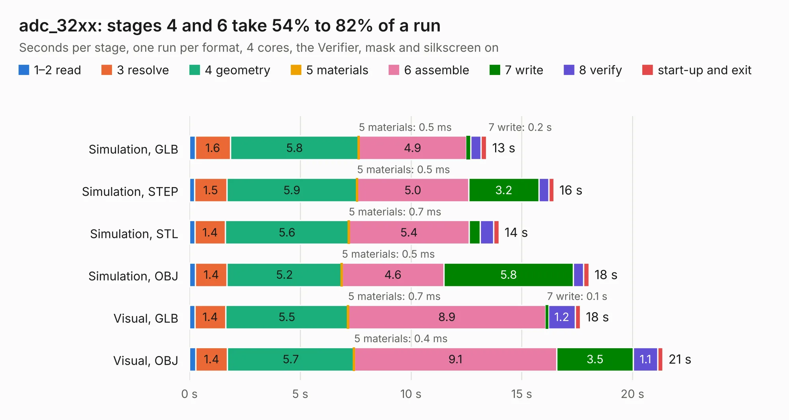

# 1497. adc_32xx

Board 1,497 of the 3,122 of [Corpus Testing](../Corpus-Testing.md), on [Corpus Page 14](../CorpusTestingPages/Corpus-Testing-14.md#1497-adc_32xx).

| Mode and format | 1–2 read | 3 resolve | 4 geometry | 5 materials | 6 assemble | 7 write | 8 verify | start-up and exit | Total |
|---|---:|---:|---:|---:|---:|---:|---:|---:|---:|
| Simulation, GLB | 0.3 | 1.6 | 5.8 | 0.5&nbsp;ms | 4.9 | 0.2 | 0.5 | 0.3 | 13.4 |
| Simulation, STEP | 0.2 | 1.5 | 5.9 | 0.5&nbsp;ms | 5.0 | 3.2 | 0.4 | 0.2 | 16.4 |
| Simulation, STL | 0.2 | 1.4 | 5.6 | 0.7&nbsp;ms | 5.4 | 0.5 | 0.6 | 0.2 | 14.0 |
| Simulation, OBJ | 0.3 | 1.4 | 5.2 | 0.5&nbsp;ms | 4.6 | 5.8 | 0.5 | 0.2 | 18.0 |
| Visual, GLB | 0.2 | 1.4 | 5.5 | 0.7&nbsp;ms | 8.9 | 0.1 | 1.2 | 0.2 | 17.6 |
| Visual, OBJ | 0.3 | 1.4 | 5.7 | 0.4&nbsp;ms | 9.1 | 3.5 | 1.1 | 0.2 | 21.4 |

<table align="center"><tr><td valign="top">

| Board | Repo: [loxodes/vna](https://github.com/loxodes/vna) Board: `adc_32xx.kicad_pcb` |
|---|---|
| Folder | breakouts / adc_32xx / ram_adc |
| Complexity | 296&nbsp;/&nbsp;1000 (size&nbsp;241, features&nbsp;55) |
| KESE&nbsp;features | through vias, rounded, trapezoid or chamfered pads, filled zones, curved board outline |
| Tested | 9th November 2026 |
| Copper&nbsp;layers | 4 |
| File&nbsp;format | KiCad 5 (20171130) |
| Parts,&nbsp;tracks,&nbsp;vias | 100, 933, 118 |
| Triangles,&nbsp;simulation | 1,439,468 in 97 parts |
| Verifier | PASS in all six runs |

</td><td valign="top">

<table>
<tr><th>File type</th><th>File size</th><th>Peak memory used</th></tr>
<tr><th colspan="3" align="left">Simulation</th></tr>
<tr><td>GLB</td><td align="right">50&nbsp;MB</td><td align="right">559&nbsp;MB</td></tr>
<tr><td>STEP</td><td align="right">230&nbsp;MB</td><td align="right">694&nbsp;MB</td></tr>
<tr><td>STL</td><td align="right">72&nbsp;MB</td><td align="right">575&nbsp;MB</td></tr>
<tr><td>OBJ</td><td align="right">150&nbsp;MB</td><td align="right">1.0&nbsp;GB</td></tr>
<tr><th colspan="3" align="left">Visual</th></tr>
<tr><td>GLB</td><td align="right">29&nbsp;MB</td><td align="right">626&nbsp;MB</td></tr>
<tr><td>OBJ</td><td align="right">86&nbsp;MB</td><td align="right">677&nbsp;MB</td></tr>
</table>

</td></tr></table>

| Previous | Next |
|:---|---:|
| [1496. adc344x](b1496b_vna_adc344x.md) | [1498. adc_cape](b1498b_vna_adc-cape.md) |
