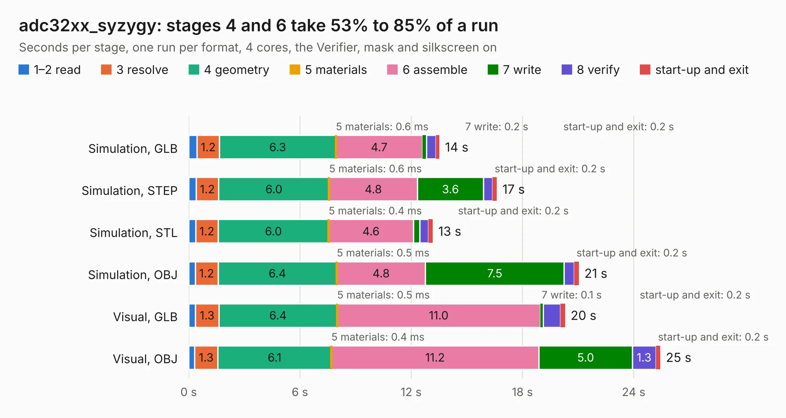

# 1497. adc32xx_syzygy

Board 1,497 of the 3,125 of [Corpus Testing](../Corpus-Testing.md), on [Corpus Page 14](../CorpusTestingPages/Corpus-Testing-14.md#1497-adc32xx_syzygy).

| Mode and format | 1–2 read | 3 resolve | 4 geometry | 5 materials | 6 assemble | 7 write | 8 verify | start-up and exit | Total |
|---|---:|---:|---:|---:|---:|---:|---:|---:|---:|
| Simulation, GLB | 0.4 | 1.2 | 6.3 | 0.6&nbsp;ms | 4.7 | 0.2 | 0.5 | 0.2 | 13.5 |
| Simulation, STEP | 0.4 | 1.2 | 6.0 | 0.6&nbsp;ms | 4.8 | 3.6 | 0.5 | 0.2 | 16.6 |
| Simulation, STL | 0.4 | 1.2 | 6.0 | 0.4&nbsp;ms | 4.6 | 0.4 | 0.5 | 0.2 | 13.2 |
| Simulation, OBJ | 0.4 | 1.2 | 6.4 | 0.5&nbsp;ms | 4.8 | 7.5 | 0.5 | 0.2 | 21.0 |
| Visual, GLB | 0.4 | 1.3 | 6.4 | 0.5&nbsp;ms | 11.0 | 0.1 | 0.9 | 0.2 | 20.3 |
| Visual, OBJ | 0.3 | 1.3 | 6.1 | 0.4&nbsp;ms | 11.2 | 5.0 | 1.3 | 0.2 | 25.4 |

<table align="center"><tr><td valign="top">

| Board | Repo: [loxodes/vna](https://github.com/loxodes/vna) Board: `adc32xx_syzygy.kicad_pcb` |
|---|---|
| Folder | breakouts / adc32xx_syzygy / adc32xx_syzygy |
| Complexity | 346&nbsp;/&nbsp;1000 (size&nbsp;246, features&nbsp;100) |
| KESE&nbsp;features | through vias, rounded, trapezoid or chamfered pads, arc tracks, filled zones, curved board outline, stack-up, dielectric εr and tanδ |
| Tested | 9th November 2026 |
| Copper&nbsp;layers | 4 |
| File&nbsp;format | KiCad 7 (20221018) |
| Parts,&nbsp;tracks,&nbsp;vias | 105, 1,115, 193 |
| Triangles,&nbsp;simulation | 1,389,302 in 112 parts |
| Verifier | PASS in all six runs |

</td><td valign="top">

<table>
<tr><th>File type</th><th>File size</th><th>Peak memory used</th></tr>
<tr><th colspan="3" align="left">Simulation</th></tr>
<tr><td>GLB</td><td align="right">48&nbsp;MB</td><td align="right">598&nbsp;MB</td></tr>
<tr><td>STEP</td><td align="right">220&nbsp;MB</td><td align="right">667&nbsp;MB</td></tr>
<tr><td>STL</td><td align="right">69&nbsp;MB</td><td align="right">613&nbsp;MB</td></tr>
<tr><td>OBJ</td><td align="right">145&nbsp;MB</td><td align="right">962&nbsp;MB</td></tr>
<tr><th colspan="3" align="left">Visual</th></tr>
<tr><td>GLB</td><td align="right">32&nbsp;MB</td><td align="right">716&nbsp;MB</td></tr>
<tr><td>OBJ</td><td align="right">96&nbsp;MB</td><td align="right">767&nbsp;MB</td></tr>
</table>

</td></tr></table>

| Previous | Next |
|:---|---:|
| [1496. ad9864_breakout](b1496b_vna_ad9864-breakout.md) | [1498. adc344x](b1498b_vna_adc344x.md) |
