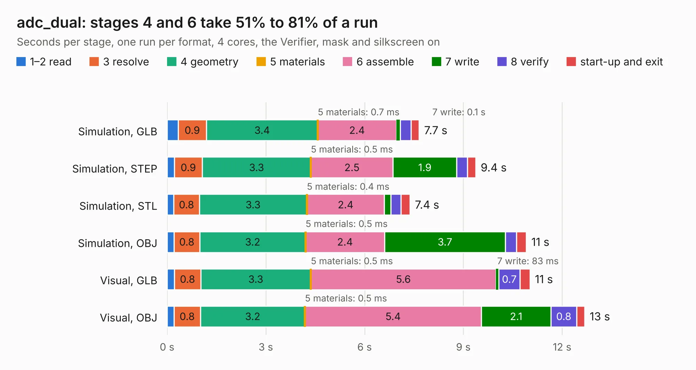

# 1498. adc_dual

Board 1,498 of the 3,120 of [Corpus Testing](../Corpus-Testing.md), on [Corpus Page 14](../CorpusTestingPages/Corpus-Testing-14.md#1498-adc_dual).

| Mode and format | 1–2 read | 3 resolve | 4 geometry | 5 materials | 6 assemble | 7 write | 8 verify | start-up and exit | Total |
|---|---:|---:|---:|---:|---:|---:|---:|---:|---:|
| Simulation, GLB | 0.3 | 0.9 | 3.4 | 0.7&nbsp;ms | 2.4 | 0.1 | 0.3 | 0.2 | 7.7 |
| Simulation, STEP | 0.2 | 0.9 | 3.3 | 0.5&nbsp;ms | 2.5 | 1.9 | 0.3 | 0.3 | 9.4 |
| Simulation, STL | 0.2 | 0.8 | 3.3 | 0.4&nbsp;ms | 2.4 | 0.2 | 0.3 | 0.3 | 7.4 |
| Simulation, OBJ | 0.2 | 0.8 | 3.2 | 0.5&nbsp;ms | 2.4 | 3.7 | 0.3 | 0.3 | 10.9 |
| Visual, GLB | 0.2 | 0.8 | 3.3 | 0.5&nbsp;ms | 5.6 | 83&nbsp;ms | 0.7 | 0.3 | 11.0 |
| Visual, OBJ | 0.2 | 0.8 | 3.2 | 0.5&nbsp;ms | 5.4 | 2.1 | 0.8 | 0.2 | 12.7 |

<table align="center"><tr><td valign="top">

| Board | Repo: [loxodes/vna](https://github.com/loxodes/vna) Board: `adc_dual.kicad_pcb` |
|---|---|
| Folder | breakouts / adc_dual |
| Complexity | 262&nbsp;/&nbsp;1000 (size&nbsp;227, features&nbsp;35) |
| KESE&nbsp;features | through vias, filled zones |
| Tested | 9th November 2026 |
| Copper&nbsp;layers | 4 |
| File&nbsp;format | KiCad 4 (4) |
| Parts,&nbsp;tracks,&nbsp;vias | 77, 465, 61 |
| Triangles,&nbsp;simulation | 697,788 in 69 parts |
| Verifier | PASS in all six runs |

</td><td valign="top">

<table>
<tr><th>File type</th><th>File size</th><th>Peak memory used</th></tr>
<tr><th colspan="3" align="left">Simulation</th></tr>
<tr><td>GLB</td><td align="right">25&nbsp;MB</td><td align="right">387&nbsp;MB</td></tr>
<tr><td>STEP</td><td align="right">96&nbsp;MB</td><td align="right">398&nbsp;MB</td></tr>
<tr><td>STL</td><td align="right">35&nbsp;MB</td><td align="right">375&nbsp;MB</td></tr>
<tr><td>OBJ</td><td align="right">72&nbsp;MB</td><td align="right">513&nbsp;MB</td></tr>
<tr><th colspan="3" align="left">Visual</th></tr>
<tr><td>GLB</td><td align="right">16&nbsp;MB</td><td align="right">421&nbsp;MB</td></tr>
<tr><td>OBJ</td><td align="right">46&nbsp;MB</td><td align="right">410&nbsp;MB</td></tr>
</table>

</td></tr></table>

| Previous | Next |
|:---|---:|
| [1497. adc_cape](b1497b_vna_adc-cape.md) | [1499. adrf5020_breakout](b1499b_vna_adrf5020-breakout.md) |
