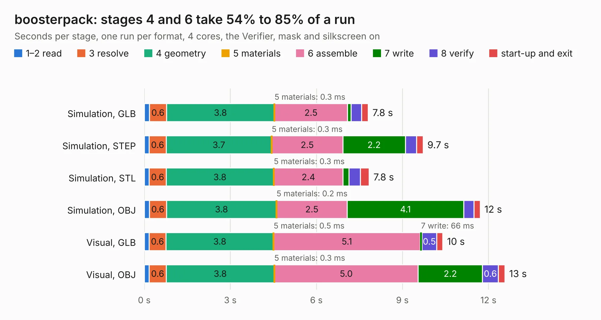

# 1498. boosterpack

Board 1,498 of the 3,109 of [Corpus Testing](../Corpus-Testing.md), on [Corpus Page 14](../CorpusTestingPages/Corpus-Testing-14.md#1498-boosterpack).

| Mode and format | 1–2 read | 3 resolve | 4 geometry | 5 materials | 6 assemble | 7 write | 8 verify | start-up and exit | Total |
|---|---:|---:|---:|---:|---:|---:|---:|---:|---:|
| Simulation, GLB | 0.2 | 0.6 | 3.8 | 0.3&nbsp;ms | 2.5 | 0.1 | 0.4 | 0.2 | 7.8 |
| Simulation, STEP | 0.2 | 0.6 | 3.7 | 0.3&nbsp;ms | 2.5 | 2.2 | 0.4 | 0.2 | 9.7 |
| Simulation, STL | 0.2 | 0.6 | 3.8 | 0.3&nbsp;ms | 2.4 | 0.2 | 0.4 | 0.3 | 7.8 |
| Simulation, OBJ | 0.2 | 0.6 | 3.8 | 0.2&nbsp;ms | 2.5 | 4.1 | 0.4 | 0.2 | 11.7 |
| Visual, GLB | 0.2 | 0.6 | 3.8 | 0.5&nbsp;ms | 5.1 | 66&nbsp;ms | 0.5 | 0.2 | 10.4 |
| Visual, OBJ | 0.2 | 0.6 | 3.8 | 0.3&nbsp;ms | 5.0 | 2.2 | 0.6 | 0.2 | 12.6 |

<table align="center"><tr><td valign="top">

| Board | Repo: [loxodes/vna](https://github.com/loxodes/vna) Board: `boosterpack.kicad_pcb` |
|---|---|
| Folder | breakouts / boosterpack |
| Complexity | 177&nbsp;/&nbsp;1000 (size&nbsp;142, features&nbsp;35) |
| KESE&nbsp;features | through vias, filled zones |
| Tested | 9th November 2026 |
| Copper&nbsp;layers | 2 |
| File&nbsp;format | KiCad 4 (4) |
| Parts,&nbsp;tracks,&nbsp;vias | 24, 227, 7 |
| Triangles,&nbsp;simulation | 696,784 in 52 parts |
| Verifier | PASS in all six runs |

</td><td valign="top">

<table>
<tr><th>File type</th><th>File size</th><th>Peak memory used</th></tr>
<tr><th colspan="3" align="left">Simulation</th></tr>
<tr><td>GLB</td><td align="right">24&nbsp;MB</td><td align="right">365&nbsp;MB</td></tr>
<tr><td>STEP</td><td align="right">117&nbsp;MB</td><td align="right">387&nbsp;MB</td></tr>
<tr><td>STL</td><td align="right">35&nbsp;MB</td><td align="right">336&nbsp;MB</td></tr>
<tr><td>OBJ</td><td align="right">71&nbsp;MB</td><td align="right">503&nbsp;MB</td></tr>
<tr><th colspan="3" align="left">Visual</th></tr>
<tr><td>GLB</td><td align="right">14&nbsp;MB</td><td align="right">386&nbsp;MB</td></tr>
<tr><td>OBJ</td><td align="right">41&nbsp;MB</td><td align="right">384&nbsp;MB</td></tr>
</table>

</td></tr></table>

| Previous | Next |
|:---|---:|
| [1497. bias_controller](b1497b_vna_bias-controller.md) | [1499. clk_lo_buffer](b1499b_vna_clk-lo-buffer.md) |
