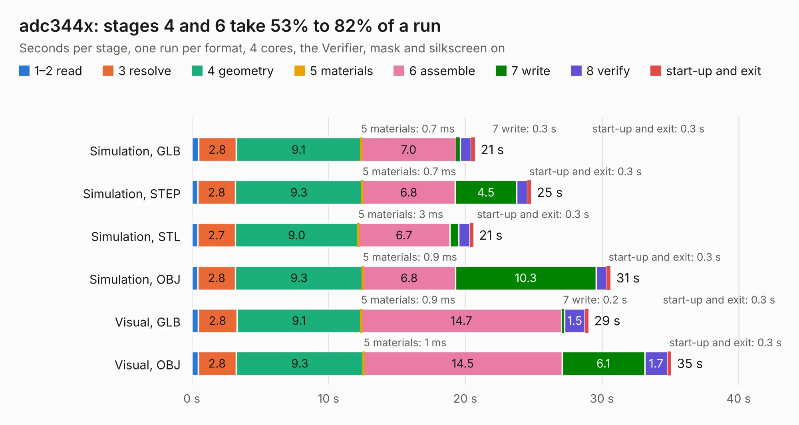

# 1499. adc344x

Board 1,499 of the 3,128 of [Corpus Testing](../Corpus-Testing.md), on [Corpus Page 14](../CorpusTestingPages/Corpus-Testing-14.md#1499-adc344x).

| Mode and format | 1–2 read | 3 resolve | 4 geometry | 5 materials | 6 assemble | 7 write | 8 verify | start-up and exit | Total |
|---|---:|---:|---:|---:|---:|---:|---:|---:|---:|
| Simulation, GLB | 0.5 | 2.8 | 9.1 | 0.7&nbsp;ms | 7.0 | 0.3 | 0.8 | 0.3 | 20.7 |
| Simulation, STEP | 0.4 | 2.8 | 9.3 | 0.7&nbsp;ms | 6.8 | 4.5 | 0.8 | 0.3 | 24.8 |
| Simulation, STL | 0.4 | 2.7 | 9.0 | 3&nbsp;ms | 6.7 | 0.6 | 0.8 | 0.3 | 20.6 |
| Simulation, OBJ | 0.4 | 2.8 | 9.3 | 0.9&nbsp;ms | 6.8 | 10.3 | 0.8 | 0.3 | 30.6 |
| Visual, GLB | 0.5 | 2.8 | 9.1 | 0.9&nbsp;ms | 14.7 | 0.2 | 1.5 | 0.3 | 29.0 |
| Visual, OBJ | 0.5 | 2.8 | 9.3 | 1&nbsp;ms | 14.5 | 6.1 | 1.7 | 0.3 | 35.1 |

<table align="center"><tr><td valign="top">

| Board | Repo: [loxodes/vna](https://github.com/loxodes/vna) Board: `adc344x.kicad_pcb` |
|---|---|
| Folder | breakouts / adc344x |
| Complexity | 296&nbsp;/&nbsp;1000 (size&nbsp;251, features&nbsp;45) |
| KESE&nbsp;features | through vias, rounded, trapezoid or chamfered pads, filled zones |
| Tested | 9th November 2026 |
| Copper&nbsp;layers | 4 |
| File&nbsp;format | KiCad 6 (20190516) |
| Parts,&nbsp;tracks,&nbsp;vias | 156, 1,475, 112 |
| Triangles,&nbsp;simulation | 1,762,408 in 160 parts |
| Verifier | PASS in all six runs |

</td><td valign="top">

<table>
<tr><th>File type</th><th>File size</th><th>Peak memory used</th></tr>
<tr><th colspan="3" align="left">Simulation</th></tr>
<tr><td>GLB</td><td align="right">61&nbsp;MB</td><td align="right">636&nbsp;MB</td></tr>
<tr><td>STEP</td><td align="right">262&nbsp;MB</td><td align="right">753&nbsp;MB</td></tr>
<tr><td>STL</td><td align="right">88&nbsp;MB</td><td align="right">588&nbsp;MB</td></tr>
<tr><td>OBJ</td><td align="right">186&nbsp;MB</td><td align="right">1.2&nbsp;GB</td></tr>
<tr><th colspan="3" align="left">Visual</th></tr>
<tr><td>GLB</td><td align="right">35&nbsp;MB</td><td align="right">829&nbsp;MB</td></tr>
<tr><td>OBJ</td><td align="right">105&nbsp;MB</td><td align="right">820&nbsp;MB</td></tr>
</table>

</td></tr></table>

| Previous | Next |
|:---|---:|
| [1498. adc32xx_syzygy](b1498b_vna_adc32xx-syzygy.md) | [1500. adc_32xx](b1500b_vna_adc-32xx.md) |
