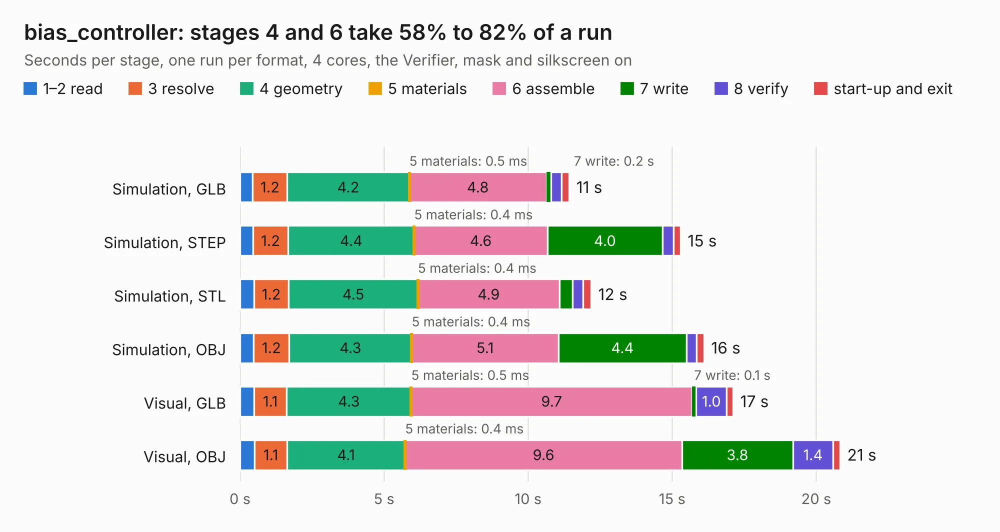

# 1499. bias_controller

Board 1,499 of the 3,111 of [Corpus Testing](../Corpus-Testing.md), on [Corpus Page 14](../CorpusTestingPages/Corpus-Testing-14.md#1499-bias_controller).

| Mode and format | 1–2 read | 3 resolve | 4 geometry | 5 materials | 6 assemble | 7 write | 8 verify | start-up and exit | Total |
|---|---:|---:|---:|---:|---:|---:|---:|---:|---:|
| Simulation, GLB | 0.4 | 1.2 | 4.2 | 0.5&nbsp;ms | 4.8 | 0.2 | 0.4 | 0.3 | 11.4 |
| Simulation, STEP | 0.4 | 1.2 | 4.4 | 0.4&nbsp;ms | 4.6 | 4.0 | 0.4 | 0.2 | 15.3 |
| Simulation, STL | 0.5 | 1.2 | 4.5 | 0.4&nbsp;ms | 4.9 | 0.5 | 0.4 | 0.3 | 12.2 |
| Simulation, OBJ | 0.5 | 1.2 | 4.3 | 0.4&nbsp;ms | 5.1 | 4.4 | 0.3 | 0.3 | 16.1 |
| Visual, GLB | 0.5 | 1.1 | 4.3 | 0.5&nbsp;ms | 9.7 | 0.1 | 1.0 | 0.2 | 17.1 |
| Visual, OBJ | 0.5 | 1.1 | 4.1 | 0.4&nbsp;ms | 9.6 | 3.8 | 1.4 | 0.2 | 20.8 |

<table align="center"><tr><td valign="top">

| Board | Repo: [loxodes/vna](https://github.com/loxodes/vna) Board: `bias_controller.kicad_pcb` |
|---|---|
| Folder | breakouts / bias_controller / bias_controller |
| Complexity | 134&nbsp;/&nbsp;1000 (size&nbsp;114, features&nbsp;20) |
| KESE&nbsp;features | slotted holes, rounded, trapezoid or chamfered pads |
| Tested | 9th November 2026 |
| Copper&nbsp;layers | 2 |
| File&nbsp;format | KiCad 8 (20231212) |
| Parts,&nbsp;tracks,&nbsp;vias | 201, 0, 0 |
| Triangles,&nbsp;simulation | 939,990 in 182 parts |
| Note | mostly unrouted |
| Verifier | PASS in all six runs |

</td><td valign="top">

<table>
<tr><th>File type</th><th>File size</th><th>Peak memory used</th></tr>
<tr><th colspan="3" align="left">Simulation</th></tr>
<tr><td>GLB</td><td align="right">32&nbsp;MB</td><td align="right">544&nbsp;MB</td></tr>
<tr><td>STEP</td><td align="right">180&nbsp;MB</td><td align="right">637&nbsp;MB</td></tr>
<tr><td>STL</td><td align="right">47&nbsp;MB</td><td align="right">519&nbsp;MB</td></tr>
<tr><td>OBJ</td><td align="right">96&nbsp;MB</td><td align="right">642&nbsp;MB</td></tr>
<tr><th colspan="3" align="left">Visual</th></tr>
<tr><td>GLB</td><td align="right">27&nbsp;MB</td><td align="right">603&nbsp;MB</td></tr>
<tr><td>OBJ</td><td align="right">81&nbsp;MB</td><td align="right">636&nbsp;MB</td></tr>
</table>

</td></tr></table>

| Previous | Next |
|:---|---:|
| [1498. balun](b1498b_vna_balun.md) | [1500. boosterpack](b1500b_vna_boosterpack.md) |
