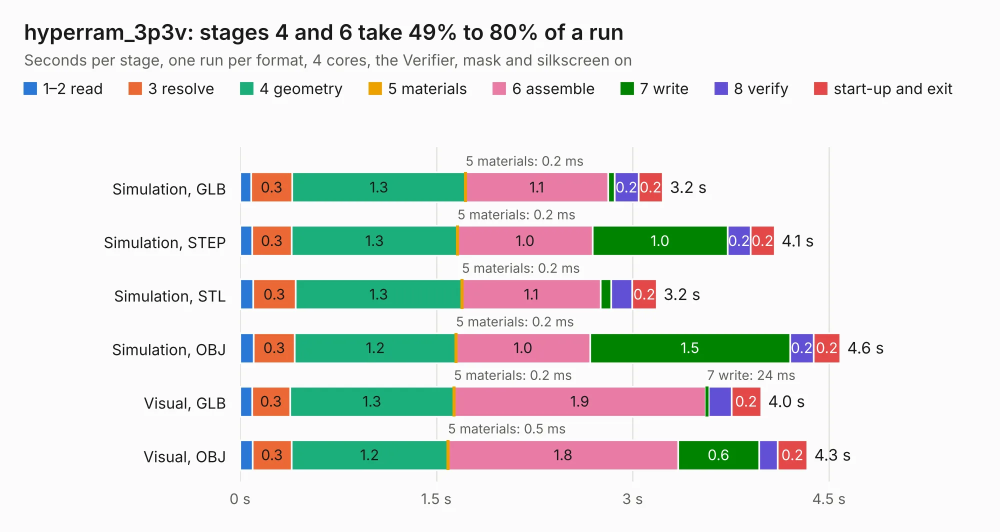

# 1499. hyperram_3p3v

Board 1,499 of the 3,102 of [Corpus Testing](../Corpus-Testing.md), on [Corpus Page 14](../CorpusTestingPages/Corpus-Testing-14.md#1499-hyperram_3p3v).

| Mode and format | 1–2 read | 3 resolve | 4 geometry | 5 materials | 6 assemble | 7 write | 8 verify | start-up and exit | Total |
|---|---:|---:|---:|---:|---:|---:|---:|---:|---:|
| Simulation, GLB | 84&nbsp;ms | 0.3 | 1.3 | 0.2&nbsp;ms | 1.1 | 51&nbsp;ms | 0.2 | 0.2 | 3.2 |
| Simulation, STEP | 92&nbsp;ms | 0.3 | 1.3 | 0.2&nbsp;ms | 1.0 | 1.0 | 0.2 | 0.2 | 4.1 |
| Simulation, STL | 0.1 | 0.3 | 1.3 | 0.2&nbsp;ms | 1.1 | 81&nbsp;ms | 0.2 | 0.2 | 3.2 |
| Simulation, OBJ | 0.1 | 0.3 | 1.2 | 0.2&nbsp;ms | 1.0 | 1.5 | 0.2 | 0.2 | 4.6 |
| Visual, GLB | 91&nbsp;ms | 0.3 | 1.3 | 0.2&nbsp;ms | 1.9 | 24&nbsp;ms | 0.2 | 0.2 | 4.0 |
| Visual, OBJ | 96&nbsp;ms | 0.3 | 1.2 | 0.5&nbsp;ms | 1.8 | 0.6 | 0.1 | 0.2 | 4.3 |

<table align="center"><tr><td valign="top">

| Board | Repo: [loxodes/vna](https://github.com/loxodes/vna) Board: `hyperram_3p3v.kicad_pcb` |
|---|---|
| Folder | breakouts / hyperram / hyperram_3p3v |
| Complexity | 184&nbsp;/&nbsp;1000 (size&nbsp;139, features&nbsp;45) |
| KESE&nbsp;features | through vias, rounded, trapezoid or chamfered pads, filled zones |
| Tested | 9th November 2026 |
| Copper&nbsp;layers | 4 |
| File&nbsp;format | KiCad 5 (20171130) |
| Parts,&nbsp;tracks,&nbsp;vias | 6, 129, 16 |
| Triangles,&nbsp;simulation | 371,994 in 27 parts |
| Verifier | PASS in all six runs |

</td><td valign="top">

<table>
<tr><th>File type</th><th>File size</th><th>Peak memory used</th></tr>
<tr><th colspan="3" align="left">Simulation</th></tr>
<tr><td>GLB</td><td align="right">13&nbsp;MB</td><td align="right">245&nbsp;MB</td></tr>
<tr><td>STEP</td><td align="right">48&nbsp;MB</td><td align="right">263&nbsp;MB</td></tr>
<tr><td>STL</td><td align="right">19&nbsp;MB</td><td align="right">246&nbsp;MB</td></tr>
<tr><td>OBJ</td><td align="right">37&nbsp;MB</td><td align="right">289&nbsp;MB</td></tr>
<tr><th colspan="3" align="left">Visual</th></tr>
<tr><td>GLB</td><td align="right">5.4&nbsp;MB</td><td align="right">225&nbsp;MB</td></tr>
<tr><td>OBJ</td><td align="right">16&nbsp;MB</td><td align="right">224&nbsp;MB</td></tr>
</table>

</td></tr></table>

| Previous | Next |
|:---|---:|
| [1498. trl_thru](b1498b_vna_breakouts-hmc576-breakout_trl-thru.md) | [1500. launchpad_synthcontrol](b1500b_vna_launchpad-synthcontrol.md) |
