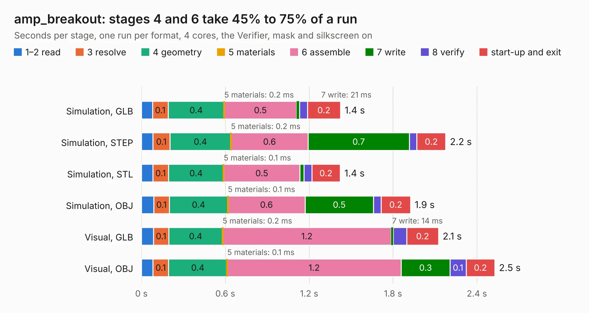

# 1500. amp_breakout

Board 1,500 of the 3,119 of [Corpus Testing](../Corpus-Testing.md), on [Corpus Page 14](../CorpusTestingPages/Corpus-Testing-14.md#1500-amp_breakout).

| Mode and format | 1–2 read | 3 resolve | 4 geometry | 5 materials | 6 assemble | 7 write | 8 verify | start-up and exit | Total |
|---|---:|---:|---:|---:|---:|---:|---:|---:|---:|
| Simulation, GLB | 79&nbsp;ms | 0.1 | 0.4 | 0.2&nbsp;ms | 0.5 | 21&nbsp;ms | 57&nbsp;ms | 0.2 | 1.4 |
| Simulation, STEP | 81&nbsp;ms | 0.1 | 0.4 | 0.2&nbsp;ms | 0.6 | 0.7 | 55&nbsp;ms | 0.2 | 2.2 |
| Simulation, STL | 81&nbsp;ms | 0.1 | 0.4 | 0.1&nbsp;ms | 0.5 | 29&nbsp;ms | 55&nbsp;ms | 0.2 | 1.4 |
| Simulation, OBJ | 88&nbsp;ms | 0.1 | 0.4 | 0.1&nbsp;ms | 0.6 | 0.5 | 55&nbsp;ms | 0.2 | 1.9 |
| Visual, GLB | 86&nbsp;ms | 0.1 | 0.4 | 0.2&nbsp;ms | 1.2 | 14&nbsp;ms | 97&nbsp;ms | 0.2 | 2.1 |
| Visual, OBJ | 83&nbsp;ms | 0.1 | 0.4 | 0.1&nbsp;ms | 1.2 | 0.3 | 0.1 | 0.2 | 2.5 |

<table align="center"><tr><td valign="top">

| Board | Repo: [loxodes/vna](https://github.com/loxodes/vna) Board: `amp_breakout.kicad_pcb` |
|---|---|
| Folder | breakouts / amp_breakout |
| Complexity | 184&nbsp;/&nbsp;1000 (size&nbsp;149, features&nbsp;35) |
| KESE&nbsp;features | through vias, filled zones |
| Tested | 9th November 2026 |
| Copper&nbsp;layers | 4 |
| File&nbsp;format | KiCad 4 (4) |
| Parts,&nbsp;tracks,&nbsp;vias | 19, 99, 20 |
| Triangles,&nbsp;simulation | 121,518 in 25 parts |
| Verifier | PASS in all six runs |

</td><td valign="top">

<table>
<tr><th>File type</th><th>File size</th><th>Peak memory used</th></tr>
<tr><th colspan="3" align="left">Simulation</th></tr>
<tr><td>GLB</td><td align="right">4.4&nbsp;MB</td><td align="right">197&nbsp;MB</td></tr>
<tr><td>STEP</td><td align="right">15&nbsp;MB</td><td align="right">197&nbsp;MB</td></tr>
<tr><td>STL</td><td align="right">6.1&nbsp;MB</td><td align="right">188&nbsp;MB</td></tr>
<tr><td>OBJ</td><td align="right">12&nbsp;MB</td><td align="right">198&nbsp;MB</td></tr>
<tr><th colspan="3" align="left">Visual</th></tr>
<tr><td>GLB</td><td align="right">3.0&nbsp;MB</td><td align="right">162&nbsp;MB</td></tr>
<tr><td>OBJ</td><td align="right">8.3&nbsp;MB</td><td align="right">160&nbsp;MB</td></tr>
</table>

</td></tr></table>

| Previous | Next |
|:---|---:|
| [1499. ammp6120_breakout](b1499b_vna_ammp6120-breakout.md) | [1501. amp_cpw_hmc311](b1501b_vna_amp-cpw-hmc311.md) |
